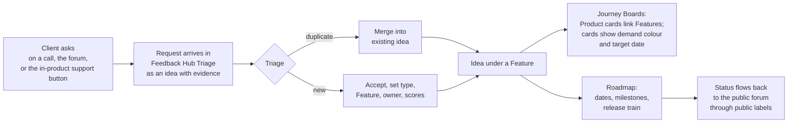
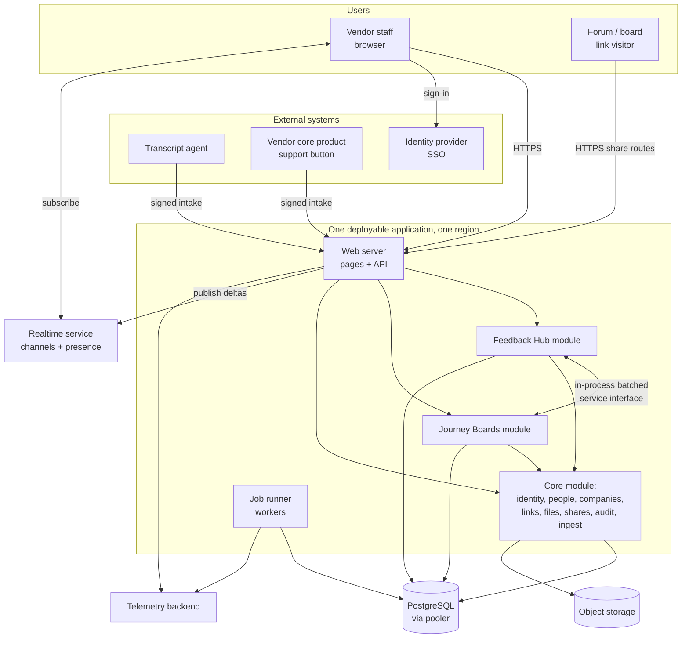
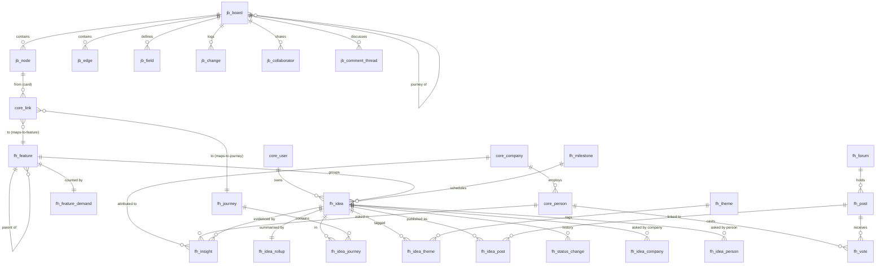
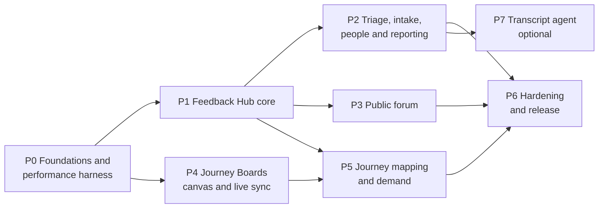

# Rebuild Specification: Feedback Hub and Journey Boards

Version 1.0. A self-contained specification for building two connected products from scratch.

- **Feedback Hub** collects requests from Clients and turns them into a triaged, prioritised roadmap.
- **Journey Boards** is a collaborative whiteboard for mapping user journeys and product areas, coloured by the demand recorded in Feedback Hub.

The company that builds and runs both products is called **the Vendor**. The Vendor's paying customers are called **Clients**. People at Clients who post, vote or ask for things are **external people**. Vendor staff who sign in are **users**.

---

## 0. How to use this document

These instructions are for the Claude chat that receives this document.

1. **Read the whole document before writing any code.** The sections depend on each other. The data model (section 6) and the performance architecture (section 4) constrain every functional requirement.
2. **Confirm the open decisions first.** Section 16 lists the choices only the product owner can make. Each one has a recommended default. Before you write code, ask the product owner to confirm or change each one. Record the answers in a `DECISIONS.md` file in the repository, and follow them.
3. **Build in the phase order in section 15.** Each phase ends with acceptance criteria. Do not start a phase until the previous phase's criteria pass.
4. **Write tests in every phase.** Section 13.3 sets out the test pyramid. Pure domain rules (status machine, scores, demand rules, op application, sanitiser) get unit tests. Every endpoint gets an integration test against a real PostgreSQL database. Key journeys get end-to-end tests.
5. **Treat the performance budgets as acceptance criteria, not goals.** Sections 4.10 and 15 list measurable checks. A phase that misses a budget is not done.
6. **Ask before you deviate.** If a requirement looks wrong, conflicts with another, or would break a performance budget, stop and ask the product owner. Explain the conflict and give options. Do not silently pick one.
7. **Requirement IDs are stable.** Use them in commit messages, test names and code comments where a rule is not obvious, for example `// FH-305: entering a roadmap status sets a default start date`.
8. **"Must" and "shall" are binding.** "Should" means "do this unless there is a stated reason not to". "May" means optional.
9. **Where this document says "assumption"**, the rule came from observation of an earlier system and has not been confirmed. Build it as written, but flag it to the product owner when you reach it.

ID scheme used in this document:

| Prefix | Area |
|---|---|
| ARC- | Architecture rules |
| PERF- | Performance rules and budgets |
| INV- | Data invariants |
| FH- | Feedback Hub functional requirements |
| JB- | Journey Boards functional requirements |
| INT- | Journey mapping and cross-module integration |
| ING- | Intake (ingest) API |
| SEC- | Security and privacy |
| NFR- | Other non-functional requirements |
| PT- | Performance acceptance tests |
| OD- | Open decisions |

---

## 1. Product overview

### 1.1 What each product is for

**Feedback Hub** is the single place where the Vendor records what Clients ask for, decides what to do about it, and tells Clients what is happening. It answers three questions:

- What are Clients asking for, in their own words, and how many of them (weighted by revenue)?
- What has the product team decided to do about each request, and when?
- What can we show Clients publicly about progress?

**Journey Boards** is a whiteboard where product and design staff map the product: user journeys, product areas, screens and their design state. Its link to Feedback Hub lets anyone see, on the map itself, where Client demand is concentrated and when planned work will land.

The two products are one deployable application with two modules. They share sign-in, people, companies, files and a links table.

### 1.2 Users and roles

| Role | Who | What they do |
|---|---|---|
| **Member** | Any signed-in, active Vendor user | Reads everything in Feedback Hub; creates ideas; uses boards according to board access |
| **Feedback admin** | Product managers and leads | Triage, edit, merge, publish, manage forums, companies and people |
| **Post deleter** (see OD-03) | A very small named group | The only users who may permanently delete a public forum post |
| **Workspace admin** | Operations or engineering lead | Manages users, roles, intake clients and keys, system settings |
| **Board owner / manager / collaborator** | Any member, per board | Edits, comments on or views a board, per section 8.13 |
| **Forum visitor** | Anonymous holder of a forum share link | Reads, submits and votes on the public forum, per the link's capabilities |
| **Board link visitor** | Anonymous holder of a board share link | Views one board and its journeys, read-only |
| **Intake client** | Another system with a signed key | Posts call requests or support submissions |

### 1.3 The end-to-end workflow



Step by step:

1. **A Client asks.** This can happen three ways:
   - On a **call**. A transcript agent (Appendix A) reads the call transcript, extracts each distinct request, and posts it to Feedback Hub's intake API.
   - On the **public forum**. A Client opens a share link, writes a post, and other Clients vote on it.
   - Through the **support button** inside the Vendor's own product. That product posts a signed support submission, with screenshots and page context.
2. **It lands in Triage.** Every request becomes an **idea** in status Open, with one **insight** holding the Client's own words, the person, the company and where it came from. Machine-submitted ideas arrive **Unreviewed**.
3. **Triage.** A feedback admin looks at the Triage view, filtered by source if needed. For each idea they either:
   - **merge** it into an existing idea that it duplicates (the system suggests likely matches), or
   - **accept** it and set its type, Feature, owner and scores, then move it to Backlog, Under review or Planned.
4. **Mapping to Features.** Each idea sits under at most one **Feature**, a node in a product-area tree up to three levels deep.
5. **Journey Boards shows demand.** On a board, **Product cards** inside a **detailed journey** link to Features. Each card is coloured by how many open ideas sit under its Features, and shows the latest planned due date. A top-level Product card stands for a whole **Journey** and adds up its detailed journey's Features. Staff can open the list of ideas behind any card.
6. **Roadmap.** Admins give ideas start and due dates and milestones. The roadmap Gantt view shows them against the release train.
7. **Back to the forum.** Feedback admins can publish ideas to the main public forum. Each internal status has an optional public label (for example "Planned", "Shipped"). The public forum shows those labels and a public roadmap, so Clients see progress without seeing internal detail.

### 1.4 Key principles

- **Clients own their words; the Vendor owns the framing.** A forum post and an idea are separate records. Merging and editing ideas never changes what a Client wrote.
- **Evidence is counted, not typed.** User counts, company counts and revenue (ARR) are derived from insights, votes and links. Nobody types a number in.
- **Revenue is counted once per company.** Three requests from one company add its ARR once.
- **Nothing internal leaks to the public.** Internal statuses, themes, comments, owners and requester identities never reach a share route.
- **Fast by construction.** Every screen interaction costs one request and a bounded number of database statements, whatever the data size (section 4).

---

## 2. Scope

### 2.1 MVP (phases 1 to 5 in section 15)

**Shared platform**
- Staff sign-in (single sign-on recommended, OD-01), sessions, roles.
- Shared people (external identities), companies (with ARR), files, links, audit log.
- Share links with capabilities, passwords, expiry and use limits.
- Signed intake API with keys, receipts, logs, rate limits and a pause switch.
- Realtime channel for deltas and presence.
- Background job runner.

**Feedback Hub**
- Ideas with types, statuses (separate bug workflow), scores, owners, dates, milestones.
- Server-paginated, virtualised ideas table with views (All, Triage, Backlog, Roadmap, Board), column filters, sort, saved layouts and saved views.
- Idea panel with evidence, roll-ups, themes, journeys (read-only), comments, activity.
- Triage: unreviewed intake, source quick filter, bulk accept including "accept all from calls", duplicate matching, merge, publish to forum.
- Features tree (create, rename, move, reorder, delete).
- Journeys (user journey components), read-only and synced from Journey Boards.
- Themes, including a seeded "UX required" theme.
- Milestones, roadmap Gantt with release train, kanban board view.
- CSV export of selected rows or all filtered rows, with formula neutralisation.
- People and companies with ARR, domain-based attribution, erasure.
- Reporting tiles and theme trends.
- Public forum with submit, vote, status filter, public roadmap.
- Collapsible, scrollable left navigation.

**Journey Boards**
- Boards and tabs, infinite canvas, kind registry (Design card, Product card, Section, Text, Statistics).
- Connectors, Design card hierarchy, custom fields, filters, isolate mode, health, statistics, lookahead.
- Comments, collaborators, workspace-edit switch, share links, presence and cursors.
- Op-based saving with versions, undo/redo, **live collaborator edits**.
- Images, import/export, sample template.
- Detailed journeys, Feature and Journey links, demand overlay, target release dates, breakdowns, attention flags, Journey sync.

### 2.2 Later phases (after MVP; each needs a product owner decision to start)

| Item | Note |
|---|---|
| Sub-ideas (parent/child ideas) | OD-09 |
| Manual ARR override per idea | OD-10 |
| Reporting period comparison and segments | |
| Forum comments by visitors | Needs moderation design |
| Email verification for forum posters | |
| CRM, chat and email connectors as insight sources | Source values reserved |
| Outbound webhooks and notifications ("your idea shipped") | |
| Embedding-based duplicate matching | Full-text matching ships first |
| Spatial tiling for boards above 5,000 nodes | Not needed within caps |
| Excel export | CSV first (OD-06) |
| Offline editing of boards beyond the outbox | |

### 2.3 Explicitly out of scope

- Billing, invoicing or any payment handling.
- Multi-tenant hosting for several Vendors (the system serves one Vendor; see OD-02).
- A mobile native app. The web app must work on tablets; phones get read-only use of the forum and board viewing.
- Writing into the Vendor's core product. Feedback Hub only receives from it.
- Automatic status changes driven by external tools (for example, an issue tracker). Status changes are always made by a person or by the documented rules.
- Feedback Hub writing into Journey Boards cards. Data flows one way: boards read demand; the only write from boards into Feedback Hub is the Journey sync.
- A local-only (signed-out) board editing mode.
- Running the transcript agent inside the application (Appendix A describes it as a separate client of the intake API).


---

## 3. Architecture

### 3.1 System context



### 3.2 Modules and ownership

The application is **one deployable** with three modules. Each module owns its tables. A module reads or writes another module's tables **only through that module's service interface**, never by SQL.

| Module | Owns (table prefix) | Responsibilities |
|---|---|---|
| **Core** | `core_`, `ing_` | Users, sessions, roles; external people; companies; links; files; share links; audit log; rate-limit windows; intake gateway (clients, keys, receipts, logs); realtime authorisation |
| **Feedback Hub** | `fh_` | Ideas, insights, Features, Journeys, themes, milestones, forums, posts, votes, comments, status history, activity, roll-ups, demand counts, saved views, status config |
| **Journey Boards** | `jb_` | Boards, nodes, edges, fields, change log, snapshots, collaborators, comments, images |

Rules:

- **ARC-01** Each module exposes a TypeScript service interface (section 11.4). Other modules call it in-process. There is no HTTP between modules.
- **ARC-02** Every service method that reads records takes a **set** of ids or keys and returns a map. There are no per-record service calls in loops. A method states its statement budget in a comment, and an integration test enforces it (PT-16).
- **ARC-03** Code in one module must not import another module's repository or table definitions. Enforce this with a lint rule (for example, an import-boundary rule) that fails the build.
- **ARC-04** Shared types that cross a boundary (for example `FeatureRef`, `DemandSet`) live in a `contracts` package with no runtime dependencies. Adding fields is allowed; removing or narrowing fields needs a version bump.
- **ARC-05** Module-level transactions: a service call runs in its own transaction unless the caller passes a transaction handle explicitly. A cross-module write (only the Journey sync does this) is two steps, each idempotent, so a failure part-way is fixed by running it again (INT-24).
- **ARC-06** Core owns the `core_link` table. Feedback Hub and Journey Boards write and read links through Core's link service. Section 9.6 sets out who may write which relation.

### 3.3 Tech stack defaults

These are defaults. A different choice is fine if it meets the same budgets; ask the product owner first (rule 6 in section 0). Maintenance status was checked at the time of writing; re-check before you adopt.

| Concern | Default | Notes and alternatives |
|---|---|---|
| Language | TypeScript (strict) everywhere | |
| Web framework | Next.js (App Router) on Node.js, run as a long-lived server | Any React server framework with route handlers works (for example Remix/React Router). Prefer a long-lived Node process over per-request serverless functions (section 3.9) |
| UI | React 19 | |
| Server state cache (client) | TanStack Query | Actively maintained. Normalised entity updates via `setQueryData` |
| Tables | TanStack Table + TanStack Virtual | Headless, maintained. Alternative: AG Grid Community (heavier) |
| Canvas | React Flow (`@xyflow/react` v12) | Maintained, MIT. Alternative: tldraw (licence terms differ) |
| Board client store | Zustand with normalised maps | Maintained, small |
| Validation | Zod (shared client/server schemas) | Alternative: Valibot (smaller bundle) |
| Database | PostgreSQL 16 or later, managed, with `pg_trgm` | |
| Connection pooling | PgBouncer in transaction mode, or the provider's pooled endpoint | Same region as the app |
| SQL layer | Kysely (typed SQL builder) or Drizzle | Both maintained. Prisma is acceptable only with relation joins enabled and with every heavy read written as SQL |
| Migrations | The SQL layer's migration tool, plain SQL files, reviewed | |
| Realtime | Managed pub/sub with presence (for example Ably or Pusher Channels) | Alternative: self-hosted WebSocket service or Postgres `LISTEN/NOTIFY` fanned out over server-sent events |
| Object storage | S3-compatible bucket, private, signed URLs | |
| Job runner | pg-boss or Graphile Worker (Postgres-backed) | No extra infrastructure. Both maintained |
| Auth | OpenID Connect single sign-on, sealed session cookie (for example iron-session or Auth.js) | See section 3.5 |
| Testing | Vitest (unit, integration), Playwright (end to end), Testcontainers or a disposable Postgres for integration | |
| Observability | OpenTelemetry traces and metrics, structured JSON logs, web-vitals in the browser | |
| Web Worker RPC | Comlink | Maintained, small |

### 3.4 Request lifecycle

Every authenticated API request goes through these steps. Steps 1 to 3 must not touch the database except as stated.

1. **Edge checks.** TLS, request size limit for the route, request id assigned, `Server-Timing` timer started.
2. **Session.** Read the sealed session cookie. Verify and decrypt it in memory. It holds `userId`, `sessionId`, `sessionEpoch`, `issuedAt`. No database call.
3. **Principal.** Look up the user's current role, status and grants in a per-instance in-memory cache keyed by `userId` (time to live 30 seconds, maximum 10,000 entries). On a miss, load them with **one** query (user row joined to grants). If the user is not active, or the cookie's `sessionEpoch` is below the user's `session_epoch`, answer 401.
4. **Route.** Match the route. Validate the body and query with the route's schema (400 with the field name on failure).
5. **Authorise.** Apply the module's resource rule (for example "feedback admin", or the board access rule in section 8.13). Board access needs a lightweight board row (`id, owner_id, journey_of_board_id, workspace_can_edit`) and the viewer's collaborator row: **one query**, cached per request.
6. **Handle.** Run the handler. It calls services and repositories. Each handler has a statement budget (section 4.10).
7. **Respond.** JSON body; `Server-Timing: auth;dur=…, db;dur=…, app;dur=…`; trace id in a response header.
8. **After commit.** Publish realtime deltas and enqueue jobs. Never inside the transaction. Failures here are logged and never change the response.

**ARC-07** The preamble (steps 2 to 5) costs at most **one** database round trip on a cache hit for the principal and at most two on a miss. It must never upsert, insert or register anything.

**ARC-08** Errors use one envelope: `{ "code": "conflict", "message": "This idea changed since you loaded it.", "details": {…} }`. Any unexpected error is a 500 with `{ "code": "internal", "message": "Something went wrong", "requestId": "…" }` and never includes the exception text.

**ARC-09** Status codes: 400 validation, 401 not signed in, 403 signed in but not allowed (inside a resource the user can see), 404 not found or not visible, 409 conflict (version, state, duplicate), 410 gone (merged idea), 413 too large, 415 wrong file type, 422 well-formed but breaks a rule, 426 client out of date, 429 rate limited, 503 dependency unavailable.

### 3.5 Authentication and access model

- **ARC-10** Staff sign in with single sign-on (OIDC) by default (OD-01). On first sign-in a user row is created with status `PENDING` unless the email domain is on the workspace's allowed list, in which case it is `ACTIVE` with role `MEMBER`.
- **ARC-11** Sessions are sealed, HTTP-only, `Secure`, `SameSite=Lax` cookies with a 12-hour idle timeout and a 7-day absolute lifetime. Each session also has a `core_session` row so it can be revoked; revocation bumps `core_user.session_epoch`, which the principal cache picks up within its 30-second time to live.
- **ARC-12** Role and grant changes take effect within 30 seconds (the principal cache time to live). Deactivating a user takes effect immediately on the instance that made the change and within 30 seconds elsewhere (assumption to confirm, OD-13).
- **ARC-13** Roles (stored on `core_user.role`): `ADMIN` (workspace admin), `PRODUCT`, `MEMBER`. Feedback admin = `ADMIN` or `PRODUCT` or an `fh_grant` row with role `ADMIN`. The post-delete permission is a separate grant (`fh_grant.can_delete_posts`), never implied by a role (OD-03).
- **ARC-14** Share-link visitors are anonymous. The share pipeline (section 12.2) resolves the link and the module's target before any handler runs. Share mode never reads the staff session, even if the visitor is signed in.
- **ARC-15** Intake clients authenticate by HMAC signature only (section 10). They have no session.
- **ARC-16** A workspace admin console manages users (activate, deactivate, role), Feedback Hub grants, intake clients and keys, and system settings (allowed email domains, staff email domains for intake, release train anchor, planning year start). Every change writes an audit row.

### 3.6 Cross-module interface (batched)

Journey Boards needs Feature data, demand and idea lists from Feedback Hub. Feedback Hub needs card names for its "Mapped to" lists. Both go through in-process service interfaces (full list in section 11.4).

Design rules:

- **ARC-17** Every method takes the **whole working set** for one screen. For example, the demand overlay for a board calls `feedbackHub.demandForBoard(...)` once with all of the board's card-to-Feature sets, and gets counts, release dates and missing references back in one answer.
- **ARC-18** A service method runs a fixed number of SQL statements (stated per method, usually 1 to 3) whatever the input size, up to its documented caps.
- **ARC-19** Methods that return Feedback Hub data to a viewer take the viewer's principal and check Feedback Hub access once per call. A viewer without access gets `{ available: false }`, never an error.
- **ARC-20** Missing references are returned as `gone`, not dropped and not `null`. This is what makes attention flags work (INT-30).
- **ARC-21** No service call may run inside another module's open transaction.

### 3.7 Realtime

One realtime service carries four kinds of traffic. Channels are authorised by Core using the same access rules as the API.

| Channel | Who may join | Events (server-published unless stated) |
|---|---|---|
| `fh.workspace` | Members | `idea.upserted {row}`, `idea.removed {id, mergedIntoId?}`, `lookup.changed {kind, id}` (Feature, Journey, theme, milestone, owner) |
| `fh.idea.<ideaId>` | Members with the panel open | `idea.detail.changed {ideaId, sections[]}` (which lazy sections to refetch) |
| `jb.board.<boardId>` (presence) | Viewers of the board (a journey judged by its parent) | `ops.applied {seq, batchId, clientId, userId, ops, versions}`, `ops.available {seq}` (when the payload is too big), `comment.upserted {thread}`, `comment.removed {threadId}`, `demand.changed {cardIds?}`, `board.meta {name, settings}`, `board.locked {reason}`; client events: `cursor {x, y}` |
| `jb.workspace` | Members | `board.created/renamed/deleted {meta}` |

Rules:

- **ARC-22** Events are published **after commit**. Publishing is best-effort; a failed publish is logged and never fails the write.
- **ARC-23** Every board event that changes content carries the board `seq`. A client that sees a gap in `seq` (or reconnects) pulls `GET boards/:id/changes?since=<seq>` and applies the result. This makes delivery self-healing, so no transactional outbox is needed.
- **ARC-24** Event payloads stay under 8 KB. Above that, publish a small notice (`ops.available`, `idea.detail.changed`) and let the client pull.
- **ARC-25** The app works without realtime: lists still update from the user's own mutations, and boards still save. A banner says "Live updates paused" while the connection is down, and on reconnect the client pulls the changes it missed.

### 3.8 Files

- **ARC-26** Files are stored in private object storage. Each file has one `core_file` row: owner module, owner kind, owner id, storage key, content type, size, SHA-256.
- **ARC-27** Uploads are checked by **sniffing the first bytes**, not by the declared type. Allowed: PNG, JPEG, WebP. SVG, GIF and anything else are refused (415). Maximum sizes are per route.
- **ARC-28** Downloads use short-lived signed URLs (15 minutes) created after an access check. Share routes create signed URLs only for files reached through the resolved share target.
- **ARC-29** A file is deleted by the code path that deletes its owner, **after** the owner's rows commit. If the storage delete fails, the `core_file` row is marked `deleted_at` and a nightly job retries. Every owner kind registers a resolver with Core so the nightly orphan sweep can tell whether the owner still exists.
- **ARC-30** If object storage is unavailable, an upload answers **503 `files_unavailable`**. The system never drops attachments silently.

### 3.9 Background jobs

Jobs run on the Postgres-backed job runner, in a separate worker process from the web server (same deployable, different start command).

| Job | Trigger | Purpose |
|---|---|---|
| `fh.match.compute` | Idea created or title/description changed (debounced 5 s per idea) | Compute and store duplicate matches for that idea (FH-406) |
| `fh.rollup.reconcile` | Nightly | Recompute all idea roll-ups and Feature demand counts; repair and alert on drift |
| `fh.reporting.refresh` | Every 5 minutes | Refresh the reporting materialised view |
| `jb.demand.notify` | After an idea write that changes demand inputs | Find boards with cards linked to the affected Features or Journeys and publish `demand.changed` (debounced 2 s per board) |
| `jb.changes.compact` | Nightly | Snapshot boards and delete change-log rows and tombstones beyond the retention window (JB-1606) |
| `core.files.sweep` | Nightly | Retry failed file deletes; delete files whose owner no longer exists |
| `core.erasure` | On request | Run the erasure sequence (SEC-20) |
| `ing.logs.prune` | Monthly | Delete intake log rows older than 12 months |

- **ARC-31** Jobs are idempotent. Each job has a retry policy (exponential back-off, maximum 5 attempts) and a dead-letter state shown in the admin console.

### 3.10 Deployment

- **ARC-32** The web server, the workers, the database, the pooler and object storage are in **one cloud region**. Database round-trip time from the app must be at most 5 ms at p50.
- **ARC-33** Run the web server as long-lived Node processes (containers) with **at least two warm instances** at all times. If a serverless host is used, configure minimum warm instances and use the pooled connection string.
- **ARC-34** Connect through a pooler in transaction mode. Each app instance keeps a client-side pool of 10 connections (configurable). Connection acquire timeout is 2 seconds; a request that cannot get a connection answers 503 rather than waiting 15 seconds.
- **ARC-35** Nothing is registered, upserted or migrated on the request path. Migrations and seed data run as a deploy step before new instances take traffic.
- **ARC-36** Cold start (process boot to first request served) must be at most 800 ms at p95 with zero database writes.
- **ARC-37** Environments: `development`, `staging`, `production`. Each has its own database, bucket, realtime app and intake master key.
- **ARC-38** Backups: point-in-time recovery for 14 days; daily snapshots kept 35 days; a restore drill every quarter (NFR-30).

### 3.11 Observability

- **ARC-39** Every request emits a trace with spans for auth, each SQL statement (with statement text, not values), service calls and realtime publishes.
- **ARC-40** Every response carries `Server-Timing`. A metric records statement count per route; a dashboard shows p50/p95/p99 latency and statement count per route.
- **ARC-41** The browser reports Core Web Vitals (including INP) and custom marks (`idea-panel-visible`, `board-interactive`, `drag-frame`) to the telemetry backend.
- **ARC-42** Alerts: p95 latency over budget for 10 minutes on any route; error rate above 1%; job dead letters; roll-up drift found by reconciliation; intake rejections spike; realtime publish failures above 5%.
- **ARC-43** Logs are structured JSON with request id, user id (never email), route, status and duration. Personal data (emails, names, IP addresses) is never logged in plain text; IP addresses are hashed with a rotating salt.

---

## 4. Performance architecture

The earlier system was slow in two places: opening an idea right after creating it sometimes took more than five seconds, and boards lagged more and more as content grew. The causes were diagnosed. This section designs each one out.

### 4.1 Diagnosed causes and how this design removes them

| # | Cause in the earlier system | Required design |
|---|---|---|
| 1 | After creating an idea, the client refetched the whole idea list and seven lookup lists. About 12 requests and 70 to 100 SQL statements competed for the same connections as the panel's own request. | The create response returns the full row. The client inserts it into its cache and opens the panel from it. No list or lookup refetch (PERF-10). |
| 2 | The idea detail endpoint loaded about 20 relations and two heavy queries, and the panel had nothing to draw until it returned. | The panel draws from the cached row at once. Detail is split into a small summary and lazy sections, each at most 3 statements (PERF-12). |
| 3 | Each request did 3 sequential database lookups (surface, session, grants) before the handler started. | Sealed session cookie plus an in-memory principal cache. At most one round trip (ARC-07). |
| 4 | A pool of 3 direct connections per instance, a 15-second connection wait, cold starts that wrote registry rows, and a database possibly in another region. | Pooler in the same region, 10 connections per instance, 2-second acquire timeout, warm instances, no request-path writes (ARC-32 to ARC-36). |
| 5 | Roll-ups were computed on every list load with correlated sub-queries; duplicate matching built text vectors for every idea on every panel open. | Roll-ups and demand counts are maintained in tables updated in the same transaction as the change. Matches are computed in the background and stored. Full-text uses a stored, indexed vector (PERF-13, PERF-14). |
| 6 | The ideas table rendered 500 rows by 25 columns with an option list in every cell, and re-rendered it 2 to 3 times on create. | Server pagination plus a virtualised table, rows memoised by version, editors mounted only on focus (PERF-11). |
| 7 | On boards, every edit and every drag frame gave a new context value, so every node and edge re-rendered. | Per-node selectors for transient state; context holds only constants (PERF-21). |
| 8 | Every drag frame ran the full edit pipeline: diff of all nodes, op application with linear scans, undo bookkeeping with quadratic copying, and an IndexedDB write. | Drag positions live in transient state. One op batch, one undo step and one outbox write on drag stop (PERF-22). |
| 9 | No viewport culling; section depth computed by scanning all nodes for each section on every frame. | Render only visible elements; maintain section depth and hierarchy incrementally (PERF-23). |
| 10 | The demand overlay listed links one card at a time, and each listing reloaded the whole board. About 7 queries per card, thousands for a top-level board. | One overlay request per board with at most 4 statements, using a board-scoped link index and maintained demand counts (PERF-30). |
| 11 | App boot loaded every board and every journey in full, then fetched each board again. | Boot loads board metadata only. A board's content loads when it is opened; journeys when their card opens (PERF-24). |
| 12 | Each save locked the board, ran two queries per op, then read every live node, edge and field to check integrity. | Set-based SQL per table, integrity checks limited to what the batch touched, counters for caps (PERF-25). |
| 13 | Collaborators never saw each other's edits until reload. | Every applied batch is published as a delta with its sequence number (JB-1501). |

### 4.2 Principles

- **PERF-01 Never refetch what a mutation already told you.** Every mutation response returns the changed records in the same shape the cache stores. The client updates exactly the affected cache entries.
- **PERF-02 One request per interaction.** A user action (open, create, save, filter) costs one request on the critical path. Secondary data loads lazily, after first paint.
- **PERF-03 Bounded statements.** Each endpoint runs a fixed number of SQL statements, independent of data size. No N+1 patterns. Integration tests count statements on a small and a 10× fixture and fail if the count changes (PT-16).
- **PERF-04 Client work proportional to what is visible or what changed.** Never to the whole dataset.
- **PERF-05 Derived numbers are maintained, not recomputed.** Counts that many screens read (roll-ups, demand, vote counts) live in tables updated in the same transaction as their inputs, with a nightly reconciliation.
- **PERF-06 Heavy pure work runs off the main thread** (Web Worker), for example import parsing, large diffs and conflict rebase.
- **PERF-07 Same region, pooled, warm.** See section 3.10.

### 4.3 Caching

**Server side**

| Cache | Scope | Contents | Time to live | Invalidation |
|---|---|---|---|---|
| Principal cache | Per instance, in memory | User role, status, grants, session epoch | 30 s | Time only (OD-13) |
| Lookup cache | Per instance, in memory | Feature tree with closure, themes, milestones, active owners, status config | 60 s | Local write clears it at once; other instances via `lookup.changed` on the realtime channel or time |
| Board access cache | Per request | Board access rows | Request | — |

No cache holds idea rows or board content on the server; PostgreSQL with the right indexes is fast enough, and a second copy would add staleness bugs.

**Client side (TanStack Query for Feedback Hub, Zustand store for boards)**

| Key | Stale time | Updated by |
|---|---|---|
| `ideas.page(viewSpec, cursor)` | 30 s | Mutation responses (`setQueryData` on every page containing the id), `idea.upserted` events |
| `idea.row(id)` (normalised entity) | 30 s | Same as above. Pages hold ids; rows hold data |
| `idea.detail.<section>(id)` | 60 s | Mutation responses for that idea; `idea.detail.changed` events |
| `lookups.*` (Features, Journeys, themes, milestones, owners) | 5 min | Own mutations; `lookup.changed` events |
| `facets(viewSpec)` | 30 s | Invalidated (not refetched until visible) after mutations that change faceted fields |
| `board.meta[]` | 5 min | `jb.workspace` events |
| `board.content(id)` | Until closed | Ops (local and remote) |
| `board.overlay(id, scope)` | Until `demand.changed` | Realtime event or own link change |

- **PERF-08 Optimistic updates.** Inline edits, status changes, votes, link/unlink and Journey sync update the cache at once, send the request, and roll back with a toast on failure.
- **PERF-09 Targeted invalidation.** After a mutation, invalidate only the keys the mutation could change. A test lists, per mutation, the keys it touches.

### 4.4 Flow: create an idea, then open it

1. User submits the New idea form.
2. `POST /api/fh/ideas` runs one transaction: insert idea, insert status history, insert activity, insert roll-up row (zeros), update Feature demand count. Then one `SELECT` builds the **list-row shape** (with owner, Feature, milestone and empty arrays). Total: at most 6 statements.
3. The response is `{ row }`.
4. The client writes `row` into `idea.row(id)`, inserts the id into the current view's first page if it matches the view's filter (otherwise holds it, FH-109), updates the Feature's count in `lookups.features`, and opens the panel from `row` **in the same render**.
5. The panel's header, details and impact tiles draw from the row. Lazy sections (evidence, comments, activity, matches) show skeletons and fetch in parallel after first paint. For a just-created idea the client knows they are empty, so it skips evidence and comments and fetches only activity and matches.
6. After commit, the server publishes `idea.upserted {row}` and enqueues `fh.match.compute`.

- **PERF-10** No list refetch and no lookup refetch after create. The panel shows title, type, status, owner and Feature **within 150 ms of the create response arriving**, with no extra round trip.

### 4.5 Flow: ideas list

- **PERF-11** The list is **server-paginated** with keyset pagination on `(sort value, id)`, page size 100. The view (All, Triage, Backlog, Roadmap, Board), column filters, search and sort travel as one `viewSpec` and become a `WHERE`/`ORDER BY` on the server. Facet counts come from one aggregate request (`GET ideas/facets`), fetched when the filter menu opens. The table is virtualised: at most 60 rows plus overscan in the DOM. Rows are memoised by `(id, version)`. Cell editors (selects, date pickers) mount only when a cell is focused; option lists are rendered once in a shared popover, never per row. Scrolling near the end of loaded rows fetches the next page in the background. Sorting a column resets to the first page.
- The list query reads `fh_idea` joined to `fh_idea_rollup` and small lookups, with array aggregates for themes, companies and journeys limited to the page's ids. At most 4 statements.

### 4.6 Flow: idea detail

The panel needs these parts. Each is its own endpoint and cache key, so the panel paints the parts it has and loads the rest.

| Part | Source | Loaded | Budget |
|---|---|---|---|
| Header, details, scores, impact tiles | Cached list row | Immediately | 0 requests |
| Summary (description, themes, journeys, companies, people, posts summary) | `GET ideas/:id` | On open, if not cached or stale | ≤ 3 statements, p95 ≤ 80 ms server |
| Evidence (insights with person and company) and counted people | `GET ideas/:id/evidence` | On open, in parallel | ≤ 2 statements |
| Comments | `GET ideas/:id/comments` | When scrolled into view | 1 statement |
| Activity (status changes and field events, newest 50) | `GET ideas/:id/activity` | When scrolled into view | 1 statement (`UNION ALL`) |
| Matches | `GET ideas/:id/matches` | On open, for Open ideas only | 1 statement (stored matches) |
| Screenshots | `GET ideas/:id/images` | On click | 1 statement + signed URLs |

- **PERF-12** Opening an idea that is not in the cache (for example a deep link): first useful paint ≤ 300 ms p95 from navigation. Detail summary fetch p95 ≤ 300 ms as measured in the browser and ≤ 80 ms server time; payload ≤ 50 KB.

### 4.7 Flow: board load

- **PERF-24** App boot calls `GET jb/boards`, which returns board **metadata only** (id, name, owner, role flags, journey parent, counts, updated time): ≤ 50 KB for 100 boards, 2 statements. Opening a board calls `GET jb/boards/:id/content`, which returns live nodes, edges and fields, versions and the current `seq` in **4 statements** (access row, nodes, edges, fields). Deleted rows (tombstones) are **not** sent; the client treats any id it does not have as "not live". Journeys are fetched only when opened. The server validates data at write time, so the client does not re-parse the board with a full schema; it runs a cheap shape check in a Web Worker for boards above 1,000 nodes.

### 4.8 Flow: board edit and drag

- **PERF-21 Rendering.** React Flow renders only visible elements (`onlyRenderVisibleElements`). Node components receive stable props. Transient per-node state (dimmed, highlighted, selected, overlay colour, comment count) is read by **per-node selectors** (`useBoardStore(s => s.dimmed.has(id))`), never through a context value that changes. React context holds only values that do not change during a session (read-only flag, presentation mode, theme). Derived sets (dimmed ids, filter matches, hierarchy) are recomputed only when their inputs change, and their results are compared so unchanged nodes keep the same reference.
- **PERF-22 Drag.** During a drag, positions are held in React Flow's internal state (or a separate transient store). No ops, no undo entries, no outbox writes and no diffing happen while dragging. On drag stop the client builds one `node.patch` per moved node (including carried subtree and section members), applies them as **one** undo step and **one** outbox entry. Smart guides use a spatial index (a uniform grid of 512-unit cells) built at drag start, so each frame checks only nearby nodes.
- **PERF-23 Store.** The board store is normalised: `nodesById`, `edgesById`, `fieldsById` and `order` arrays (sort keys). Applying an op is O(1) plus the order update. Hierarchy (`childrenOf`, `depth`) and section membership are maintained incrementally from ops. Undo steps are append-only chunks, never copied. The outbox persists to IndexedDB at most every 250 ms and on `pagehide`.

### 4.9 Flow: save and sync

- **PERF-25 Server save.** `POST jb/boards/:id/ops` applies a batch with set-based SQL:
  1. `UPDATE jb_board SET seq = seq + 1 … WHERE id = $1 RETURNING seq, min_client_protocol` (takes the row lock and allocates `seq` in one statement; held for the rest of the transaction, target ≤ 30 ms).
  2. Replay check: `SELECT result FROM jb_change WHERE board_id = $1 AND batch_id = $2`. If found, roll back and return the stored result.
  3. One statement per table and op type, using `INSERT … SELECT FROM unnest(...)` or `UPDATE … FROM (VALUES …) WHERE version = base RETURNING id`. Rows not returned are conflicts.
  4. Integrity checks limited to the touched set: new or re-pointed edges must join live nodes (one query over the batch's edge endpoints); deleted nodes must have no live edges left (one query over the batch's deleted ids); changed parents must not create cycles (one recursive query walking up from each changed node, bounded by depth 64); caps from counters on `jb_board`.
  5. Insert the change row; update counters.
  A 50-op batch runs in at most 8 statements and p95 ≤ 80 ms server time.
- **Client flush.** 400 ms after the last edit, and on `pagehide` (with `keepalive`). See JB-1604.

### 4.10 Flow: demand overlay and panel

- **PERF-30** `GET jb/boards/:id/overlay?scope=open|all` returns counts, release dates and attention flags for every Product card on the board in **at most 4 statements**, whatever the number of cards:
  1. Access row for the board (from the preamble).
  2. All links for the board and, for a top-level board, all links for its journeys, in one query on `core_link (from_scope_id, relation)` where `from_scope_id = ANY(board ids)`. The journey board ids come from a join on `jb_board.journey_of_board_id` in the same statement.
  3. One call to `feedbackHub.demandForSets(sets, scope)`, which runs **one** SQL statement: expand Features through the closure table, de-duplicate per set, sum maintained per-Feature counts, take the maximum in-flight due date from a partial index, and report missing Feature ids as `gone`.
  The panel's per-card summary and Feature list reuse the overlay's sets and cost 1 request with ≤ 3 statements. The per-card ideas list and breakdown are lazy, 1 request each, ≤ 2 statements.
- **PERF-31** Overlay data updates by event: when an idea write changes demand inputs, the `jb.demand.notify` job publishes `demand.changed` on each affected board's channel; open clients refetch the overlay (one request). No polling.

### 4.11 Materialised and denormalised data

| Data | Where | Maintained by | Consistency rule |
|---|---|---|---|
| Idea roll-up (users, companies, ARR, insights, votes, distinct voters, sources) | `fh_idea_rollup` | Recomputed for the affected ideas **in the same transaction** as any write to insights, idea–company or idea–person links, idea–post links, votes, merges, or a company's ARR or domain | Strongly consistent with its inputs at commit. Nightly reconciliation recomputes all rows, repairs differences and raises an alert if any were found |
| Per-Feature direct demand | `fh_feature_demand (feature_id, open_count, all_count)` | Incremented or decremented in the same transaction as idea create, delete, merge, Feature change, status change or type change | Strongly consistent. Because each idea has at most one Feature, distinct ideas under a set of Features equals the sum of direct counts over the de-duplicated descendant-closed set. Nightly reconciliation as above |
| Feature closure | `fh_feature_closure` | Rewritten for the moved subtree in the same transaction as Feature create, move or delete | Strongly consistent |
| Post vote count | `fh_post.vote_count` | Same transaction as vote insert or delete; recounted after erasure | Strongly consistent; reconciled nightly |
| Journey idea count, theme idea count, milestone idea count, Feature idea count | Computed on read with indexed `GROUP BY` (cheap at the target scale) | — | Always exact |
| Reporting tiles and theme trends | Materialised view `fh_reporting_mv` | Refreshed concurrently every 5 minutes by a job | Eventually consistent; the page shows "Updated N minutes ago" |
| Duplicate matches | `fh_idea_match` | Background job after create or title/description change | Eventually consistent (seconds). Stale matches whose candidate was merged or deleted are filtered at read time |
| Board caps counters | `jb_board.live_node_count`, `live_edge_count`, `live_field_count` | Same transaction as each ops batch | Strongly consistent |

### 4.12 Performance budgets

Budgets apply on the production-like fixture in section 13.4, with the app and database in one region, measured as p95 unless stated.

| ID | Flow | Budget |
|---|---|---|
| PERF-B01 | Create idea: `POST` server time | ≤ 100 ms, ≤ 6 statements |
| PERF-B02 | Create idea: panel heading visible after the create response | ≤ 150 ms, 0 extra requests before first paint |
| PERF-B03 | Requests fired by one create | ≤ 3 (create, activity, matches) |
| PERF-B04 | Idea detail summary fetch (browser-measured) | ≤ 300 ms; server ≤ 80 ms; ≤ 3 statements; ≤ 50 KB |
| PERF-B05 | Ideas list page (any view and filter) | Server ≤ 150 ms at 50,000 ideas; ≤ 4 statements; ≤ 100 KB per 100 rows |
| PERF-B06 | Ideas table scrolling 5,000 loaded rows | 60 fps; no long task > 50 ms; ≤ 100 rows in the DOM |
| PERF-B07 | Inline cell edit to visual update | ≤ 50 ms (optimistic) |
| PERF-B08 | API preamble | ≤ 1 DB round trip; ≤ 15 ms |
| PERF-B09 | 20 concurrent requests from one client | No request > 1 s; 0 connection-timeout errors |
| PERF-B10 | Cold start | ≤ 800 ms; 0 DB writes |
| PERF-B11 | Board metadata on boot | 1 request; ≤ 50 KB for 100 boards; journeys not fetched |
| PERF-B12 | Open a 2,000-node, 2,000-edge board | ≤ 1.0 s to interactive canvas; server ≤ 300 ms; ≤ 1.5 MB transferred |
| PERF-B13 | Pan, zoom and drag on a 2,000-node board | 60 fps (frame ≤ 16 ms, scripting ≤ 8 ms) |
| PERF-B14 | Typing in a card field on a 2,000-node board | INP ≤ 100 ms; ≤ 5 node components re-render per keystroke |
| PERF-B15 | Ops batch save (50 ops) | Server ≤ 80 ms; ≤ 8 statements; board lock ≤ 30 ms. Cost grows with batch size only, not board size |
| PERF-B16 | Demand overlay for a top-level board with 40 cards, each with a 50-card journey | 1 request; ≤ 4 statements; server ≤ 150 ms; statement count independent of card count |
| PERF-B17 | Remote change visible to another user (idea or board edit) | ≤ 1 s; delta ≤ 8 KB; no full refetch |
| PERF-B18 | Duplicate match read | ≤ 50 ms server |
| PERF-B19 | Journey sync (card with a 50-card journey) | ≤ 500 ms server; statement count independent of the number of boards in the workspace |
| PERF-B20 | Public forum page with 300 posts | ≤ 300 ms server; ≤ 3 statements; ≤ 150 KB |
| PERF-B21 | CSV export of 5,000 filtered rows | Streams first bytes ≤ 500 ms; completes ≤ 5 s |


---

## 5. Domain model and glossary

### 5.1 Shared (Core)

| Term | Meaning |
|---|---|
| **User** | A Vendor staff account. Signs in. Has a role (`ADMIN`, `PRODUCT`, `MEMBER`) and a status (`PENDING`, `ACTIVE`, `DISABLED`). |
| **External person** | Someone outside the Vendor who posted, voted or asked for something. May have an email, a display name, a company. May be anonymous (known only by a browser cookie). Never signs in. |
| **Company** | A Client or prospect organisation: name, optional unique email domain, optional ARR, aliases, prospect flag. |
| **ARR** | Annual recurring revenue of a company, a decimal amount in the Vendor's reporting currency. The multiplier behind every revenue figure. |
| **Link** | A typed connection between records in two modules, for example "this Product card maps to this Feature". Stored once in `core_link`. |
| **Share link** | An unguessable URL that lets an anonymous visitor reach one target (a forum or a board) with stated capabilities. |
| **Capability** | What a share link allows: `VIEW`, `SUBMIT`, `VOTE`. (`COMMENT` is reserved and never granted.) |
| **Intake client** | An external system allowed to post to the intake API, with one or more signing keys. |
| **Receipt** | The stored answer to an intake request, keyed by client and request key, so a retry gets the same answer and never creates a duplicate. |

### 5.2 Feedback Hub

| Term | Meaning |
|---|---|
| **Idea** | The internal unit of work: title, description, type, status, Feature, owner, dates, scores. Owned by the Vendor's framing. One idea may absorb many posts and insights. |
| **Idea type** | `FEATURE_REQUEST`, `IMPROVEMENT`, `INITIATIVE` (a larger piece of work grouping smaller requests), `BUG`, `QUESTION`. Shown in that order. |
| **Status** | Non-bug ideas use the idea workflow (7 statuses); bugs use the bug workflow (7 statuses). Exactly one is set. |
| **Insight** | One piece of Client evidence on an idea: the Client's words, source, person, company, priority, link, intake context. |
| **Source** | Where an insight came from: Forum, Support button, Call, Manual (reserved: CRM, Chat, Email). An idea's sources are **derived** from its insights; an idea with no insights reads as Manual. |
| **Post** | A public forum entry in the Client's own words, with a vote count. Linked to ideas. |
| **Vote** | One external person's (or one user's) upvote on a post. |
| **Feature** | A node in the product-area tree (up to three levels). An idea has at most one Feature. |
| **Journey** | A flat, named grouping of ideas that mirrors a top-level Product card on Journey Boards. An idea can be in several. Read-only in Feedback Hub: created, renamed and filled only by the Journey sync. Also called "user journey component". |
| **Theme** | A free, internal tag on ideas, for example "UX required". Never public. |
| **Milestone** | A named, dated checkpoint ideas are delivered for. |
| **Release train** | Release dates every 21 days from a configured anchor date. Derived, never stored. |
| **Triage** | The view of ideas in status Open. |
| **Unreviewed** | An intake idea nobody has accepted yet. Accepting sets a reviewed time and never changes status. |
| **Company missing** | An intake idea (Call or Support button source) with no company in its evidence. Derived. |
| **Merge** | One-way, irreversible fold of one idea (source) into another (target). Evidence moves; the target's framing stays; the source becomes a **tombstone**. |
| **Roll-up** | An idea's derived numbers: users, companies, ARR, insights, votes, distinct voters. |
| **Prio-Value** | A derived 1–10 priority score from five 1–10 inputs. |
| **Open demand** | Live (unmerged) ideas not Complete or Closed, and bugs not Released, Closed or Cannot reproduce. A Fixed bug still counts. |
| **In flight** | Ideas Planned or In progress, and bugs In development. |
| **Target release date** | The latest due date among open, in-flight ideas under a set of Features. |
| **Forum** | A public space reached by share link: posts, votes, a public roadmap. One forum is the **main forum** that Triage publishes to. |
| **Public label** | The text a forum shows for an internal status, if that status is set to public. Default label for anything not public: "Under consideration". |
| **Saved view** | A named combination of view, filters, sort and columns, private or shared. |

### 5.3 Journey Boards

| Term | Meaning |
|---|---|
| **Board** | A named infinite canvas holding nodes, connectors, field definitions, settings and a shared viewport. Shown as a tab. |
| **Node** | One object on the canvas: id, kind, position, optional size and stacking order, and kind-specific data. |
| **Kind** | A registered node type: `design-card`, `product-card`, `section`, `text`, `stats`. |
| **Design card** | A product screen or feature with design status, custom fields, screenshots, version history and links. The only kind in the parent/child hierarchy. |
| **Product card** | A product entity (journey or journey step) with owner, journey stage, status and links to Feedback Hub. Carries demand colour and target date. May own one detailed journey. |
| **Section** | A coloured, resizable rectangle. Contains whatever lies inside it by geometry; moving it carries its contents. |
| **Text** | A free text label. |
| **Statistics widget** | A live chart card summarising one attribute over a scope. |
| **Connector** | A stored, labelled line between two nodes, optionally directed. |
| **Hierarchy** | Parent/child between Design cards. Drawn as derived lines; never stored as connectors. |
| **Field** | A per-board custom attribute definition (picker, text, toggle, date) shown on Design cards. The built-in **Design status** picker cannot be deleted. |
| **Detailed journey** | A board owned by one Product card on a top-level board. Exactly one level deep. Hidden from tabs; opened from its card; access follows the parent board. |
| **Top-level board** | A board that is not a detailed journey. |
| **Op** | One small edit operation (create, patch, delete, restore of a node, edge or field; or a board patch). All board writes are ops. |
| **Batch** | A group of ops sent together with a unique batch id. Idempotent. |
| **Seq** | A board's sequence number, increased by one for every applied batch. |
| **Outbox** | The browser's queue of unsent batches for a board, kept in IndexedDB. |
| **Demand overlay** | The layer that colours each Product card by its open demand and shows target dates and attention flags. |
| **Attention flag** | A warning on a card whose link points at a Feature or Journey that no longer exists. |
| **Isolate mode** | A focus on one cohort of cards (for example "stale") that dims everything else and drives a review rail. |
| **Workspace edit** | A per-board switch: "Everyone in the workspace can edit". |

---

## 6. Data model

Conventions:

- PostgreSQL. Table names are `snake_case` with a module prefix (`core_`, `ing_`, `fh_`, `jb_`). The prefix marks ownership (ARC-01).
- `id` columns are `uuid` (version 7, time-ordered) generated by the application unless stated. Journey Boards node, edge and field ids are client-generated text (≤ 64 characters, `[A-Za-z0-9_-]`) because the client creates them offline.
- Times are `timestamptz`. Calendar dates are `date` (wire format `YYYY-MM-DD`, no time zone).
- Money is `numeric(14,2)` and travels as a string on the wire. Never convert to floating point except for display.
- Status-like columns are `text` with a `CHECK` constraint, not database enum types, so values can be added in a normal migration.
- "FK C" = foreign key with `ON DELETE CASCADE`; "FK SN" = `ON DELETE SET NULL`; "FK R" = `ON DELETE RESTRICT`.
- Every table has `created_at timestamptz NOT NULL DEFAULT now()` unless it says otherwise; mutable tables also have `updated_at`.

### 6.1 Core-owned tables

**core_user** (Vendor staff)

| Column | Type | Rules |
|---|---|---|
| id | uuid PK | |
| email | text NOT NULL | Stored lower-cased and trimmed. `UNIQUE` |
| full_name | text NULL | ≤ 200 |
| role | text NOT NULL DEFAULT 'MEMBER' | CHECK in (`ADMIN`, `PRODUCT`, `MEMBER`) |
| status | text NOT NULL DEFAULT 'PENDING' | CHECK in (`PENDING`, `ACTIVE`, `DISABLED`) |
| session_epoch | int NOT NULL DEFAULT 0 | Bumped to revoke all sessions |
| avatar_url | text NULL | http(s) only |
| created_at, updated_at | timestamptz | |

Indexes: `UNIQUE(email)`; `(status)`.

**core_session**: `id uuid PK`, `user_id FK C`, `created_at`, `last_seen_at`, `expires_at`, `revoked_at NULL`, `user_agent_hash`. Index `(user_id)`.

**core_company**

| Column | Type | Rules |
|---|---|---|
| id | uuid PK | |
| name | text NOT NULL | ≤ 200 |
| name_key | text GENERATED ALWAYS AS (lower(btrim(name))) STORED | For matching |
| domain | text NULL | Normalised (lower case, no scheme, no `@`, no path, must contain a dot). `UNIQUE` |
| arr | numeric(14,2) NULL | ≥ 0 |
| aliases | text[] NOT NULL DEFAULT '{}' | Each lower-cased and trimmed |
| prospect_at | timestamptz NULL | Set when created automatically from intake for an unknown company |
| created_at, updated_at | | |

Indexes: `UNIQUE(domain)`; `(name_key)`; GIN on `aliases`; `(arr DESC NULLS LAST, name)`.

**core_person** (external person)

| Column | Type | Rules |
|---|---|---|
| id | uuid PK | |
| email | text NULL | Lower-cased and trimmed. `UNIQUE` (nulls distinct, so any number of anonymous people) |
| display_name | text NULL | ≤ 200 |
| verified_at | timestamptz NULL | Email proven or vouched for |
| verified_by | text NULL | For example `ingest:<client name>`; null when self-asserted |
| cookie_token_hash | text NULL | SHA-256 of the visitor cookie. `UNIQUE` |
| company_id | uuid NULL FK SN → core_company | |
| company_source | text NULL | CHECK in (`DOMAIN`, `MANUAL`, `INTAKE`); `DOMAIN` means attributed by email domain and may be released when the company's domain changes |
| created_at | | |
| last_seen_at | timestamptz NOT NULL DEFAULT now() | |

Indexes: `UNIQUE(email)`, `UNIQUE(cookie_token_hash)`, `(company_id)`, `(last_seen_at DESC)`, and an expression index on `split_part(email, '@', 2)` for domain adoption.

**core_link**

| Column | Type | Rules |
|---|---|---|
| id | uuid PK | |
| relation | text NOT NULL | CHECK in (`maps-to-feature`, `maps-to-journey`, `references-card`) (extend by migration) |
| from_module, from_kind, from_id | text NOT NULL | For a card: `jb`, `card`, `<boardId>:<nodeId>` |
| from_scope_id | text NULL | The board id for card ends, so all of a board's links read with one index scan |
| to_module, to_kind, to_id | text NOT NULL | For example `fh`, `feature`, `<featureId>` |
| created_by | uuid NULL FK SN → core_user | |
| created_at | | |

Constraints and indexes:
- `UNIQUE(relation, from_kind, from_id, to_kind, to_id)` (idempotent create).
- `(from_scope_id, relation)` for board-level reads (PERF-30).
- `(to_kind, to_id, relation)` for "Mapped to" lists and the Journey sync's "which cards share this Journey" query.
- `(from_kind, from_id)`.
- No foreign keys: either end may be deleted and must then resolve as `gone`.

**core_file**

| Column | Type | Rules |
|---|---|---|
| id | uuid PK | |
| module | text NOT NULL | `fh`, `jb` |
| owner_kind | text NOT NULL | For example `insight`, `post`, `board` |
| owner_id | text NOT NULL | |
| storage_key | text NOT NULL UNIQUE | `<module>/<owner_kind>/<owner_id>/<file id>` |
| content_type | text NOT NULL | CHECK in (`image/png`, `image/jpeg`, `image/webp`) |
| size_bytes | int NOT NULL | |
| sha256 | text NOT NULL | |
| original_name | text NULL | ≤ 200 |
| created_by | text NULL | User id, or `ingest:<client>`, or `visitor` |
| created_at | | |
| deleted_at | timestamptz NULL | Set when a storage delete failed and must be retried |

Index: `(module, owner_kind, owner_id)`; partial `(deleted_at) WHERE deleted_at IS NOT NULL`.

**core_share_link**

| Column | Type | Rules |
|---|---|---|
| id | uuid PK | |
| token_hash | text NOT NULL UNIQUE | SHA-256 of the token. The token itself (32 random bytes, base64url) is shown once at creation and can be re-shown only by regenerating |
| module | text NOT NULL | `fh` or `jb` |
| target_kind | text NOT NULL | `forum` or `board` |
| target_id | uuid NOT NULL | |
| capabilities | text[] NOT NULL DEFAULT '{VIEW}' | Subset of `VIEW`, `SUBMIT`, `VOTE`; must include `VIEW` |
| password_hash | text NULL | Argon2id |
| expires_at | timestamptz NULL | |
| max_uses | int NULL | ≥ 1; counts non-VIEW uses only |
| use_count | int NOT NULL DEFAULT 0 | |
| created_by | uuid NOT NULL FK C → core_user | |
| revoked_at | timestamptz NULL | |
| created_at, updated_at | | |

Index: `(module, target_kind, target_id)`.

(OD-04: whether to store the token encrypted so admins can copy it again later. Default: store only the hash, show once.)

**core_share_link_use**: `id`, `share_link_id FK C`, `capability`, `ip_hash`, `created_at`. Index `(share_link_id, created_at)`.

**core_audit_log** (append-only; a trigger refuses `UPDATE` and `DELETE` except by the retention job)

| Column | Type |
|---|---|
| id | uuid PK |
| actor_kind | text CHECK in (`user`, `visitor`, `ingest`, `system`) |
| actor_id | text NULL |
| action | text NOT NULL (for example `fh.idea.merge`, `core.user.role_change`, `fh.post.hard_delete`) |
| target_kind, target_id | text NULL |
| details | jsonb NULL (no personal data beyond ids) |
| ip_hash | text NULL |
| created_at | |

Indexes: `(target_kind, target_id, created_at)`, `(actor_id, created_at)`, `(created_at)`.

**core_rate_window**: `key text`, `window_start timestamptz`, `count int`; PK `(key, window_start)`. Used for shared rate limits.

**core_setting**: `key text PK`, `value jsonb`, `updated_by`, `updated_at`. Holds: allowed sign-in domains, staff email domains (for intake crediting), release train anchor date, release train length (21 days), planning year start month (May), currency code, default forum status label.

### 6.2 Intake tables (Core-owned)

**ing_client**

| Column | Type | Rules |
|---|---|---|
| id | uuid PK | |
| name | text NOT NULL UNIQUE | Shown as "Verified by <name>" |
| environment | text NOT NULL | CHECK in (`staging`, `production`) |
| module | text NOT NULL | `fh` |
| routes | text[] NOT NULL | Allowed route names, for example `{call-requests}` |
| paused_at | timestamptz NULL | |
| pause_reason | text NULL | |
| created_by | uuid FK SN | |
| created_at, updated_at | | |

**ing_key**: `id text PK` (the public key id, `[A-Za-z0-9_-]{1,64}`), `client_id FK C`, `status text CHECK in (active, revoked)`, `created_at`, `revoked_at`, `last_used_at`. A partial unique rule allows at most two active keys per client (enforced in the issue transaction with a row lock on the client).

**ing_review**: `id`, `kind CHECK in (gateway, client)`, `client_id NULL FK C`, `recorded_by FK`, `notes text NOT NULL`, `created_at`. A production key can be issued only if a `gateway` review exists and a `client` review exists for that client (ING-30).

**ing_receipt**: `id uuid PK`, `client_id FK C`, `request_key text`, `body_sha256 text`, `status int`, `content_type text NULL`, `response_body text NULL`, `created_at`. `UNIQUE(client_id, request_key)`. Kept for the life of the client.

**ing_log** (append-only for 12 months; trigger refuses update and delete of rows younger than 12 months): `id`, `client_id NULL`, `key_id NULL`, `route`, `outcome CHECK in (accepted, replayed, rejected, refused, failed)`, `reason text`, `status int`, `receipt_id NULL`, `body_sha256`, `body_bytes`, `ip_hash`, `latency_ms`, `created_at`. Index `(client_id, created_at)`.

**ing_unkeyed_count**: PK `(module, day)`, `count int`. Requests that fail before a known client is identified only increment this.

**ing_module_setting**: `module text PK`, `paused_at`, `pause_reason`. The module-wide pause switch.

### 6.3 Feedback Hub tables

**fh_grant**: `user_id uuid PK FK C → core_user`, `role text CHECK in (ADMIN)`, `can_delete_posts bool NOT NULL DEFAULT false`, `granted_by uuid FK SN`, `created_at`, `updated_at`.

**fh_feature**

| Column | Type | Rules |
|---|---|---|
| id | uuid PK | |
| parent_id | uuid NULL FK C → fh_feature | |
| name | text NOT NULL | 1–120 |
| description | text NULL | ≤ 1,000 |
| depth | smallint NOT NULL | CHECK `depth BETWEEN 0 AND 2`; equals parent depth + 1 (enforced in the write service and by a trigger) |
| sort_order | int NOT NULL DEFAULT 0 | |
| created_at, updated_at | | |

Indexes: `(parent_id, sort_order, name)`. Uniqueness: `UNIQUE(parent_id, lower(name))` using `COALESCE(parent_id, '00000000-0000-0000-0000-000000000000')` so siblings cannot share a name.

**fh_feature_closure**: `ancestor_id FK C`, `descendant_id FK C`, `distance smallint`; PK `(ancestor_id, descendant_id)`; index `(descendant_id)`. Every Feature has a row for itself at distance 0.

**fh_feature_demand**: `feature_id uuid PK FK C`, `open_count int NOT NULL DEFAULT 0 CHECK (open_count >= 0)`, `all_count int NOT NULL DEFAULT 0 CHECK (all_count >= 0)`, `updated_at`. Counts live ideas whose Feature is exactly this one (not descendants).

**fh_journey** (user journey component)

| Column | Type | Rules |
|---|---|---|
| id | uuid PK | |
| name | text NOT NULL | 1–120, trimmed |
| name_key | text GENERATED ALWAYS AS (lower(btrim(name))) STORED | `UNIQUE` (fixes the earlier case-sensitive index) |
| description | text NULL | |
| sort_order | int NOT NULL DEFAULT 0 | |
| synced_at | timestamptz NULL | |
| synced_by | uuid NULL FK SN → core_user | |
| created_at, updated_at | | |

**fh_idea_journey**: `idea_id FK C`, `journey_id FK C`, `created_at`; PK `(idea_id, journey_id)`; index `(journey_id)`.

**fh_theme**: `id`, `name` (1–120), `name_key` generated `UNIQUE`, `colour text NULL CHECK (colour ~ '^#[0-9a-f]{6}$')`, `is_seeded bool DEFAULT false`, `created_at`, `updated_at`. Seed row: "UX required".

**fh_idea_theme**: `idea_id FK C`, `theme_id FK C`; PK both; index `(theme_id)`.

**fh_milestone**: `id`, `name` (1–120), `date date NOT NULL`, `colour` (as theme), `description` (≤ 1,000), timestamps. Index `(date, name)`.

**fh_idea**

| Column | Type | Rules |
|---|---|---|
| id | uuid PK | |
| number | bigint GENERATED ALWAYS AS IDENTITY UNIQUE | Short human reference ("#1234") |
| title | text NOT NULL | 1–200 |
| description | text NULL | ≤ 10,000 |
| idea_type | text NOT NULL DEFAULT 'FEATURE_REQUEST' | CHECK in the five types |
| status | text NULL | CHECK in (`OPEN`, `BACKLOG`, `UNDER_REVIEW`, `PLANNED`, `IN_PROGRESS`, `COMPLETE`, `CLOSED`) |
| bug_status | text NULL | CHECK in (`OPEN`, `TRIAGED`, `IN_DEV`, `FIXED`, `RELEASED`, `CANNOT_REPRODUCE`, `CLOSED`) |
| feature_id | uuid NULL FK SN → fh_feature | |
| milestone_id | uuid NULL FK SN → fh_milestone | |
| owner_id | uuid NULL FK SN → core_user | |
| merged_into_id | uuid NULL FK SN → fh_idea | Tombstone marker |
| start_date | date NULL | |
| due_date | date NULL | CHECK `due_date IS NULL OR start_date IS NULL OR due_date >= start_date` |
| estimate_days | int NULL | CHECK 0–3650 |
| strategic_value, revenue_impact, customer_experience, risk_score, effort_score | smallint NULL | Each CHECK `BETWEEN 1 AND 10` |
| is_dealbreaker | bool NOT NULL DEFAULT false | |
| is_committed | bool NOT NULL DEFAULT false | |
| reviewed_at | timestamptz NULL DEFAULT now() | Null = Unreviewed (intake only) |
| public_summary | text NULL | ≤ 5,000; shown on the public roadmap instead of the description (OD-08) |
| created_by | uuid NULL FK SN → core_user | |
| version | int NOT NULL DEFAULT 1 | Bumped on every write |
| search_tsv | tsvector GENERATED ALWAYS AS (setweight(to_tsvector('english', title), 'A') ‖ setweight(to_tsvector('english', coalesce(description, '')), 'B')) STORED | |
| created_at, updated_at | | |

Constraints:
- **Status shape** CHECK: `(idea_type = 'BUG' AND bug_status IS NOT NULL AND status IS NULL) OR (idea_type <> 'BUG' AND status IS NOT NULL AND bug_status IS NULL)`.
- Committed CHECK: `NOT is_committed OR coalesce(status, bug_status) <> 'OPEN'`.

Indexes (all partial on `merged_into_id IS NULL` unless stated, because tombstones are excluded everywhere):
- `(status, updated_at DESC, id)` and `(bug_status, updated_at DESC, id)` for Triage and Backlog.
- `(feature_id)`; `(owner_id)`; `(milestone_id)`.
- `(start_date, due_date)` for the roadmap window.
- `(updated_at DESC, id)`, `(created_at DESC, id)` for default sorts and keyset pagination.
- `(reviewed_at) WHERE reviewed_at IS NULL` for Unreviewed.
- GIN on `search_tsv` (matching); GIN `title gin_trgm_ops` (substring title search).
- In-flight due dates: `(feature_id, due_date DESC) WHERE merged_into_id IS NULL AND (status IN ('PLANNED','IN_PROGRESS') OR bug_status = 'IN_DEV')`.
- `(merged_into_id)` (not partial) for resolving tombstones.

**fh_idea_rollup**

| Column | Type |
|---|---|
| idea_id | uuid PK FK C |
| user_count | int NOT NULL DEFAULT 0 |
| company_count | int NOT NULL DEFAULT 0 |
| arr | numeric(14,2) NOT NULL DEFAULT 0 |
| insight_count | int NOT NULL DEFAULT 0 |
| vote_total | int NOT NULL DEFAULT 0 (sum of vote rows on linked posts) |
| distinct_voters | int NOT NULL DEFAULT 0 (distinct identities across linked posts) |
| sources | text[] NOT NULL DEFAULT '{}' (distinct insight sources; empty means Manual) |
| has_intake_source | bool NOT NULL DEFAULT false |
| on_forum | bool NOT NULL DEFAULT false |
| updated_at | |

Indexes: `(arr DESC)`, `(user_count DESC)`, `(company_count)` (for "Company missing"), GIN `(sources)` for the Source filter.

**fh_status_change** (append-only): `id`, `idea_id FK C`, `from_status text NULL`, `to_status text NOT NULL` (holds either workflow's values, prefixed `IDEA_` or `BUG_`), `actor_id uuid NULL` (no FK, survives user deletion), `comment text NULL` (≤ 500), `changed_at`. Index `(idea_id, changed_at DESC)`.

**fh_idea_event** (field-level activity, append-only): `id`, `idea_id FK C`, `actor_id uuid NULL`, `actor_label text NULL` (for example "Intake: <client>"), `field text NOT NULL`, `from_value text NULL`, `to_value text NULL`, `created_at`. Index `(idea_id, created_at DESC)`.

**fh_comment** (internal idea comments)

| Column | Type | Rules |
|---|---|---|
| id | uuid PK | |
| idea_id | uuid NOT NULL FK C | |
| author_id | uuid NULL FK SN → core_user | |
| body | text NOT NULL | 1–2,000 |
| edited_at | timestamptz NULL | |
| deleted_at | timestamptz NULL | Soft delete; body cleared |
| created_at | | |

Index `(idea_id, created_at)`.

**fh_insight**

| Column | Type | Rules |
|---|---|---|
| id | uuid PK | |
| idea_id | uuid NOT NULL FK C | |
| value | text NOT NULL | 1–5,000 (the Client's words) |
| source | text NOT NULL DEFAULT 'MANUAL' | CHECK in (`FORUM`, `SUPPORT_BUTTON`, `CALL`, `MANUAL`, `CRM`, `CHAT`, `EMAIL`) |
| source_ref | text NULL | Post id or intake key |
| person_id | uuid NULL FK SN → core_person | |
| company_id | uuid NULL FK SN → core_company | |
| staff_user_id | uuid NULL FK SN → core_user | Set for internal calls credited to a staff member (ING-24) |
| priority | text NOT NULL DEFAULT 'MEDIUM' | CHECK in (`LOW`, `MEDIUM`, `HIGH`, `DEALBREAKER`) |
| url | text NULL | ≤ 2,000; http(s) only |
| meta | jsonb NULL | Intake context, validated on write, read defensively |
| intake_key | text NULL UNIQUE | `<clientId>:<requestKey>` |
| created_by | uuid NULL | |
| created_at | | |

Indexes: `(idea_id)`, `(company_id)`, `(person_id)`, `UNIQUE(intake_key)`.

**fh_idea_company** ("companies who asked"): `idea_id FK C`, `company_id FK C`, `created_at`; PK both; index `(company_id)`.

**fh_idea_person** ("people who asked"): `idea_id FK C`, `person_id FK C`, `created_at`; PK both; index `(person_id)`.

**fh_merge_event**: `id`, `source_idea_id uuid`, `target_idea_id uuid`, `actor_id`, `snapshot jsonb NOT NULL` (source's title, description, type, status, owner, Feature, dates; and the ids moved), `merged_at`. Indexes on both idea ids.

**fh_idea_match** (stored duplicate suggestions)

| Column | Type |
|---|---|
| idea_id | uuid FK C |
| candidate_id | uuid FK C |
| score | real NOT NULL (0–1) |
| title_hits | smallint NOT NULL |
| computed_at | timestamptz |

PK `(idea_id, candidate_id)`; index `(idea_id, score DESC)`. Only candidates with score ≥ 0.5 are stored; at most 10 per idea.

**fh_forum**

| Column | Type | Rules |
|---|---|---|
| id | uuid PK | |
| name | text NOT NULL | 1–120 |
| slug | text NOT NULL UNIQUE | ≤ 60 (see FH-1102) |
| submission_prompt | text NULL | ≤ 500 |
| is_archived | bool NOT NULL DEFAULT false | |
| is_main | bool NOT NULL DEFAULT false | CHECK `NOT (is_main AND is_archived)` |
| created_by | uuid FK SN | |
| created_at, updated_at | | |

Partial unique index: `UNIQUE (is_main) WHERE is_main` (at most one main forum).

**fh_post**

| Column | Type | Rules |
|---|---|---|
| id | uuid PK | |
| forum_id | uuid NOT NULL FK C | |
| title | text NOT NULL | 1–200 |
| details | text NULL | ≤ 5,000 |
| author_person_id | uuid NULL FK SN → core_person | Customer author |
| author_user_id | uuid NULL FK SN → core_user | Publishing staff member |
| vote_count | int NOT NULL DEFAULT 0 | Maintained |
| image_count | smallint NOT NULL DEFAULT 0 | ≤ 3 |
| created_at, updated_at | | |

Indexes: `(forum_id, vote_count DESC, created_at DESC)`, `(forum_id, created_at DESC)`, `(author_person_id)`. Post images are `core_file` rows with owner kind `post`.

**fh_idea_post**: `idea_id FK C`, `post_id FK C`, `created_at`; PK both; index `(post_id)`.

**fh_vote**

| Column | Type | Rules |
|---|---|---|
| id | uuid PK | |
| post_id | uuid NOT NULL FK C | |
| person_id | uuid NULL FK C → core_person | |
| user_id | uuid NULL FK C → core_user | |
| created_at | | |

CHECK exactly one of `person_id`, `user_id` is set. `UNIQUE(post_id, person_id)`, `UNIQUE(post_id, user_id)`. Indexes `(person_id)`, `(user_id)`.

**fh_vote_event** (append-only, no foreign keys): `id`, `post_id`, `action CHECK in (UP, UNDO)`, `person_id NULL`, `user_id NULL`, `created_at`. Index `(post_id, created_at)`.

**fh_status_config**: `status_key text PK` (`IDEA_<STATUS>` or `BUG_<STATUS>`), `is_public bool NOT NULL DEFAULT false`, `public_label text NULL` (≤ 60), `public_kind text NULL CHECK in (complete, closed)`, `sort_order int`, `updated_at`. Missing rows mean "not public". Reads never insert defaults.

**fh_saved_view**: `id`, `name` (1–80), `owner_id uuid NULL FK C` (null = built-in), `is_shared bool`, `config jsonb NOT NULL` (view, filters, sort, columns, widths, rail selection; validated by a schema with a version number), `sort_order`, timestamps. Built-ins (All, Triage, Backlog, Roadmap, Board) are seeded and cannot be deleted.

**fh_reporting_mv** (materialised view): weekly counts per theme over live ideas, and totals; refreshed concurrently every 5 minutes; unique index for concurrent refresh.

### 6.4 Journey Boards tables

**jb_board**

| Column | Type | Rules |
|---|---|---|
| id | text PK | Client may supply (≤ 64, `[A-Za-z0-9_-]`) so local and server ids match |
| name | text NOT NULL | 1–200 |
| owner_id | uuid NOT NULL FK R → core_user | Ownership must be transferred before a user is deleted |
| journey_of_board_id | text NULL FK C → jb_board | |
| journey_of_node_id | text NULL | No FK; the card may be deleted |
| workspace_can_edit | bool NOT NULL DEFAULT false | |
| settings | jsonb NOT NULL DEFAULT '{}' | Change summary visibility, card properties, health thresholds, lookahead |
| viewport | jsonb NULL | `{x, y, zoom}` |
| seq | bigint NOT NULL DEFAULT 0 | Last applied batch |
| min_client_protocol | int NOT NULL DEFAULT 1 | |
| live_node_count, live_edge_count, live_field_count | int NOT NULL DEFAULT 0 | Maintained per batch for caps |
| compacted_seq | bigint NOT NULL DEFAULT 0 | Change-log rows at or below this were removed |
| schema_version | int NOT NULL DEFAULT 1 | |
| updated_by | uuid NULL | |
| created_at, updated_at | | `updated_at` moves only on content batches, not on viewport or access changes |

Constraints:
- CHECK `(journey_of_board_id IS NULL) = (journey_of_node_id IS NULL)`.
- `UNIQUE(journey_of_board_id, journey_of_node_id)`.
- Trigger: refuse a journey whose parent is itself a journey; refuse turning a board that has journeys into a journey.
- CHECK `journey_of_board_id IS NULL OR NOT workspace_can_edit` (journeys follow the parent).
Indexes: `(owner_id)`, `(journey_of_board_id)`, `(updated_at DESC)`.

**jb_node**

| Column | Type | Rules |
|---|---|---|
| board_id | text FK C | |
| id | text | |
| kind | text NOT NULL | CHECK format `^[a-z][a-z0-9-]*$` (not a fixed list, so unknown kinds survive) |
| x, y | double precision NOT NULL | Absolute canvas coordinates |
| width, height | double precision NULL | Resizable kinds |
| z_index | int NULL | Sections |
| parent_id | text NULL | Copy of the hierarchy parent for cycle checks; `data` is the truth |
| sort_key | text NOT NULL COLLATE "C" | Fractional index; byte-order comparison |
| data | jsonb NOT NULL | Kind data; ≤ 256 KB (CHECK on `pg_column_size`) |
| version | int NOT NULL DEFAULT 1 | Compare-and-set target |
| last_seq | bigint NOT NULL | Batch that last wrote it |
| deleted_at | timestamptz NULL | Soft delete |

PK `(board_id, id)`. Indexes: `(board_id) WHERE deleted_at IS NULL`; `(board_id, parent_id) WHERE deleted_at IS NULL AND parent_id IS NOT NULL`; `(board_id) WHERE kind = 'product-card' AND deleted_at IS NULL`.

**jb_edge**: PK `(board_id, id)`; `source_id text NOT NULL`, `target_id text NOT NULL`, `sort_key`, `data jsonb` (`label`, `directed`, `sourceHandle`, `targetHandle`, unknown keys kept), `version`, `last_seq`, `deleted_at`. Indexes `(board_id, source_id) WHERE deleted_at IS NULL`, `(board_id, target_id) WHERE deleted_at IS NULL`.

**jb_field**: PK `(board_id, id)`; `kind text CHECK in (picker, text, toggle, date)`, `label` (1–80), `options jsonb` (`[{id, label, colour}]`, `[]` for non-pickers), `show_on_card bool`, `sort_key`, `preset_key text NULL` (`status` for the built-in), `extra jsonb NOT NULL DEFAULT '{}'` (unknown keys kept), `version`, `last_seq`, `deleted_at`.

**jb_change** (change log)

| Column | Type |
|---|---|
| board_id | text FK C |
| seq | bigint |
| batch_id | text NOT NULL (≤ 128) |
| client_id | text NOT NULL |
| user_id | uuid NULL |
| ops | jsonb NOT NULL (as applied, with resulting versions) |
| result | jsonb NOT NULL (returned verbatim on replay) |
| created_at | |

PK `(board_id, seq)`; `UNIQUE(board_id, batch_id)`. Retention: JB-1606.

**jb_snapshot**: PK `(board_id, seq)`; `reason CHECK in (compaction, manual, import, pre-migration)`, `doc jsonb` (canonical board document), `doc_hash` (SHA-256), `created_at`. Keep the last 10 per board plus one per week for 12 weeks.

**jb_collaborator**: `board_id FK C`, `user_id FK C`, `role text CHECK in (EDITOR, COMMENTER, VIEWER) DEFAULT 'EDITOR'`, `added_by`, `created_at`; PK `(board_id, user_id)`; index `(user_id)`.

**jb_comment_thread**: `id uuid PK`, `board_id FK C`, `author_id FK SN`, `anchor_type CHECK in (BOARD, NODE)`, `anchor_node_id text NULL`, `x, y double precision` (canvas position, or offset from the card when anchored to a node), `resolved_at timestamptz NULL`, `resolved_by uuid NULL`, `created_at`, `updated_at`. Index `(board_id, updated_at DESC)`; `(board_id, anchor_node_id)`.

**jb_comment_message**: `id`, `thread_id FK C`, `author_id FK SN`, `body` (1–2,000), `edited_at`, `created_at`. Index `(thread_id, created_at)`.

**jb_image**: `board_id FK C`, `image_id text` (`[A-Za-z0-9_-]{1,200}`), `file_id uuid FK → core_file`, `created_at`; PK `(board_id, image_id)`.

Server caps per board: 5,000 live nodes, 10,000 live edges, 200 live fields, 256 KB node data, 500 ops per batch.

### 6.5 Core entity-relationship diagram



(The two `core_link` relationships to Feedback Hub tables are logical only. There are no foreign keys, so a deleted end resolves as `gone`.)

### 6.6 Data invariants

| ID | Invariant | Enforced by |
|---|---|---|
| INV-01 | Exactly one of `status` and `bug_status` is set, matching the type | CHECK + write service assertion |
| INV-02 | Every status change writes an `fh_status_change` row in the same transaction (create, transition, type change, forum submit, intake) | Single status-change function; integration test |
| INV-03 | One vote per identity per post; a vote has exactly one of person or user | Unique indexes + CHECK |
| INV-04 | `fh_post.vote_count` equals the number of vote rows | Same-transaction maintenance; nightly reconcile; recount after erasure |
| INV-05 | ARR counts each distinct company once per idea | Roll-up SQL; test |
| INV-06 | `reviewed_at` is null only for intake ideas not yet accepted; accepting never changes status | Write service; test |
| INV-07 | At most one main forum; an archived forum is never main | Partial unique index + CHECK |
| INV-08 | Scores are 1–10 or null | CHECK |
| INV-09 | Feature depth is 0–2 and equals parent depth + 1; the closure table matches the tree | CHECK + trigger + reconcile |
| INV-10 | Emails stored normalised; one company per domain | Write service + unique indexes |
| INV-11 | Merged ideas are tombstones: excluded from every list, count, roll-up, demand, assignment and service result; never a merge target; refuse writes | Partial indexes + write service guard |
| INV-12 | Every write to an idea bumps `version` | Write service (single update function) |
| INV-13 | An insight naming a company implies an `fh_idea_company` row; naming a person implies an `fh_idea_person` row | Same transaction |
| INV-14 | Intake requests are idempotent by receipt and `intake_key` | Unique constraints |
| INV-15 | Share handlers never read a row not reached through the resolved target (`WHERE id = $1 AND forum_id = $2`) | Repository functions take the target; test |
| INV-16 | No internal status, theme, owner, comment or requester identity reaches a share route | Separate response types; contract test |
| INV-17 | Intake and post files are deleted on every path that deletes their owner | Owner-kind resolver + test per path |
| INV-18 | `fh_idea_rollup` and `fh_feature_demand` equal a full recomputation | Same-transaction maintenance + nightly reconcile with alert |
| INV-19 | Every live edge joins two live nodes of the same board | Batch integrity check |
| INV-20 | No Design card is its own ancestor | Batch cycle check |
| INV-21 | A detailed journey is exactly one level below a top-level board, and one card has at most one journey | CHECK, unique index, trigger |
| INV-22 | Board `seq` increases by exactly one per applied batch; a batch id is applied at most once per board | Locked increment + unique index |
| INV-23 | `fh_journey.name_key` is unique (case- and space-insensitive) | Unique index |
| INV-24 | `is_committed` is false while status is Open | CHECK |


---


### 6.7 Additions required by §10–12

These items are introduced by the intake, API and security sections. They belong to the data
model above and are listed here so that §6 stays the single source of truth for storage.

| Item | Owner | What to add | Why |
|---|---|---|---|
| `ing_client.target` | Core (intake) | Nullable text, the record a client is scoped to (`kind:id`). Intake routes refuse a key whose client has a target. | ING-15: intake ideas belong to no forum or record |
| `core_setting` key `intake.internal_company_id` | Core | The organisation that internal calls are credited to (for example, the Vendor) | ING-24 |
| `core_setting` key `intake.public_email_domains` | Core | Free-mail and staff domains that company lookup by email domain skips | §10 company resolution |
| `core_setting` key `export.include_personal_data` | Core | Off by default; when on, CSV export may include requester emails | SEC-01, §7 export |
| View `jb_board_scope` | Journey Boards (read-only to others) | The cards on a board and in its detailed journeys, with their links, for one-statement demand reads | PERF-30 without crossing module boundaries |
| Share-link management | Core | Share links are created and revoked through `/api/core/share-links`, not the forum routes | §11, §12 share links fail closed |

## 7. Functional requirements: Feedback Hub

Unless a requirement says otherwise, "admin" means feedback admin (ARC-13) and "member" means any active signed-in user. Members can read everything in this section except comments and forum administration; only admins can change data, except creating ideas.

### 7.1 Navigation and left rail

- **FH-001** The module has four sections in a top-level navigation: **Ideas** (default), **Forums**, **People & Companies**, **Reporting**. Each is a client-side route, so deep links and browser back/forward work without full reloads.
- **FH-002** Within Ideas there are five view tabs: **All**, **Triage**, **Backlog**, **Roadmap**, **Board**. Each tab has its own URL.
- **FH-003** The Ideas section accepts deep-link parameters, applied once on load and then removed from the address bar:
  - `?idea=<id>` opens that idea's panel.
  - `?feature=<id>` applies a Feature column filter covering that Feature **and all its descendants**. Unknown ids are ignored.
  - `?journey=<id>` selects that Journey in the left rail. Unknown ids are ignored.
- **FH-004** The left rail shows two lists: **Features** (as a tree, with idea counts) and **Journeys** (flat, with idea counts and last-synced time on hover). Selecting a Feature filters to ideas whose Feature is exactly that one (a "include sub-features" toggle widens it to descendants). Selecting a Journey filters to ideas in it. Rail selections combine with column filters (AND).
- **FH-005** The left rail is **collapsible**. A toggle narrows it to a strip about 40 px wide. The collapsed state is remembered per browser. While collapsed, the strip still shows the active Feature or Journey filter as a label with a clear (×) button, so a filter is never hidden.
- **FH-006** The Features list and the Journeys list **each scroll in their own area**. Rows keep their full height and never shrink when the lists are long. Long names are truncated with an ellipsis and shown in full on hover.
- **FH-007** The Forums section is visible to everyone in the navigation. Non-admins see "Forum administration is for feedback admins" instead of content.
- **FH-008** The module follows the user's light/dark preference. The public forum and the roadmap Gantt use their own light theme, scoped to their containers, with no global style leakage.

### 7.2 Ideas table and views

**Views**

- **FH-101** View predicates (the server applies them as `WHERE` clauses; the client uses the same pure function to decide whether to hold or drop a row after an edit):
  - **All** and **Board**: every live idea.
  - **Triage**: `status = OPEN` or `bug_status = OPEN`.
  - **Backlog**: `status = BACKLOG` or `bug_status = TRIAGED`.
  - **Roadmap**: has a start date **and** (`status` in Planned, In progress, Complete, or `bug_status` in In development, Fixed, Released).
- **FH-102** The list is server-paginated (PERF-11). There is **no hard cap** that hides rows. The table shows "N ideas" from a count returned with the first page.
- **FH-103** Search is a case-insensitive substring match on the **title only**, debounced 250 ms, applied on the server.

**Columns** (canonical order; every column can be hidden or reordered)

| Column | Editable inline (admin) | Notes |
|---|---|---|
| # (number) | No | |
| Title | Yes | |
| Triage | No | Chips: Unreviewed, Company missing, Duplicate? NN% |
| Source | No | One chip per derived source |
| Status | Yes | Options from the idea's own workflow |
| Type | Yes | Uses the type-change rule (FH-307) |
| Owner | Yes | Active users |
| Feature | Yes | Tree picker |
| Milestone | Yes | |
| Companies | Yes | Multi-select; whole-set replace |
| Journeys | No | "Set by Journey Boards sync" tooltip |
| Themes | Yes | Multi-select |
| Strategic, Revenue, Customer experience, Risk, Effort | Yes | 1–10 or blank |
| Prio-Value | No | Derived |
| Users, Companies count, ARR, Insights, Votes | No | From the roll-up |
| Start, Due | Yes | |
| Estimate (days) | Yes | |
| Committed | Yes | Disabled with tooltip while Open |
| Dealbreaker | Yes | |
| Created, Updated | No | |

- **FH-104** Inline edits are optimistic (PERF-08), send `baseVersion`, and on 409 revert the cell and show "This idea changed since you loaded it" with a Reload action for that row only.
- **FH-105** The Triage column sorts rows with more flags first. The Source column filter has one facet per source, so an idea with several sources is found under each.

**Filters**

- **FH-106** Column filters open from a header menu (right-click or a filter icon). A filter is a set of facet values per column. Rows must match **every** filtered column (AND) and **any** selected value in a column (OR).
- **FH-107** Facets and their counts come from the server for the current view **before** column filters are applied (so counts show what each choice would give), with a "no value" facet (for example "No Feature", "Unassigned", "No themes") that can be selected. Multi-valued columns (Companies, Themes, Journeys, Source) give one facet per value. Facets for high-cardinality columns (Companies, Owner) are searchable and show the top 50 by count.
- **FH-108** Column filters persist across view tabs and also apply to the Roadmap and Board views. A "Clear filters" control is in the table toolbar and the Roadmap toolbar. A filter on a column that no longer exists is ignored, not treated as "match nothing".
- **FH-109** **Held rows.** In Triage and Backlog, a row edited during the visit stays visible even if the edit moves it out of the view, until the user changes view, filters or search. A held row shows a subtle "moved to <view>" marker. The same applies to a row the user just created that does not match the current view.

**Sort and layout**

- **FH-110** Clicking a header cycles sort ascending → descending → off (off = default order: Triage and Backlog by updated newest first; All by created newest first; Roadmap by start date). Nulls sort last in both directions; ties break on id. Sorting is done on the server.
- **FH-111** Column order (drag), visibility ("Columns (n/m)"), widths (minimum 56 px) and sort persist per user per view in local storage under a versioned key. On load, saved layouts are reconciled: unknown columns dropped, new columns inserted after their canonical predecessor and visible by default.
- **FH-112** Other users' changes appear live through `idea.upserted` events (PERF-B17): rows already loaded update in place; a new idea that matches the view appears in a "N new ideas — show" bar at the top rather than shifting rows under the user's cursor.

### 7.3 Selection, bulk actions and export

- **FH-151** Rows have checkboxes and a header "select all loaded" checkbox. When all loaded rows are selected and more exist, a bar offers "Select all N matching ideas"; choosing it fetches the matching ids from the server (`POST ideas/ids`, cap 5,000) and selects them.
- **FH-152** **Selection is pruned to what the user can see.** Selection clears when the view, search, rail selection or section changes, and whenever a filter change hides a selected row, that row is unselected. Bulk actions never reach rows the user cannot see. (This fixes a defect in the earlier system, where column and rail filters did not clear hidden selections.)
- **FH-153** The bulk bar (admin) offers: **Accept** (shows the count of selected Unreviewed ideas), **Publish to forum…**, **Set status…** (only when all selected share one workflow), **Milestone…** (assign or clear), **Themes…** (add or remove one theme), **Export CSV**, **Delete**, **Clear selection**.
- **FH-154** Bulk requests are sent in chunks of 200 ids (the server cap; a test keeps the client constant equal to the server cap). Chunks run one after another. Progress shows "Accepting 400 of 1,200…". A failure part-way stops, keeps what committed and reports "Accepted 400 of 1,200, then stopped: <reason>".
- **FH-155** Delete confirmation states that insights, themes, status history, activity and comments are deleted and forum posts are kept. The result reports the number deleted.
- **FH-156** **Export CSV** has two entry points:
  - Bulk bar: **Export selected (N)**.
  - Table toolbar: **Export all filtered (N)**, which exports every idea matching the current view, rail selection, filters and search, not just the loaded page.
- **FH-157** Export rules:
  - The server builds the file (`POST ideas/export` with either `ids` or the `viewSpec`), streamed, so it covers rows not loaded in the browser.
  - Columns are the user's **visible columns in their current order**; rows follow the current sort.
  - UTF-8 with byte-order mark, CRLF line endings, RFC 4180 quoting. File name `ideas-<view>-YYYY-MM-DD.csv`.
  - **Formula neutralisation:** any text cell whose first character is `=`, `+`, `-`, `@`, tab (U+0009) or carriage return (U+000D) is prefixed with a single quote `'`. This applies to every text cell, because titles and company names come from customers. Numeric columns (ARR, scores, counts, Prio-Value, estimate) are written as plain numbers and are not prefixed.
  - Multi-valued cells are joined with `; `.
  - **No requester emails or personal contact details** are exported (OD-06). Company names are exported.
  - Maximum 50,000 rows per export.
  - Each export writes an audit row (who, row count, columns, filter).
- **FH-158** Export is offered on the All, Triage and Backlog views and on the Board view's toolbar ("export what this board shows"); not on the Roadmap bulk bar.

### 7.4 Creating ideas

- **FH-201** Any member can create an idea with **title** (required, ≤ 200), **type** (default Feature request), optional **Feature**, optional **description** (≤ 10,000). The form opens with the current rail Feature preselected.
- **FH-202** A new idea starts in status Open in the workflow for its type, is **owned by its creator**, records `created_by`, is born reviewed, and writes a status-history row `null → OPEN` and a roll-up row of zeros, in one transaction.
- **FH-203** After creation the panel opens on the new idea at once, built from the create response (PERF-10). The list is not refetched.

### 7.5 Idea panel

The panel opens beside the table (wide screens) or over it (narrow screens). It has a header, a left column (content) and a right column (details). Parts load as described in section 4.6.

**Header**
- **FH-211** Shows number, title (editable inline, ≤ 200), type, status pill, and buttons: Copy link, Merge…, Delete (admin), Close. Keyboard: Esc closes; J/K move to the next/previous idea in the current list.

**Left column**
- **FH-212** **Description**: editable (≤ 10,000), rendered as limited Markdown (section 12.3), never as raw HTML.
- **FH-213** **Triage strip** (shown when the idea is Open or Unreviewed or has flags): source chips; Unreviewed and Company missing chips; "On the forum" chip; admin buttons **Accept** (if Unreviewed) and **Publish to forum…** (disabled with the reason when the idea is a Question or already on a forum); **Possible duplicates** (top 5 stored matches, score ≥ 50%), each with **Merge into this** behind a two-step confirm.
- **FH-214** **Insights (n)**, newest first, with **Add insight** (admin): text (required, ≤ 5,000), company picker, person picker, priority (Low, Medium default, High, Dealbreaker), link (≤ 2,000). Each insight shows: company; person (with "Verified by <client>" when vouched for) or staff member for internal calls; priority; source; and intake evidence when present: call title, date, time in call, call type label (Prospect call, Client interview, Feedback session, Internal call), a warning **"Quote not found in transcript"** when the agent could not verify it, product context (module, page, app version), screenshots, and a link back to the knowledge-base page. If an insight's text equals the description, its body is collapsed to avoid repeating it. Admins can delete an insight (confirm).
- **FH-215** **Themes**: chips with add/remove; admins can create a theme inline (name, colour).
- **FH-216** **Journeys**: read-only chips, each linking to the Journey filter, with tooltip "Set by Journey Boards sync".
- **FH-217** **Companies who asked** and **People who asked**: pickers that replace the whole set (≤ 100 each). Below them, a **Counted people** list explains the Users number: every person reached through a direct link, an insight or a vote, each tagged with why (linked / insight / vote).
- **FH-218** **Screenshots (n)**: images from linked forum posts and intake insights, loaded only when expanded; thumbnails and a full-size viewer.
- **FH-219** **Comments** (admin read and write): internal notes (≤ 2,000), oldest first, with author and time, labelled "Never shown on the public forum". Authors can edit (shows "edited") and delete their own comments (soft delete, shows "Comment deleted").
- **FH-220** **Activity**: status changes and field edits interleaved, newest first, at most 50 with "Show more". Phrasing: "<Field> set to <value>", "<Field> cleared (was <value>)", "<Field>: <old> → <new>", "Status: Open → Backlog — <comment>".

**Right column**
- **FH-221** **Impact** tiles: Users, Companies, ARR (currency, whole units, "—" for zero), Insights, Votes (distinct voters, with total votes in the tooltip; OD-11).
- **FH-222** **Details**: Status, Type, Milestone, Owner, Start date, Due date, Estimate (days), Prio-Value with the five score inputs, Committed (disabled with tooltip while Open), Dealbreaker, Feature, Public summary (OD-08), and **Mapped on boards**: the Product cards linked to this idea's Feature (via Journey Boards' service), each a link to the card.
- **FH-223** Opening a merged idea shows "This idea was merged into #<n> <title>" with a link, instead of the panel content (the API answers 410 with `mergedIntoId`).
- **FH-224** Every edit updates the cached row and the panel from the mutation response. Adding or removing an insight, company or person returns the new roll-up in the response, so no reload is needed.
- **FH-225** If another user changes the open idea, the panel updates from `idea.upserted` and refetches only the sections named in `idea.detail.changed`. A field the user is editing at that moment is not overwritten; the user sees "Changed by <name> — reload field".

### 7.6 Statuses and workflow

Idea statuses: Open, Backlog, Under review, Planned, In progress, Complete, Closed.
Bug statuses: Open, Triaged, In development, Fixed, Released, Cannot reproduce, Closed.

- **FH-301** Status changes go through one dedicated operation (admin) that validates the transition, refuses merged ideas (409), honours `baseVersion` (409 on mismatch), and writes the status-history row (with optional comment ≤ 500) in the same transaction.
- **FH-302** Allowed transitions (moving to the same status is a no-op and allowed):

| From (idea) | To |
|---|---|
| Open | Backlog, Under review, Planned, In progress, Complete, Closed |
| Backlog | Open, Under review, Planned, Closed |
| Under review | Open, Backlog, Planned, Closed |
| Planned | Backlog, Under review, In progress, Complete, Closed |
| In progress | Planned, Backlog, Complete, Closed |
| Complete | Open, Backlog, Under review, Planned, In progress, Closed |
| Closed | Open, Backlog, Under review, Planned, In progress, Complete |

| From (bug) | To |
|---|---|
| Open | Triaged, In development, Cannot reproduce, Closed |
| Triaged | Open, In development, Cannot reproduce, Closed |
| In development | Triaged, Fixed, Cannot reproduce, Closed |
| Fixed | In development, Released, Closed |
| Released | Open, Triaged, In development, Fixed, Cannot reproduce, Closed |
| Cannot reproduce | Open, Triaged, Closed |
| Closed | Open, Triaged, In development, Fixed, Released, Cannot reproduce |

  A refused transition answers 400 "Cannot move from <X> to <Y>". The UI only offers allowed targets.
- **FH-303** Every write to an idea bumps its version; edits may send `baseVersion` and get 409 on mismatch.
- **FH-304** Status changes are also allowed from the Board view (drag between status columns) and bulk "Set status…", both through FH-301.
- **FH-305** Entering a roadmap status (Planned, In progress, Complete; or In development, Fixed, Released) with no start date sets start = today (UTC calendar day). If the due date is empty, due = start + 7 days.
- **FH-306** Moving to Open clears Committed and writes the activity row "Committed: Yes → No".
- **FH-307** **Type change** (admin) remaps status into the other workflow and writes a status-history row with comment "Type changed to <type>":
  - Idea → bug: Open→Open; Backlog, Under review, Planned→Triaged; In progress→In development; Complete→Released; Closed→Closed.
  - Bug → idea: Open→Open; Triaged→Under review; In development, Fixed→In progress; Released→Complete; Cannot reproduce, Closed→Closed.
  - Changing between non-bug types keeps the status. Same type is a no-op.
- **FH-308** Committed may be set only when the status is not Open. Error text: "An idea in Open cannot be committed — triage it first."
- **FH-309** Status pill colours (defaults; the design system may adjust them but must keep them distinguishable and accessible): Open grey; Backlog darker grey; Under review coral; Planned deep purple; In progress purple; Complete pink; Closed dark grey; Triaged grey; In development purple; Fixed pink; Released pink; Cannot reproduce dark grey. A row that breaks the shape invariant shows "No status" instead of failing.
- **FH-310** Status config keys for the forum are `IDEA_<STATUS>` and `BUG_<STATUS>`.

**Prioritisation scores**
- **FH-311** Five optional whole-number scores, 1–10: Strategic value, Revenue impact, Customer experience, Risk, Effort. Blank means unscored; there is no default.
- **FH-312** Raw Prio-Value = 0.2 × Strategic + 0.3 × Revenue + 0.25 × Customer experience − 0.1 × Risk − 0.15 × Effort, rounded to 2 decimal places (range −1.75 to 7.25). Displayed Prio-Value = clamp(1 + 9 × (raw + 1.75) / 9, 1, 10), which equals raw + 2.75, to 2 decimal places. **Blank if any of the five is unscored.** Never stored; computed in SQL for sorting and in a shared pure function for display.

### 7.7 Triage

- **FH-401** Intake ideas arrive **Unreviewed**. The Unreviewed chip and facet show them.
- **FH-402** **Accept** (single or bulk) sets `reviewed_at = now`, bumps version, writes the activity row "Reviewed: Unreviewed → Accepted", skips already-reviewed and merged ideas, and **never changes status**. Accepted ideas stay in Triage until their status changes (OD-07). The response lists the accepted ids.
- **FH-403** The Triage tab shows a **Source quick filter**: chips "All" plus one per source present in Triage with its count. A chip sets the Source column filter (the same filter as FH-106).
- **FH-404** **Accept all from calls (n)**: a button in the Triage toolbar, shown when Unreviewed call-sourced ideas exist in the current filtered set. It shows a confirm ("Accept 312 call requests? They stay in Triage."), then fetches the matching ids and accepts them in chunks of 200 (FH-154). A matching "Accept all from support (n)" button exists for the Support button source.
- **FH-405** **Company missing** = the idea has an intake source (Call or Support button), is not from an internal call, and its roll-up company count is 0. Derived; clears as soon as any company is linked.
- **FH-406** **Duplicate suggestions** are computed in the background (job `fh.match.compute`) when an idea is created or its title or description changes, and stored in `fh_idea_match`:
  - Source terms: the English-stemmed words of the source idea's title.
  - Candidates: live ideas other than the source whose `search_tsv` matches any source term (GIN index).
  - Score: the share of source title terms found in the candidate's title and description.
  - Keep candidates with score ≥ 0.5, ranked by score, then number of terms found in the candidate's title, then candidate updated time (newest first). Store the top 10.
  - At read time drop candidates that have since been merged or deleted.
  - The panel shows the top 5; the table's Triage column shows the top 1 as "Duplicate? NN%".
- **FH-407** **Merge into this** on a suggestion merges the **current** idea into the suggested one (FH-451), one at a time, after a two-step confirm naming the direction. There is no bulk merge.

**Publishing to the forum**
- **FH-411** Admins can publish 1–50 selected ideas at a time to the **main forum**. Feature requests, improvements, initiatives and bugs can be published. **Questions are refused.** Ideas already linked to any post are refused ("Already on a forum."). With no main forum: 409 "No forum is set as the main forum."
- **FH-412** Publishing is two steps. **Preview** returns the forum and, per idea in request order, an editable title (truncated to 200) and details (truncated to 5,000), or the refusal reason. **Publish** takes the edited `{ideaId, title, details}` items, sanitises them exactly like a customer post (over-length is rejected, not truncated), rejects duplicate idea ids, re-checks refusals inside each idea's own transaction, and takes the previewed `forumId` as a staleness check (409 "The main forum is now <name>" if it changed).
- **FH-413** A published post is attributed to the publishing staff member (never to the customer); the forum never shows authors. It opens with **exactly one vote**: from the earliest requester with an identity (earliest insight with a person, else earliest person link), else from the publishing staff member. Each publish writes the post, the idea–post link, the vote, a vote event and an activity row "Published → <forum name>", and updates the roll-up. Response: `{forum, published: [{ideaId, postId}], skipped: [{ideaId, reason}]}`.

### 7.8 Merge and delete

- **FH-451** Admin merges source S into target T. Refusals (409): S = T; S already merged; T already merged (prevents cycles).
- **FH-452** In one transaction: move insights to T; copy then delete (skipping duplicates) S's company links, person links, post links, theme links and Journey links; set `S.merged_into_id = T`, bump both versions; adjust Feature demand counts; recompute T's roll-up; write `fh_merge_event` with a snapshot of S and the moved ids; write activity rows on both ("Merged #S into this", "Merged into #T").
- **FH-453** T keeps its own title, description, status, owner, Feature, dates, scores and milestone. S's comments, status history and activity stay on S and remain readable from the tombstone (OD-12).
- **FH-454** The response reports T's new distinct voter count. Vote totals can go down after a merge when the same person voted on both posts; the UI says so.
- **FH-455** Tombstones are excluded from every list, count, roll-up, demand count, assignment and service result. Reading one answers 410 with `mergedIntoId`; any write answers 409 "This idea has been merged into another."
- **FH-456** Admin bulk delete (1–200 ids per request) really deletes: insights, themes, history, activity, comments, matches and links cascade; **forum posts are kept** (only the link goes). Feature demand counts are adjusted in the same transaction. Intake and post screenshots owned by deleted insights are removed after commit (ARC-29). File failures are reported, retried by the nightly sweep, and never fail the delete.
- **FH-457** A resend of a deleted intake request does not recreate it: the intake receipt outlives the idea (ING-15).

### 7.9 Evidence, people who asked and roll-ups

- **FH-501** Adding a manual insight forces `source = MANUAL` (a client cannot claim another source), checks referenced company and person exist (400 otherwise), and in the same transaction adds the company to "companies who asked" and the person to "people who asked" (idempotent), then recomputes the roll-up.
- **FH-502** Setting companies or people who asked replaces the whole set (≤ 100 ids; all must exist; 400 otherwise). The server computes the difference and writes only that.
- **FH-503** Deleting an insight is idempotent (200 even if already gone) and removes the insight's files after commit.
- **FH-504** Roll-up definition (computed by one SQL function for a set of idea ids, used both by write paths and by reconciliation):
  - Evidence set = union of: (a) insights → (person, company = insight company, else the person's company); (b) votes on linked posts → (voter, voter's company); (c) direct company links → (no person, company); (d) direct person links → (person, person's company).
  - `user_count` = distinct external people in the evidence set. Staff votes and staff-credited insights do not count.
  - `company_count` = distinct companies in the evidence set.
  - `arr` = sum of ARR over **distinct** companies in the evidence set. Three insights from one company count its ARR once.
  - `insight_count` = number of insights.
  - `vote_total` = number of vote rows across linked posts; `distinct_voters` = distinct identities across linked posts.
  - `sources` = distinct insight sources; `has_intake_source` = sources include Call or Support button; `on_forum` = at least one linked post.
- **FH-505** A change to a company's ARR or domain, or a person's company, recomputes the roll-ups of affected ideas in the same transaction when there are ≤ 500 of them, otherwise in a job within 60 seconds (the UI says "Revenue figures updating").
- **FH-506** Money is `numeric(14,2)` end to end and a string on the wire.

### 7.10 Features

- **FH-601** List all Features as a tree (depth, sort order, name) with idea counts (direct, and including sub-features).
- **FH-602** Admin creates a Feature with name (≤ 120), optional parent, optional description (≤ 1,000). Depth = parent depth + 1; refuse depth 3 or more ("Features may not nest deeper than 3 levels"); refuse an unknown parent; refuse a duplicate name among siblings (409).
- **FH-603** Admin renames a Feature, edits its description, reorders siblings (drag), and moves it under another parent, as long as the moved subtree still fits within three levels and the move does not create a cycle. The closure table is rewritten for the moved subtree in the same transaction.
- **FH-604** Admin deletes a Feature after a confirm that states how many sub-Features and ideas are affected. Sub-Features are deleted; ideas lose their Feature (set to none). Board links to deleted Features are **kept** and show an attention flag on the board (INT-30).
- **FH-605** Each Feature shows a **Mapped on boards** list: the Product cards linked to it, resolved through Journey Boards' service as the viewer (cards the viewer cannot see are omitted; deleted cards are shown as "deleted card"), each a deep link to the card.

### 7.11 Journeys (user journey components)

- **FH-651** List Journeys by sort order then name, with idea counts and last-synced time; show them in the rail, as a read-only table column and as panel chips.
- **FH-652** There is **no** create, rename or idea-assignment action for Journeys in Feedback Hub. They are created, renamed and filled only by the Journey sync from Journey Boards (section 9.4).
- **FH-653** Admin may delete a Journey (confirm). Its idea memberships go; ideas stay. Board links to it are kept and flagged on the board; a later sync from the card recreates it.
- **FH-654** Journey names are unique ignoring case and outer spaces (INV-23).
- **FH-655** Each Journey shows its **Mapped on boards** list (the top-level Product cards linked to it).

### 7.12 Themes and the "UX required" tag

- **FH-701** List themes by name with idea counts. Admin creates a theme (name 1–120, trimmed; optional `#rrggbb` colour). A name equal ignoring case to an existing one answers 409 naming the existing theme.
- **FH-702** Admin renames, recolours and deletes themes. Deleting removes the theme from all ideas after a confirm stating how many ideas carry it. Seeded themes can be renamed but not deleted.
- **FH-703** Admin sets an idea's themes as a whole set (≤ 20). Unknown ids → 400; merged idea → 409. An activity row "Themes: <old sorted names> → <new sorted names>" is written only when the set changed.
- **FH-704** A theme named **"UX required"** is seeded at install (colour amber) so product managers can flag ideas that need design work. It behaves like any other theme: column, filter facet, panel chip, bulk add/remove, export. It is internal only (OD-05).
- **FH-705** Themes never appear on any share route.

### 7.13 Milestones, roadmap and board views

**Milestones**
- **FH-751** List milestones by date then name with idea counts (members). Admin creates (name ≤ 120, date, optional colour, description ≤ 1,000), updates (any subset; an empty update is 400) and deletes them (ideas detached; count reported).
- **FH-752** Admin assigns 1–200 ideas to a milestone, or clears it. Merged ideas are skipped. One activity row per idea whose milestone actually changed. Assigning a milestone never moves an idea's dates.

**Roadmap (Gantt)**
- **FH-761** Rows are the Roadmap view's ideas after filters, one flat row each, showing title and planned finish; committed ideas show a lock icon. The server returns only ideas whose span overlaps the visible window plus one window either side, paginated.
- **FH-762** Zoom levels: 2 weeks (day ticks), 8 weeks (week ticks), 6 months (182 days, month ticks), 1 year (365 days, month ticks). Short zooms open 3 days before today. 6 months opens on the first day of the current month (assumption from the earlier system). 1 year opens on the first day of the planning year (default 1 May; configurable).
- **FH-763** Panning moves the window by a quarter of the visible span per click (and by drag on the time axis).
- **FH-764** Type toggles (one per idea type) all start selected; clicking one hides that type.
- **FH-765** Bars span **inclusive** dates (start = due is one day). Bars clipped at the window edges are drawn shortened with a marker. Bars fully outside are not drawn. All date maths uses UTC calendar days.
- **FH-766** Admins drag a bar to move it, or drag its edge handles to change start or end. Dragging snaps to days, or to 7-day steps when one day is narrower than 3 px. On release, the dates operation is called: it **never changes status**, rejects due before start (400, never swapped), refuses merged ideas, honours `baseVersion`, and sets estimate = max(1, round((due − start) in days)).
- **FH-767** Overlays: a today line; milestone lines (milestone colour or the default accent); **release train markers** every 21 days from the configured anchor date, computed in both directions.
- **FH-768** Admins can create, edit and delete milestones from the Roadmap toolbar.

**Board (kanban)**
- **FH-771** The Board view shows the same ideas as All (after filters), grouped by **Status**, **Type**, **Owner** or **Feature**.
- **FH-772** Grouping by Status shows every status of both workflows as columns (bug columns labelled "Bug · <status>"), including empty ones. Type shows all types. Owner and Feature show values present plus "Unassigned" / "No Feature".
- **FH-773** Each column loads its first 50 cards and more on scroll (server-paginated per column), and is virtualised.
- **FH-774** Drag and drop is offered only when grouped by Status. It calls the status operation (audited) and **refuses a drop into the other workflow** (that would be a type change), with a message saying to change the type instead.

### 7.14 People, companies and ARR

**Companies**
- **FH-801** List companies (server-paginated, searchable by name or domain) sorted by ARR (highest first, no ARR last) then name: name, domain, ARR, people count, and idea count (distinct live ideas whose evidence includes the company).
- **FH-802** Admin creates a company: name (≤ 200), optional domain (normalised: lower case; strip scheme, leading `@`, path; must contain a dot), optional ARR (digits, ≤ 12 integer digits, ≤ 2 decimals; commas stripped). One company per domain (409 "This domain belongs to <name>"). On create, **people with no company whose email ends with `@<domain>` are attributed to it** (company source `DOMAIN`); the count is returned.
- **FH-803** Admin edits name, domain, ARR and aliases. A domain change **releases** people attributed by the old domain (source `DOMAIN` only; manual attributions stay), then adopts by the new domain. The response reports adopted and released counts. Roll-ups update per FH-505.
- **FH-804** Admin deletes companies (≤ 100 at a time, confirm warns that ARR figures will drop): people are detached, insights lose their company, company links are removed. The response reports counts.
- **FH-805** A company detail panel shows its people, the ideas it asked for (with status), its total open demand, and allows inline editing, with ARR emphasised as the multiplier behind every revenue figure.

**People**
- **FH-811** List people (server-paginated, searchable by email or name), most recently seen first: email, display name, verified flag, company, vote count, post count, insight count. Anonymous people show as "Anonymous"; no company shows as "Unattributed".
- **FH-812** Admin creates a person: display name (≤ 200) and/or email (≤ 320; at least one required), optional company. Email is normalised and unique (409). With no company given, the email domain attributes them if a company claims it.
- **FH-813** Person detail shows the profile plus their last 50 posts, votes (with post title) and insights (with idea title).
- **FH-814** Admin edits display name and company (setting none detaches).
- **FH-815** Admin **erases** people (≤ 100 at a time, typed confirmation "ERASE"). Each runs the erasure sequence (SEC-20). The response reports how many were erased and how many posts were recounted.

### 7.15 Reporting

- **FH-851** Tiles: **Total**, **Completed** (status Complete or bug status Released), **Incomplete** (total − completed), **Dealbreakers** (distinct live ideas flagged Dealbreaker or with any Dealbreaker-priority insight). Live ideas only.
- **FH-852** **Theme trends**: number of live ideas per theme per ISO week of idea creation, as a stacked bar chart over the last 26 weeks, with a theme filter.
- **FH-853** **Demand by Feature**: top 20 Features by open demand (including sub-features), with ARR.
- **FH-854** All aggregation is done in SQL (the materialised view, section 4.11). The page shows "Updated N minutes ago". The UI never recounts.

### 7.16 Saved views

- **FH-901** A user can save the current combination of view tab, rail selection, column filters, search, sort, visible columns, order and widths as a **saved view** with a name, private or shared with all members.
- **FH-902** Saved views appear in a menu beside the view tabs. Opening one applies it; the URL carries the saved view id so it can be shared.
- **FH-903** Owners can rename, update ("Save changes"), and delete their views. Admins can manage shared views. Built-in views (All, Triage, Backlog, Roadmap, Board) cannot be deleted.
- **FH-904** A saved view referencing a column, Feature, Journey, theme or milestone that no longer exists ignores that part and shows a notice "Some filters in this view no longer apply".

### 7.17 Forum administration

- **FH-1101** List forums (archived last, newest first) with slug, prompt, archived, main flag, post count and share links (one request for all).
- **FH-1102** Create a forum: name (≤ 120) → slug (Unicode NFKD, strip diacritics, lower case, non-alphanumerics → `-`, trimmed of `-`, ≤ 60). Empty slug → 400. Slug clash → 409 "A forum called <name> already exists". Optional submission prompt (≤ 500).
- **FH-1103** Update a forum: rename (re-slug and clash check), prompt, archived, main. Archiving clears main. Making an archived forum main → 409. Making a forum main clears the previous main in the same transaction. Archiving does **not** revoke links; the resolver refuses archived forums, so links stop working and work again after un-archiving.
- **FH-1104** Share links per forum: create with capabilities ⊆ {View, Submit, Vote} (default all three; View required), optional password (≤ 200; hashed), optional maximum uses (≥ 1), optional expiry. Refused for archived forums (409). Change or clear a link's password. Revoke (idempotent). The share URL is shown once at creation with a Copy button (OD-04).
- **FH-1105** **Status visibility** table: one row per status of both workflows with a **Public** checkbox, a **Shown as** label (≤ 60; placeholder "Under consideration") and a **Kind** (none, complete, closed) used for the public "Complete" tab and shading. Unknown keys → 400. Missing rows read as not public.
- **FH-1106** **Posts** list per forum (server-paginated, most votes first then newest): title, details, votes, created, author (person), **voters** (up to 200: name or email, "<staff name> (team)" for staff votes, "Anonymous"), linked ideas with status. This is the only place voter identities are shown.
- **FH-1107** Admins can edit any post's title and details (sanitised as a customer post). The linked idea is not changed.
- **FH-1108** Users with the post-delete grant (OD-03) can permanently delete a post after a two-step inline confirm (not a native browser dialog). This deletes the post's votes, vote events, links and files. For each formerly linked idea: delete it only if **untouched** (status or bug status Open, no owner, no start date, no due date, no other linked post, no manual insight, no comments), otherwise keep it. Files of deleted insights are removed after commit. The response reports the post, deleted idea ids and kept idea ids. An audit row is written. (This corrects the earlier check, which looked only at the idea status and so always kept bugs.)

### 7.18 Public forum

**Access**
- **FH-1201** The forum is opened at `/f/<token>`. A link with a password shows a password prompt; the password is then sent with every API call in a header (`x-share-password`), so links are stateless.
- **FH-1202** Missing, revoked, expired and used-up links all answer the **same 404**, checked before the password. A live link with no password supplied → 401; wrong password → 403 (rate limited per IP: 10 attempts per 15 minutes). Target or capability failures → the same 404 as a missing link. Wrong method → 404.
- **FH-1203** A signed-in admin opening a link sees a banner "You are viewing the forum as a visitor". Actions still run as an anonymous visitor.

**Reading**
- **FH-1204** The page shows forum name and submission prompt, and posts (paginated, 50 per page, newest 300 searchable client-side; server search beyond that) with title, details (limited Markdown), vote count, relative age, whether this visitor voted, public status label (or none), status kind, whether it is the visitor's own post, and image count. Never author identity or voter lists.
- **FH-1205** Sort tabs: **Trending**, **Top**, **New**, **Complete**. Trending score = (votes + 1) / (hours since posted + 2)^1.5, with "now" fixed when the page loads. Top = most votes, then newest. New = newest. Ties break on id. Complete = posts whose status kind is "complete", newest first.
- **FH-1206** **Status filter**: a row of chips, one per public label present, plus **"Under consideration"** (always first, shown even at zero). Selecting chips filters posts to those labels (multi-select; OR). The filter combines with the sort tab and search. Only public labels are ever sent to the browser (INV-16); the filter works on labels, never on internal statuses.
- **FH-1207** Search: case-insensitive substring over title and details.
- **FH-1208** **Public roadmap** panel (sticky, scrolls on its own): ideas with a start date in a roadmap status **whose status is public**, up to 100 by start date, with title, **public summary** (OD-08; never the internal description), public label, start and due, and distinct voter count across linked posts. Grouped into **release batches**: an idea ships in the first release-train date on or after its due date; undated ideas last. Past releases are collapsed; today's and future ones are open. Hidden when empty.
- **FH-1209** Screenshots load per post on demand, through signed URLs.
- **FH-1210** The footer states plainly: "Votes and your posts are remembered by this browser. Clearing cookies or using a private window loses them."

**Submitting (Submit capability)**
- **FH-1211** Composer: title (required, ≤ 200), details (≤ 5,000), optional email (≤ 320, basic shape check), optional display name (≤ 120), up to 3 screenshots (PNG, JPEG or WebP, ≤ 2 MB each after client-side downscaling to 2,560 px on the long edge). While typing a title of 3 or more characters, show up to 4 similar existing posts (by trigram similarity, most votes first) with a "Vote for this instead" button.
- **FH-1212** On submit, in one transaction: create the post (vote count 1), the author's vote and vote event; create an idea (type Feature request, status Open, born reviewed, no owner, status history `null → OPEN`) with title = post title and description = details; link post and idea; create an insight (source Forum, source ref = post id, value = details or title, person = author, company = author's company); add the person link and (if any) the company link; create the roll-up and update Feature demand. Screenshots are stored before the rows (with pre-generated ids) and removed if the transaction fails. Forum submissions never become bugs.
- **FH-1213** Author identity: a visitor identity is created on the first write (cookie). With no email, use the visitor identity (set display name if given). With an email (normalised): if another identity already owns that email, attribute the post to that identity (do not merge identities); if the visitor already has a **different** email, create a new identity for this email (without a cookie), never renaming the first; otherwise set the email on the visitor and attribute a company by domain if one claims it. Emails given on the forum are **not** verified.
- **FH-1214** A visitor can edit their own post (Submit capability; post must be in this link's forum and authored by this visitor, else 404). Same sanitisation. The idea is not changed.

**Voting (Vote capability)**
- **FH-1251** Upvote only. Voting checks the post belongs to this link's forum (by id **and** forum id), inserts the vote skipping duplicates, and if inserted increments the vote count, writes a vote event and updates the linked ideas' roll-ups. Response `{postId, hasVoted: true, voteCount, changed}`.
- **FH-1252** Removing a vote: with no visitor identity, answer as a no-op without creating one. Otherwise delete the vote; if deleted, decrement, write an UNDO event and update roll-ups.
- **FH-1253** The client votes optimistically and reconciles to the server's count.
- **FH-1254** Staff votes are stored as user votes and shown in voter lists as "<name> (team)". They count in vote totals but not in user counts. (Assumption: the earlier system stored staff votes but the way staff cast them was not confirmed. Default: a "Vote as team member" button in the admin posts list. Confirm with the product owner.)


---

## 8. Functional requirements: Journey Boards

Unless a requirement says otherwise, "editor", "commenter" and "viewer" mean a user whose **effective board rights** (section 8.13) allow that action on the board in question. A detailed journey is always judged by its parent board. Every write in this section is an op (section 8.16) unless it is listed as "not an op".

### 8.1 Boards, tabs and navigation

- **JB-101** Journey Boards shows one tab per **top-level** board the viewer may view, oldest first. Detailed journeys never appear as tabs; they open from their Product card (section 9.2).
- **JB-102** App boot loads board **metadata only** (PERF-24), including the viewer's effective rights (`canEdit`, `canComment`, `canManage`). Content loads when a board or journey is opened.
- **JB-103** Any member can create a board three ways: blank, from the built-in sample template (JB-1903), or by importing an export file (JB-1902). The creator is the owner. A new top-level board starts with **workspace edit on** (assumption carried over from the earlier system; confirm with the product owner).
- **JB-104** Editors rename a board (a `board.patch` op). Only the owner or a manager deletes a board, after a confirm stating how many detailed journeys go with it. Deleting a board deletes its journeys, comments, collaborators and images (files removed after commit, ARC-29). Links in `core_link` are **not** deleted; their card ends resolve as `gone`.
- **JB-105** Deep link `/boards/<boardId>?node=<nodeId>` opens the board, expands any collapsed ancestors of the card, centres it and opens its details. If the node is not live, the board opens with the notice "That card no longer exists".
- **JB-106** Each board has one **shared viewport**, saved only by editors through its own request (not an op, last writer wins, never moves `updated_at`). Opening a board restores it, else fits the content.
- **JB-107** Ctrl/Cmd+K searches card titles on this board and other viewable boards (≤ 20 results); choosing one switches board, expands ancestors, centres and highlights the card.
- **JB-108** **Presentation mode** hides all chrome, fits to content and is read-only. Theme and smart guides are per-device preferences.

### 8.2 Canvas editing

- **JB-201** The canvas is infinite, with pan, zoom and Fit board. Only visible elements render (PERF-21).
- **JB-202** Editors place any registered kind from the toolbar (Product card, Design card, Connect, Section, Text, Statistics) or the canvas menu "Add … here".
- **JB-203** Selection: click, Shift+click, rubber-band, Ctrl/Cmd+A; Esc clears. Touch devices get a box-select mode.
- **JB-204** Move by drag or arrow keys (1 unit; Shift 10). A Design card carries its subtree; a section carries the nodes inside it. A drag produces **one** op batch and **one** undo step on drag stop (PERF-22). Single-node drags snap to nearby edges and centres within 6 screen pixels, with guide lines.
- **JB-205** Duplicate (Ctrl/Cmd+D) and Delete (with attached connectors) are undoable.
- **JB-206** Bulk bar: align, distribute (three or more), Set field (one undo step), Mark reviewed, Assign to parent, Delete. A shortcuts sheet lists every key binding.
- **JB-207** Every mutating control is **absent**, not just disabled, when the board is read-only for this viewer (JB-1306), in presentation mode, in share mode or under an editing lock (JB-2003).

### 8.3 Node kinds registry

- **JB-301** A kind is defined once in a shared registry: id (`^[a-z][a-z0-9-]*$`), label, a data schema that **keeps unknown keys**, hierarchy rules (`canHaveParent`, `carries`: `subtree`, `members`, `none`) and capabilities (`details`, `resizable`). The client adds component, tool, menus and panel sections; the server adds validation and after-commit hooks (outside the transaction, never undoable).
- **JB-302** Canvas, toolbar, menus, panel, filters and the server's op validator read the registry; only the Feedback Hub integration names a kind (`product-card`).
- **JB-303** Built-in kinds:

| Kind id | Label | Key data (defaults) | Hierarchy | Capabilities |
|---|---|---|---|---|
| `design-card` | Design card | `title` ("Untitled"), `description`, `area`, `versionTag`, `owner`, `team`, `contributors[]`, `excludeFromStats` (false), `fieldValues{fieldId → value}`, `parentId` (null), `collapsed`, `cardSize`, `currentVersion{designUrl, prototypeUrl, docUrl}`, `comparison` (previous/current image ids and labels), `changeSummary` (problem, UX, UI, gaps, notes), `links[]`, `versionHistory[]`, `updatedAt`, `reviewedAt?`, `reviewedBy?` | can have parent; carries subtree | details |
| `product-card` | Product card | `title` ("Untitled product"), `description`, `owner`, `journeyStage`, `status` (an option id of the Design status field, or free text), `links[]`, `updatedAt` | none | details |
| `section` | Section | `label` ("Section"), `color` (gray, blue, violet, green, amber, rose, cyan, lime); node width 480, height 320, z-index −10 | carries members | resizable |
| `text` | Text | `text`, `size` (s/m/l/xl), `color`, `font` (sans/serif/mono), `bold` | none | none |
| `stats` | Statistics | `scope` (board, a section, or the selection), `attributeId` ("status"), `goalOptionId?`, `excludedOptionIds[]`, `includeSubItems` (true) | none | none |

- **JB-304** The server refuses (422 `invalid`, "Unknown card type") an op that **creates or restores** a kind it has not registered. It stores any keys it does not recognise on existing nodes, edges and fields verbatim.
- **JB-305** A client that meets a kind it does not know renders it as **"Unsupported card"**, allows move and delete, and writes its data back byte for byte. It never drops or rewrites the node.
- **JB-306** Kind data lives in `jb_node.data` (≤ 256 KB); adding a kind needs no new columns. A registered kind is never removed. Transient UI state (selection, drag, measured size) is never persisted.

### 8.4 Design cards

- **JB-401** A Design card shows its title, Design status pill, the fields marked "show on card", and the per-board visible properties (area, version tag, owner avatar, last-updated date, freshness marker), in normal or large size.
- **JB-402** Details panel: overview; field values; comparison (previous and current screenshots, lightbox); change summary (when the board setting is on); links (http(s) only); version history.
- **JB-403** **Mark reviewed** (single or bulk) sets `reviewedAt` and `reviewedBy` and deliberately leaves `updatedAt` unchanged, so freshness reflects review, not edits.
- **JB-404** Every panel edit is one `node.patch` that also sets `data.updatedAt` (inside the patch, so a replay writes the same value). Typing in one field coalesces into one undo step per field (JB-1702).

### 8.5 Product cards

- **JB-501** A Product card is visibly distinct from a Design card (a tinted "Product" header band), shows journey stage and status as quiet lines, and has four connection handles.
- **JB-502** Details panel sections, in order: overview (description, owner, journey stage, status); **Feedback Hub** (section 9.9); **Detailed journey** button (top-level boards only, section 9.2); **Design cards** (Design cards joined to it by any connector, either direction, each listed once, click to open); labelled links; **comments** anchored to the card (section 8.12).
- **JB-503** Under the demand overlay (section 9.7) the card shows a demand band along its bottom edge with the count, the target release date line, and an attention badge when a link needs attention (INT-30). Hovering the count shows the breakdown (INT-41).
- **JB-504** A Product card is never in the Design card hierarchy and never counted by statistics widgets.

### 8.6 Sections, text and statistics widgets

- **JB-601** Sections are drawn in section mode (minimum 24 units) and resized with handles. Membership is **geometric** (a node belongs to every section wholly containing it; nothing stored). Nesting depth is maintained incrementally (PERF-23). Sections never have parents and never appear in statistics.
- **JB-602** Text nodes edit inline; a toolbar sets size, font, bold and colour across a selection, showing "mixed" when they differ.
- **JB-603** A statistics widget counts **Design cards** in its scope (board, section or selection) that have a value for its attribute (any picker, or Freshness, Ownership, Readiness) and are not `excludeFromStats`. It shows a headline percentage for the goal option (default "Current design"), excludes chosen options (default "Deprecated") from the denominator, and can include sub-items. Clicking a row selects those cards.

### 8.7 Connectors

- **JB-701** Editors connect nodes from four side handles per card. A connector (`jb_edge`) has an optional label and a directed flag; editors reconnect ends, edit the label inline, toggle direction and delete. Dropping a connection on empty canvas offers "Create sub-item" or "Create linked card".
- **JB-702** A connector always joins two live nodes of the same board (INV-19). Deleting a node deletes its connectors in the same batch; undo restores both.

### 8.8 Design card hierarchy (mind map)

- **JB-801** Parent and child relations exist **only between Design cards**, stored as `data.parentId` (mirrored in `jb_node.parent_id` for checks). Hierarchy lines are **derived and drawn**, never stored as connectors.
- **JB-802** Reparent by dropping a card onto another Design card or with "Assign to parent", after a confirm that says whether the children will inherit the parent's area. Dragging a child more than 460 units away shows a "detach" hint.
- **JB-803** A move that would make a card its own ancestor is skipped on the client and refused by the server (422, "A card cannot be its own ancestor", INV-20).
- **JB-804** A child with no area of its own shows its root ancestor's area ("effective area"). Detaching copies the effective area onto the card so it reads the same.
- **JB-805** Collapsing a card hides all descendants and their connectors and shows a child count. Search and deep links to a hidden card expand its ancestors first.
- **JB-806** Deleting a card with sub-items asks: **Keep sub-items** (they move to the deleted card's parent) or **Delete all** (the whole branch). Both are one undo step.
### 8.9 Fields and board settings

- **JB-901** Each board has its own field definitions (`jb_field`): picker, text, toggle or date, each with a label (≤ 80), "show on card" flag and order. Pickers have options with a label and one of 10 colour tokens. The built-in **Design status** picker (`preset_key = status`) can be renamed and its options edited but never deleted; it is the default statistics attribute. Its default options are Not assessed, Redesign planned, Current design, Legacy and Deprecated (assumption from observed rules; confirm with the product owner).
- **JB-902** Editors add fields (blank or presets: Dev version state, Product priority, Design type, Design needed by, Dev hand-off), rename, reorder, toggle "show on card", delete (confirm states how many cards hold a value), and manage picker options. Deleting an option in use requires choosing a replacement first; both are one batch and one undo step.
- **JB-903** Date values are bare `YYYY-MM-DD` calendar dates, never parsed through UTC.
- **JB-904** Board settings (`board.patch`, last writer wins per key): name; workspace edit (owner or manager only, JB-1303); lookahead date field and horizon (4 weeks); health thresholds aging (30 days) and stale (90 days); which properties show on Design cards; show change summary; export and import.

### 8.10 Filters, isolate mode and review

- **JB-1001** Filters judge **Design cards only**: picker options, area, owner, team, version text, has documents, has screenshots, freshness, missing owner, due window (overdue, next 2 or 4 weeks). OR within a field, AND across fields. Filters are per user and never saved to the board.
- **JB-1002** Non-matching cards are **dimmed, never hidden**. The filters control shows "N of M cards".
- **JB-1003** **Isolate mode**: choosing a health row or lookahead bucket snapshots that cohort, dims everything else, fits the view to it and opens a **review rail** (J/K to step; Mark reviewed ticks a card off without removing it). Dimming uses per-node selectors (PERF-21).

### 8.11 Health, statistics and lookahead layers

All values in this section are **derived on the client, never stored** in node data. The clock for them ticks hourly.

- **JB-1101** **Freshness** of a Design card = days since `reviewedAt`, else since `updatedAt`: fresh (below aging), aging (from aging to below stale), stale (stale or more), never (neither date).
- **JB-1102** **Board health** rows with counts: Stale; Never reviewed; No owner; Not assessed (only while that option exists); No links. Each row selects its cards or starts isolate mode; collapsed cards are excluded from actions.
- **JB-1103** **Lookahead** buckets by days until the lookahead date: overdue (< 0), this week (0–6), next week (7–13), soon (to the horizon), later, no date. **Readiness**: none (no date); overdue (date passed, status not Current design or Deprecated); at risk (within the horizon and no owner, or status Not assessed, Legacy or Redesign planned); else ready. No roll-up from sub-items. **Ownership** is Owned or No owner.

### 8.12 Comments

- **JB-1201** Commenters drop a pin on the board (canvas position) or on a card (offset from the card, so the pin follows it; the server checks the card is live, 422 otherwise).
- **JB-1202** Threads have messages (1–2,000 characters), replies, resolve and unresolve (any commenter), edit of one's own message, and delete (author, owner or manager). Comments are not ops and not undoable.
- **JB-1203** A card's panel lists its threads, open first. Threads on a deleted card stay readable and answerable, listed as "on a deleted card"; undoing the delete brings the pins back.
- **JB-1204** Each comment write publishes `comment.upserted {thread}` or `comment.removed {threadId}`; clients update that thread only.

### 8.13 Collaborators and access

One pure function computes a viewer's **effective rights** on a board. Every route, the board list, realtime channel authorisation, the service interface and the share resolver use it. A detailed journey has no access of its own: it is judged by its parent board.

| Viewer | Effective role | View | Edit | Comment | Manage |
|---|---|---|---|---|---|
| Workspace admin (`ADMIN`) | Manager | ✓ | ✓ | ✓ | ✓ |
| Board owner | Owner | ✓ | ✓ | ✓ | ✓ |
| Collaborator, Editor | Editor | ✓ | ✓ | ✓ | |
| Collaborator, Commenter | Commenter | ✓ | if workspace edit on | ✓ | |
| Collaborator, Viewer | Viewer | ✓ | if workspace edit on | if workspace edit on | |
| Any other active member, workspace edit on | Workspace | ✓ | ✓ | ✓ | |
| Anyone else | none | 404 | | | |

- **JB-1301** "Manage" covers deleting the board, managing collaborators, switching workspace edit and deleting other people's comment threads. Workspace edit never grants Manage. A collaborator role never reduces rights below what workspace edit gives.
- **JB-1302** Owners and managers invite an existing active user by email (case-insensitive) as Editor (default), Commenter or Viewer. Re-inviting changes the role. The owner cannot be invited. Any collaborator may remove themselves. Collaborator changes are audited and are not ops.
- **JB-1303** Workspace edit is set per top-level board (not an op, does not move `updated_at`). A journey's workspace edit is always off and cannot be changed (422); its effective rights come from the parent. A journey's owner is the parent's owner; transferring parent ownership transfers its journeys'.
- **JB-1304** Owners and managers can transfer ownership to another active user. A user who owns boards cannot be deleted until ownership is transferred (FK R on `owner_id`).
- **JB-1305** A missing board and a board the viewer may not view both answer **404**. Insufficient rights on a visible board answer **403**.
- **JB-1306** **The UI follows actual rights.** The client gets `canEdit`, `canComment` and `canManage` with board metadata and on each rights change (`board.meta`). Without edit rights the canvas is read-only (JB-207) and the store refuses to produce ops, so no edit can appear to succeed and then be lost. If a save answers 403 mid-session, the board turns read-only, a banner says "You can no longer edit this board. N unsaved changes are kept on this device", and the outbox is kept until rights return or the user discards it.

### 8.14 Share links

- **JB-1401** Owners and managers create share links for a top-level board. A board link grants **View only**, whatever is requested; password, expiry and use limits work as in section 12.2.
- **JB-1402** The resolver admits a link only if the board exists, the link is live, its creator is still active, and the creator could still view the board **judged as if workspace edit were off**. Any failure answers the same 404 as a missing link.
- **JB-1403** The share view returns the board and its detailed journeys read-only, with screenshots for both through signed URLs bound to the resolved board.
- **JB-1404** Share mode **persists nothing** in the browser (no outbox, image cache, preferences or viewport) and has no save loop, presence, comments or Feedback Hub reads. A "Refresh" control reloads the content.

### 8.15 Presence, cursors and live collaboration

- **JB-1501** **Collaborators' edits appear live.** After each ops batch commits, the server publishes `ops.applied {seq, batchId, clientId, userId, ops, versions}` on the board's channel (ARC-22), or `ops.available {seq}` when the payload exceeds 8 KB (ARC-24). A remote edit is visible to other viewers within 1 second (PERF-B17), without a board reload.
- **JB-1502** A client applies a remote batch only if its `seq` is exactly one more than its last applied `seq`; for its own `clientId` it only advances `seq` and versions. On a gap, `ops.available` or reconnect it pulls `GET boards/:id/changes?since=<seq>` (ARC-23).
- **JB-1503** Remote ops are applied to the server layer of the store and unsent local ops re-applied on top, so pending edits stay visible. Remote ops never enter local undo history; their keys are journaled for JB-1703.
- **JB-1504** A field being typed in is not overwritten by a remote change to the same key; the pending local value wins when it saves (JB-1605). If the card whose panel is open is deleted remotely, the panel says "This card was deleted by <name>".
- **JB-1505** Signed-in viewers join the board's presence channel; an avatar stack shows who is there. Cursors are sent in canvas coordinates at most every 40 ms, shown with name and a stable colour, and removed after 15 seconds of silence.
- **JB-1506** Without realtime the board still works and saves; a banner says "Live updates paused" and missed changes are pulled on reconnect (ARC-25).

### 8.16 Saving, sync and conflicts

- **JB-1601** **All board content writes are ops**, batched to `POST boards/:id/ops` (editors only) and applied with set-based SQL (PERF-25). Ops: `node`, `edge`, `field` × `create`, `patch`, `delete` (soft), `restore`; and `board.patch` (name, settings; last writer wins per key). A patch merges `data` one level deep, with explicit unset lists (`null` is a value). Patch, delete and restore of an existing row **require** `baseVersion` (422 otherwise).
- **JB-1602** A batch `{batchId, clientId, ops[1..500]}` applies **all or nothing**. A repeated `batchId` returns the stored result (`replayed: true`, INV-22). Responses: 200 `{seq, results[{kind, id, version}]}`; 409 `conflict {conflicts[]}` naming each stale object; 422 `invalid {opIndex, reason}`; 426 `client_outdated`.
- **JB-1603** **Outbox.** Every local edit is recorded in the per-user, per-board outbox **before** sending. Later patches fold into the latest create, restore or patch of the same object while the entry stays within 500 ops. It persists to IndexedDB at most every 250 ms and on `pagehide` (PERF-23); without IndexedDB it falls back to memory with a warning banner.
- **JB-1604** **Flush.** The client sends 400 ms after the last edit, and on `pagehide` with `keepalive`. The `batchId` is fixed before the first send and reused on retry, so an interrupted send is answered as a replay. Base versions are stamped at send time.
- **JB-1605** **Conflict merge.** On 409 the client pulls changes since its `seq` (never the whole board), applies them as remote ops, and rebases its unsent ops: ops on live objects are re-stamped and kept; ops on objects deleted remotely are dropped, with "N of your changes were dropped because someone deleted those items". Different objects or keys merge silently; for **the same key**, the later save wins for that key only. No conflict dialog. Up to 5 rounds, then a sync warning. Large rebases run in the Web Worker (PERF-06).
- **JB-1606** **Change log retention.** Change rows and tombstones are kept 30 days. The nightly job snapshots changed boards, removes older rows and raises `compacted_seq`. A `changes?since=` below it answers 410 `resync`; the client reloads content and rebases its outbox. A purged node still resolves `gone` for links.
- **JB-1607** **Offline.** Editing continues offline with a banner "Offline — N changes waiting". On reconnect, and on boot with a leftover outbox, the client pulls changes, rebases and sends.
- **JB-1608** A 422 drops that batch, pulls changes and says "Some changes could not be saved: <reason>". Network or 5xx failures keep the batch and retry with back-off ("Couldn't sync — changes are kept on this device").

### 8.17 Undo and redo

- **JB-1701** History is per board and per tab, at most 50 steps. A step holds the ops applied and their inverses. Undo steps are append-only (PERF-23).
- **JB-1702** A user action opens a step **before** it mutates. Edits until the next step join it. Steps opened with the same key within 1 second coalesce (typing in one field, dragging a slider). An action that changes nothing records no step.
- **JB-1703** **Collaborator-safe, per key.** Undo applies the step's inverse **minus every key a collaborator changed since the step began**. Keys are fine-grained: `node:<id>:position`, `node:<id>:size`, `node:<id>:data.<key>`, `node:<id>:fieldValues.<fieldId>`, `edge:<id>:<prop>`, `field:<id>:<prop>`, `board:name`, `board:settings.<key>`. An inverse op on an object deleted remotely is skipped. Redo follows the same rule. If everything in a step was skipped, the user sees "Nothing to undo — others have changed these items".
- **JB-1704** Undo of a delete restores the object at its original order position with its connectors; its links and comments reappear because they were never deleted.
- **JB-1705** Not undoable: Feedback Hub links and Journey sync, comments, collaborators, workspace edit, share links, viewport, image uploads.

### 8.18 Images

- **JB-1801** Editors add screenshots to Design cards by upload or paste. Images over 2,560 px on the long edge are downscaled (JPEG, quality 0.9); smaller images up to 1.5 MB are kept byte-identical; other formats are converted to PNG. Maximum upload 5 MB.
- **JB-1802** Cards reference images by client-generated `imageId`. `POST boards/:id/images` sniffs bytes (PNG, JPEG, WebP; 415 otherwise) and stores a board-owned `core_file` and a `jb_image` row; 503 if storage is down (ARC-27, ARC-30).
- **JB-1803** Images display through signed URLs fetched in one request for the ids in view, and are cached in IndexedDB. An image added offline uploads on reconnect ("Uploading…"). Images are removed with their board (ARC-29).

### 8.19 Import, export and templates

- **JB-1901** Editors export one or more boards (with their journeys) to a JSON file with a format tag and schema version, optionally embedding images as base64 after a size estimate warning.
- **JB-1902** Import validates and migrates the file in the Web Worker and creates **new** boards with new ids (it never overwrites). Unknown keys survive. Invalid files are refused with the first error's path.
- **JB-1903** A built-in sample "product map" template creates a board with sections, Design cards, statuses, owners and dates, so a new user can see every feature working.

### 8.20 Modes, locks and error states

- **JB-2001** Two modes only: **collaborative** (signed in; the server is the source of truth) and **share** (read-only, JB-1404). There is no signed-out local editing mode.
- **JB-2002** A signed-in boot that cannot reach the server shows an error with "Try again" and never edits from browser data alone.
- **JB-2003** An **editing lock** (reason `client_outdated` from a 426 or a `board.locked` event) stops all sending, keeps the outbox, hides editing and shows "This page needs to reload to keep editing" with a Reload button.

---

## 9. Journey mapping and integration requirements

This section covers everything that crosses the Journey Boards and Feedback Hub boundary. All cross-module calls go through the batched service interfaces (ARC-01, ARC-02, ARC-17; signatures in section 11.4). Links live in `core_link` and are written and read through Core's link service (ARC-06).

### 9.1 The two link levels

| Where the Product card sits | It links to | Relation | How the link is made | Its demand comes from |
|---|---|---|---|---|
| A **top-level** board | exactly one **Journey** | `maps-to-journey` | Journey sync only (section 9.4) | the Features linked inside its detailed journey |
| Inside a **detailed journey** | any number of **Features** | `maps-to-feature` | Feature picker in the card panel | its own linked Features and all their sub-features |

- **INT-01** The level is derived **on the server** from the card's board on every request (`journey_of_board_id` set → Feature level; otherwise Journey level). The client's view of the level is never trusted.
- **INT-02** The link endpoints refuse with 422 a relation that does not match the board's level ("Cards on a top-level board link a Journey through Sync"; "Cards in a detailed journey link Features") and refuse any card kind other than `product-card` (422).
- **INT-03** Inside a detailed journey **any** Feature may be linked, at any depth. There is no restriction to Features related to the parent card.
- **INT-04** One Feature may be linked to many cards. Linking the same Feature twice leaves one row (unique constraint, idempotent create).
- **INT-05** Creating a link needs edit rights and a live card. Removing a link needs edit rights only, so a link on a deleted card or to a deleted Feature can still be cleared. Link changes are not ops and are not undoable (JB-1705).

### 9.2 Detailed journeys

- **INT-06** An editor clicks **Create detailed journey** on a top-level Product card. The server creates an empty board named "<card title> — journey" with `journey_of_board_id` and `journey_of_node_id` set and opens it. The button then reads **Open detailed journey** for everyone who can view the parent.
- **INT-07** Create checks: edit rights on the parent; the parent is not itself a journey (422); the card is a live `product-card` (422); the card has no journey yet (409). The database backs these with INV-21.
- **INT-08** A journey shows a breadcrumb: parent board › card title. If the parent card was deleted, the breadcrumb says "Card deleted" and the journey is kept and still reachable from the parent board's settings (a "Detailed journeys" list). Undo of the card delete reconnects it. Deleting the parent **board** deletes its journeys.
- **INT-09** A journey's access, presence channel and share visibility follow its parent board (JB-1303).

### 9.3 Demand definition

Feedback Hub owns these rules and implements them once in SQL (PERF-30). Journey Boards never recounts.

- **INT-10** A card's **Feature set**: for a journey-level card, its linked Features; for a top-level card, the union of Features linked to every live Product card inside its detailed journey. Unknown or deleted Feature ids contribute nothing (and are reported as `gone`, section 9.5).
- **INT-11** Every set is expanded to **all descendants** through `fh_feature_closure`, then de-duplicated.
- **INT-12** **Demand** = the number of **distinct live (unmerged) ideas** whose Feature is in the expanded set. Each idea has at most one Feature, so an idea is counted once per card however many of its Features overlap.
- **INT-13** **Open** scope (the default) uses the open-demand rule in section 5.2: ideas not Complete or Closed; bugs not Released, Closed or Cannot reproduce (a Fixed bug counts). **All-time** scope counts every live idea.
- **INT-14** A top-level card's demand is computed **live** from its journey's Features, never from its Journey's stored membership, so it is correct before any sync.

### 9.4 Journey sync

A top-level Product card **is** a Journey (user journey component) in Feedback Hub. The sync is the only way Journeys are created, renamed or filled (FH-652).

- **INT-15** The sync runs **only by hand** from the card panel (**Sync with Feedback Hub**). It is never polled or triggered by an edit. It needs edit rights on the board, a live top-level `product-card`, and a trimmed title of 1–120 characters.
- **INT-16** **Find, create or rename.** Feedback Hub's `ensureJourney(name, renameId?)`:
  1. If a Journey with the same name **ignoring case and outer spaces** exists, use it (`found`). If it is the card's own Journey and only the spelling differs, rename it to the card's spelling (`renamed`).
  2. Else, if `renameId` is given and exists, rename it to the card's title (`renamed`).
  3. Else create a Journey (`created`).
  `renameId` is the card's current Journey **only when no other live card links to it** (unshared). A concurrent create that hits the unique `name_key` (INV-23) re-reads and returns `found`.
- **INT-17** **One link.** The card's `maps-to-journey` links are replaced, in one Core transaction, by exactly one link to the target Journey.
- **INT-18** **Shared by title.** Cards whose titles match ignoring case and outer spaces end up on the same Journey. The Features for a Journey are the **union of Features linked inside the detailed journeys of all live cards linked to it**, found with one query on `core_link (to_kind, to_id, relation)` and one on the journeys' links. This includes cards on boards the syncing user cannot view, because membership is a workspace-wide fact; the response names only cards the user can view and counts the rest (confirm with the product owner).
- **INT-19** **Assign.** Feedback Hub's `assignJourneyIdeas(journeyId, featureIds, actor)` sets the Journey's memberships (`fh_idea_journey`) to every **live idea at any status** under those Features and their descendants, writes **only the difference**, and records the assignment on the Journey with `synced_at = now` and `synced_by = actor`. It returns `{total, added, removed, syncedAt}`.
- **INT-20** **Journeys left behind.** For every Journey the card was linked to before and is not now, the sync re-assigns it from the cards still linked to it. A Journey with no cards left keeps its row with no memberships until an admin deletes it.
- **INT-21** The sync changes nothing on the board itself. The card's count and colour do not depend on it (INT-14).
- **INT-22** Response and toast: "<Created | Renamed to | Synced with> "<name>": N ideas (a added, r removed). Shared by K cards of this name." The panel then shows "Last synced <date> by <name>".
- **INT-23** Statement count is independent of the number of boards and cards in the workspace (PERF-B19). There is no scan of every board.
- **INT-24** **Recoverable without a distributed transaction.** The sync has two cross-module steps: (a) the Core link write, (b) the Feedback Hub ensure and assign. Each is idempotent and runs in its own transaction (ARC-05). If the sync fails part-way, the panel says "Sync did not finish — run it again", and running it again converges to the correct state.
- **INT-25** If the viewer has no Feedback Hub access, the sync is not offered and the endpoint answers 403 with `{available: false}`.

### 9.5 Deleted links and attention flags

- **INT-26** Deleting a Feature, a Journey, a card or a board never deletes links (FH-604, FH-653, JB-104).
- **INT-27** Missing far ends are reported, not dropped. Feedback Hub's service answers `gone` for Feature and Journey ids that no longer exist (ARC-20), and Core's link reads return every link whatever the state of its ends.
- **INT-28** The overlay response includes `attention {cardId → [{relation, toId}]}` for every link whose far end is `gone`, computed only when Feedback Hub is reachable. A gone Feature flags the journey-level card that links it; a gone Journey flags the top-level card.
- **INT-29** Attention flags show whether or not the demand colours are switched on.
- **INT-30** **The flag must surface.** A card with any gone link shows an amber badge "N links need attention". Its panel lists each such link as "Deleted in Feedback Hub — kept until you remove it" with a **Remove** action; a gone Journey reads "Journey deleted in Feedback Hub — sync to create it again". An integration test deletes a linked Feature and a linked Journey and asserts both flags appear.

### 9.6 Who may write and read each relation

| Relation | From → to | Written by | Read by |
|---|---|---|---|
| `maps-to-feature` | journey-level Product card → Feature | Journey Boards link endpoints (editors) | Journey Boards (overlay, panel); Feedback Hub ("Mapped on boards") |
| `maps-to-journey` | top-level Product card → Journey | Journey Boards, only inside the Journey sync | Journey Boards; Feedback Hub ("Mapped on boards") |
| `references-card` | idea → card | Reserved for Feedback Hub; no MVP feature writes it (confirm with the product owner) | Feedback Hub |

- **INT-31** Core's link service checks the calling module against this table and refuses other writes (403). Either module may read links by either end, through batched methods taking sets of ids. Journey Boards therefore asks "which cards link this Journey?" directly, with no scan of its own cards.
- **INT-32** Before returning a card end to a viewer, the caller resolves it through Journey Boards' service as that viewer in one batched call: `ok` (live and viewable), `gone` (deleted or absent on a viewable board), or hidden (omitted).

### 9.7 Demand overlay and colour scale

- **INT-33** The overlay is one request per board in view (PERF-30), made in collaborative mode when the board has at least one Product card. It returns `{available, scope, counts, releaseDates, attention}` for every Product card. It is refetched on scope change, on the viewer's own link, unlink or sync, and on `demand.changed` (PERF-31). It is not refetched on unrelated board edits.
- **INT-34** Shading is **relative to the busiest card on the board in view**: inside a journey, that journey's busiest card; on a top-level board, its busiest top-level card. Never a workspace-wide maximum.
- **INT-35** Position `p = sqrt(min(count, max) / max)`, with `p = 0` when count ≤ 0 or max ≤ 0. Colour is a linear RGB blend between the neighbouring stops:

| p | Colour | RGB |
|---|---|---|
| 0 (no demand) | dark blue | (30, 58, 138) |
| 0.25 | light blue | (96, 165, 250) |
| 0.5 | yellow | (250, 204, 21) |
| 0.75 | orange | (249, 115, 22) |
| 1 (busiest) | red | (220, 38, 38) |

- **INT-36** The colour is drawn as a **band along the card's bottom edge** (full colour fading to 55% opacity) with the count, never as a wash over the card. **Only linked cards get a band**: a journey-level card with at least one Feature link, or a top-level card whose detailed journey has at least one Feature link. A linked card with zero demand shows dark blue. An unlinked card has no band.
- **INT-37** Legend (bottom-left): swatches for 0 and the distinct values of {1, round(max/4), round(max/2), max}; an **Open / All-time** switch; an on/off switch. Off hides bands and counts but keeps release dates and attention flags. Scope and on/off are remembered per user per board.
- **INT-38** A viewer without Feedback Hub access gets `{available: false}` (ARC-19): no overlay, and the panel reads "You do not have access to Feedback Hub". Never an error.

### 9.8 Target release date, ideas list and breakdown

- **INT-39** **Target release date** = the latest due date among ideas under the card's set that are open **and** in flight (Planned or In progress; bugs In development). Shown on the card as "Target 30 Nov 2026" (calendar date, no time zone shift) and in the panel; null reads "Nothing planned with a date". Shown whether or not colours are on.
- **INT-40** **Ideas list** (loaded only when expanded): up to 20 distinct ideas, most recently updated first, ties by title, each opening the idea in Feedback Hub (`?idea=`), with the total and a link to see them all (`?feature=` for one Feature; `?journey=` for a synced top-level card). Available per card and per linked Feature.
- **INT-41** **Breakdown** (on hover of the count, loaded once per card and scope until the next `demand.changed`): total; counts by idea type; counts by status (bug status for bugs); number of distinct companies; and the **top 5 companies by ARR**, ARR as a decimal string, companies without ARR last, ties by number of ideas then name.

### 9.9 Product card panel: Feedback Hub section

- **INT-42** **Top-level card** shows its Journey state: linked (name linking to Feedback Hub, "Last synced <date> by <name>" or "Not synced yet"), "Not in Feedback Hub yet", gone (INT-30), or "Linked to a Journey you cannot see"; a warning when the Journey's name differs from the card title ignoring case and outer spaces; how many Features its detailed journey links; the open ideas under them (INT-40); the target release date; and **Sync** (editors).
- **INT-43** **Journey-level card** shows each linked Feature (name, open-idea count including sub-features, link to Feedback Hub, expandable ideas list, Remove), the card's distinct total ("N open ideas under these Features", counted once across Features), the target release date, and a Feature search: from the 3rd character, 250 ms debounce, up to 20 results indented by tree depth, already-linked Features hidden.
- **INT-44** **Instant panel.** An in-memory cache keyed `<boardId>:<nodeId>` holds the last known panel state. Reopening a card shows it at once and refreshes behind it. The cache is never the truth; every read replaces it.
- **INT-45** **New cards.** If the card is still in the outbox, the panel first forces a flush. A 404 for a card the client holds locally is retried after 300, 600, 1,000, 1,500, 2,500 and 4,000 ms, showing "Saving the card…" rather than "Not found".
- **INT-46** **Optimistic link, unlink and sync** (PERF-08). Link and unlink update the panel and card at once, save in the background and refresh the overlay. Sync shows the card as synced under its title at once ("Saving to Feedback Hub — you can carry on") and finishes even if the panel closes, then toasts the result. Any failure rolls back with the reason. A reply arriving after the user moved to another card updates only the cache.

### 9.10 Batched cross-module reads

- **INT-47** There are **no per-card reads**. The overlay makes one call to `feedbackHub.demandForSets(sets, scope)` with every card's set (PERF-30): at most 4 statements per board whatever the number of cards or journeys (PERF-B16). Caps: 5,000 sets per call; 2,000 distinct Feature ids per set after de-duplication.
- **INT-48** The panel summary reuses the overlay's sets: 1 request, at most 3 statements. The ideas list and breakdown are lazy: 1 request each, at most 2 statements.
- **INT-49** A route computes a card's Feature set once per request from the board-scoped link index (`core_link (from_scope_id, relation)`), never repeating the journey scan for the same card.
- **INT-50** An integration test runs the overlay, panel and sync on a small and a 10× fixture and fails if any statement count changes (PT-16).

### 9.11 What Feedback Hub shows

- **INT-51** Feedback Hub shows Journeys **read-only**: rail list with counts and last-synced time (FH-004), table column and panel chips marked "Set by Journey Boards sync" (FH-216). Only an admin delete is offered (FH-653).
- **INT-52** **Mapped on boards** back-links appear on each Feature (FH-605), each Journey (FH-655) and the idea panel (FH-222). Each list is one link read by the to-end plus one batched card resolve as the viewer (INT-32). Cards the viewer cannot see are omitted; deleted cards show as "deleted card". Each entry deep-links to the card (JB-105).
- **INT-53** Feedback Hub never writes into board cards (section 2.3). After an idea write that changes demand inputs, it only enqueues `jb.demand.notify` (section 3.9), which publishes `demand.changed` to affected boards.


## 10. Intake API

The intake API lets trusted systems post Client requests into Feedback Hub without anyone signing in. Two clients exist at launch: the transcript agent (call requests, Appendix A) and the Vendor's core product (support button submissions). Core owns the gateway and its tables (`ing_`, section 6.2). Feedback Hub owns the route handlers and everything they write.

### 10.1 Clients, keys and scope

- **ING-01** Intake is server-to-server only. A request is authenticated by its HMAC signature alone (ARC-15): no session, no cookie, no OAuth token. Every row an intake request writes records the client as actor (`actor_kind = ingest`, actor label "Intake: <client name>").
- **ING-02** An intake client (`ing_client`) belongs to one module and one environment, and lists the route names it may call in `routes`. A client may also be scoped to **one target** for routes that act on a target (add a nullable `target text` column, format `<kind>:<id>`, to `ing_client`). Feedback Hub's two routes take no target, so a call from a target-scoped client is refused with 403 `target_scope`. A client calling a route not in its `routes` list gets 403 `out_of_scope`.
- **ING-03** Environments are isolated. A staging key never verifies in production, because the environment is part of both the key lookup and the secret derivation (ING-06), and each environment has its own master key (ARC-37).
- **ING-04** The intake API exposes exactly these routes. Base path `/api/ingest/<module>/v1/`.

| Method | Path | Body cap | Schema | Success answer |
|---|---|---|---|---|
| POST | `/api/ingest/fh/v1/call-requests` | 64 KB | ING-17 | 202 `{ "receiptId": "<uuid>" }` |
| POST | `/api/ingest/fh/v1/support-submissions` | 3 MB | ING-20 | 202 `{ "receiptId": "<uuid>" }` |
| POST | `/api/ingest/fh/v1/_verify` | empty | none | 204 |

  The success answer is **the same for a new request and a duplicate**, and never echoes the idea id, the matched company or the person. A key holder cannot use intake to find out what already exists. Every 2xx answer carries the header `x-ingest-receipt: <receiptId>`.

### 10.2 Request signing

Every intake request carries these headers:

| Header | Value |
|---|---|
| `x-ingest-version` | `1` |
| `x-ingest-key` | The public key id, `[A-Za-z0-9_-]{1,64}` |
| `x-ingest-timestamp` | Unix time in whole seconds, decimal |
| `x-ingest-request-key` | Sender-chosen, `[A-Za-z0-9._:-]{1,128}`. Stable across retries of the same logical request |
| `x-ingest-signature` | 64 lower-case hex characters |
| `content-type` | `application/json` (not required on `_verify`) |

- **ING-05** The signature is the lower-case hex HMAC-SHA256 of this canonical string, joined with `\n` (U+000A), UTF-8 encoded:

  ```
  1
  <x-ingest-timestamp>
  <x-ingest-request-key>
  POST
  <request path>
  <lower-case hex SHA-256 of the raw body bytes>
  ```

  The request path is exactly as sent, without scheme, host or query (for example `/api/ingest/fh/v1/call-requests`). Intake routes take no query string; a request with one is refused (400 `query_not_allowed`) so no unsigned input reaches a handler. The body hash covers the raw bytes before any parsing; an empty body hashes to `e3b0c442…b855` (SHA-256 of zero bytes). The HMAC key is the client's secret **as the UTF-8 bytes of its 64-character hex form**.
- **ING-06** **Secrets are derived, never stored.** `secret = hex(HKDF-SHA256(ikm = environment master key, salt = "ingest/v1", info = "<environment>|<module>|<client id>|<key id>", length = 32))`. The master key is at least 32 random bytes held in the secret manager (section 12.6). The server derives the secret per request and discards it. The secret is shown once, when the key is issued; there is no "show again". A lost secret means issuing a new key. If the master key is missing or shorter than 32 bytes, every intake route answers 503 `intake_unavailable` and an alert fires; the rest of the application keeps running.
- **ING-07** **Comparison and freshness.** The server computes the expected signature, hashes both values with SHA-256 and compares the digests with a constant-time function (`crypto.timingSafeEqual`), so neither length nor content leaks through timing. The timestamp must be within **±300 seconds** of server time (servers run NTP). Together with receipts (ING-12) this bounds replay: a captured request older than 5 minutes is refused; a replay inside the window returns the stored receipt and creates nothing; any change to body, path or request key needs a new signature, which needs the secret.

### 10.3 Gateway pipeline

- **ING-08** The gateway runs these steps **in this order** and stops at the first failure. Steps 1 to 5 never write to the database (the unkeyed counter is batched in memory, ING-37), and step 5 is one primary-key read with no cache, so a revoked key stops working at once.

| # | Step | Failure answer | Logged as (ING-36) |
|---|---|---|---|
| 1 | Module known and has intake routes | 404 `not_found` | unkeyed count |
| 2 | Browser refusal (ING-09) | 403 `browser_refused` | unkeyed count |
| 3 | Per-IP brake, 60 per minute per instance, in memory (ING-34) | 429 `rate_limited` + `Retry-After` | unkeyed count |
| 4 | All five `x-ingest-*` headers present and well formed; no query string | 401 `unauthorised` / 400 `query_not_allowed` | unkeyed count |
| 5 | Key lookup: exists, `active`, client's module and environment match this deployment | 401 `unauthorised` | unkeyed count |
| 6 | Timestamp within ±300 s | 401 `unauthorised` | `rejected`, reason `stale_timestamp` |
| 7 | Body read once, capped: `Content-Length` checked first, then actual bytes counted while streaming | 413 `too_large` | `rejected`, `too_large` |
| 8 | Signature verified (ING-07) | 401 `unauthorised` | `rejected`, `bad_signature` |
| 9 | Per-client rate limit, shared across instances (ING-33) | 429 `rate_limited` + `Retry-After` | `refused`, `rate_limited` |
| 10 | `_verify` answers here (ING-11) | — | `accepted`, `verify` |
| 11 | Pause switch: module, then client (ING-35) | 503 `intake_paused` + `Retry-After: 300` | `refused`, `paused` |
| 12 | Route exists in the module's route table | 404 `not_found` | `rejected`, `unknown_route` |
| 13 | Route in the client's `routes`; target scope matches | 403 `out_of_scope` / `target_scope` | `refused`, same word |
| 14 | Receipt check (ING-13, ING-14) | replay, or 409 `receipt_conflict` | `replayed` / `rejected` |
| 15 | `content-type` is `application/json` | 415 `unsupported_media_type` | `rejected` |
| 16 | Body parsed and validated against the route's strict schema | 400 `body_invalid` with issue paths | `rejected`, `body_invalid` |
| 17 | Handler runs; receipt written in its transaction (ING-12) | 4xx/5xx from the handler | `accepted` / `failed` |

  Authentication happens before the route lookup, so an unauthenticated caller cannot discover which routes exist, whether intake is paused, or how a client is scoped.
- **ING-09** **Browser refusal.** Intake is never called from a browser, so the gateway refuses a request with 403 `browser_refused` when it carries an **`Origin`** header or a **`Sec-Fetch-Site`** header. These are the headers every current browser sends on the requests that matter: `Sec-Fetch-Site` on every request, and `Origin` on every cross-origin and every `POST` request. The gateway **must not** refuse a request because of `Sec-Fetch-Mode`, `Sec-Fetch-Dest` or `Sec-Fetch-User` on their own. Some server-side HTTP libraries add a lone `Sec-Fetch-Mode` to every request (Node.js's built-in `fetch` sends `Sec-Fetch-Mode: cors`). An earlier system refused any `Sec-Fetch-*` header and so rejected legitimate server clients. Tests: (a) `Origin` alone → 403; (b) `Sec-Fetch-Site` alone → 403; (c) `Sec-Fetch-Mode: cors` alone, correctly signed → accepted; (d) a request sent with Node's built-in `fetch` and with `curl` → accepted. This check is defence in depth, not authentication; the signature is what keeps browsers out.
- **ING-10** **Error answers** use the envelope from ARC-08. Every authentication failure (steps 4 to 8) answers the **same** 401 body, `{ "code": "unauthorised", "message": "The request could not be authenticated." }`, whatever the reason; the specific reason goes only to the log. A 400 `body_invalid` lists issue paths and rule names (for example `call.timeInCall: pattern`) and never echoes submitted values. No answer includes exception text, schema internals or stack traces.
- **ING-11** **Verify route.** `POST /api/ingest/<module>/v1/_verify` with an empty, signed body lets a client operator check a key without creating anything. It runs steps 1 to 9, then answers **204**. If the module or client is paused, the 204 carries `x-ingest-paused: 1` so the operator can see it. It needs no route scope and writes no receipt. It counts towards the client's rate limit.

### 10.4 Idempotency and receipts

- **ING-12** **A receipt is written in the handler's own transaction.** The handler's first statement is `INSERT INTO ing_receipt (client_id, request_key, body_sha256, status, …) ON CONFLICT (client_id, request_key) DO NOTHING RETURNING id`. If a concurrent request with the same key is still running, PostgreSQL makes this insert wait on the unique index until the other transaction ends; if the other committed, no row is returned, and the handler rolls back and answers as step 14 would. So two simultaneous identical requests create one idea. The receipt stores the status and the exact response body. Only 2xx outcomes earn a receipt: a request refused with 4xx or 5xx leaves no receipt, so the sender may fix and resend under the same key.
- **ING-13** **Same key, same body → same answer.** A request whose `(client, request key)` has a receipt and whose body SHA-256 equals the stored hash gets the stored status and body again, with the header `x-ingest-replayed: 1`. Nothing is written except the log row.
- **ING-14** **Same key, different body → 409** `receipt_conflict`, `{ "code": "receipt_conflict", "message": "This request key was already used with a different body." }`. The original receipt is unchanged. The sender has a bug and must not retry (ING-39).
- **ING-15** **The receipt outlives the idea.** Receipts are kept for the life of the client, independent of what happened to the idea afterwards. If an admin deletes or merges an intake idea, a resend of the same request replays the original 202 and **does not recreate the idea** (FH-457). Clients are retired by revoking their keys, not by deletion. Deleting a client (workspace admin, typed confirmation) also deletes its receipts, and the console warns that a resend under a new client would then create new ideas.
- **ING-16** **Second line of defence: the insight's intake key.** Every intake insight stores `intake_key = "<client id>:<request key>"`, unique (`fh_insight.intake_key`). Before writing, the handler looks it up; if it exists (for example, after a restore that lost receipts but kept insights), it writes nothing new, writes the receipt and answers 202. A unique-index violation on insert is treated the same way. Intake keys are unique per client: two clients may use the same request key.

### 10.5 Call requests

- **ING-17** `POST /api/ingest/fh/v1/call-requests`, body cap 64 KB, **strict** schema (unknown fields → 400):

  ```jsonc
  {
    "requestKey": "t-1:0",            // optional; if present must equal x-ingest-request-key (400)
    "type": "feature_request",        // feature_request | improvement | bug
    "title": "…",                     // 1–200
    "details": "…",                   // ≤ 5,000, or null
    "quote": "…",                     // 1–5,000: the Client's own words
    "quoteVerified": true,            // false = the agent could not find the quote in the transcript
    "requester": { "name": "…", "email": "…" },   // name 1–120; email ≤ 320 or null. Whole object may be null
    "company": { "name": "…", "domain": "example.com" },  // name 1–120; domain bare (no scheme, @ or path) or null. Whole object may be null
    "call": {
      "transcriptId": "…",            // 1–64
      "title": "…",                   // ≤ 300
      "date": "2026-11-02",           // YYYY-MM-DD or null
      "type": "client_interview",     // prospect | client_interview | feedback_session | internal
      "timeInCall": "0:12:30",        // ^\d{1,2}:[0-5]\d:[0-5]\d$
      "link": "https://…"             // https only, ≤ 2,000, or null: the stored call record
    }
  }
  ```

  Every text field passes the shared sanitiser (section 12.3) before its length is checked. Over-length text is rejected, never truncated. Text limits equal the forum's, so any intake idea can be published to the forum unedited.
- **ING-18** **Mapping.** Idea type from `type` (`bug` starts in the bug workflow). Title = `title`; description = `details` or null. One insight: value = `quote`, source `CALL`, `url` = `call.link`, priority Medium, `meta = { call: {…all call fields}, quoteVerified }`. The idea panel labels call types as Prospect call, Client interview, Feedback session, Internal call, and shows "Quote not found in transcript" when `quoteVerified` is false (FH-214). A call requester's email is **not** vouched for: the agent read it from a meeting invite, which proves nothing about the person.
- **ING-19** **Sender contract for the transcript agent** (Appendix A): one request per distinct ask; request key `<transcriptId>:<askIndex>` so a re-run of the same transcript replays instead of duplicating; company taken from attendee email domains, excluding the Vendor's staff domains; no approval step in the agent, because Triage is the human review. The server does not trust the agent's exclusion and re-applies the staff-domain rule (ING-24).

### 10.6 Support submissions

- **ING-20** `POST /api/ingest/fh/v1/support-submissions`, body cap 3 MB, **strict** schema:

  ```jsonc
  {
    "type": "bug",                    // feature_request | bug | question
    "title": "…",                     // 1–200
    "details": "…",                   // ≤ 5,000, or null
    "submitter": {
      "email": "…",                   // required, ≤ 320: the signed-in user of the core product
      "name": "…",                    // optional, ≤ 120
      "externalUserId": "…"           // optional, ≤ 64: the user's id in the core product
    },
    "company": { "name": "…", "externalAccountId": "…" },  // name 1–200; id optional ≤ 64. Whole object may be null
    "context": { "module": "…", "page": "…", "appVersion": "…" },  // ≤ 50 / ≤ 500 / ≤ 50, or null
    "attachments": [                  // 0–3
      { "fileName": "…", "contentType": "image/png", "dataBase64": "…" }
    ]
  }
  ```

  `fileName` 1–200; `contentType` one of `image/png`, `image/jpeg`, `image/webp`; `dataBase64` is standard padded base64 with no `data:` prefix (400 otherwise). Decoded attachments total at most 2 MiB (413 `too_large`). Each file is checked by sniffing its bytes (ARC-27): a mismatch with `contentType` → 415 `file_type_mismatch`; any other type → 415 `file_type_not_allowed`.
- **ING-21** **Mapping.** `feature_request` → Feature request; `bug` → Bug (bug workflow); `question` → Question (never publishable, FH-411). Title = `title`; description = `details` or null. Insight value = `details`, else `title`; source `SUPPORT_BUTTON`. The company lookup domain is the **submitter's email domain** (ING-23). The submitter's email **is vouched for**: the core product authenticated that user, so the person gets `verified_at = now()` and `verified_by = "ingest:<client name>"` unless already verified, and the panel shows "Verified by <client name>". `meta = { context, externalUserId, externalAccountId, attachments: [{ fileId, name, contentType, size }] }`. If `context.page` parses as a URL, its query string and fragment are dropped before storage, because they can carry tokens or personal data.

### 10.7 Processing rules (both routes)

- **ING-22** **One transaction per accepted request.** In order: receipt insert (ING-12); intake-key check (ING-16); company and person resolution (ING-23, ING-24) through Core's services with the transaction handle passed explicitly (ARC-05); insert the idea in status Open of its workflow, **Unreviewed** (`reviewed_at` null), no owner, no Feature, `created_by` null; status history `null → OPEN` (INV-02); activity row "Created by Intake: <client name>"; one insight (source, `source_ref` = intake key, `intake_key`, `meta`, `url`, person, company or staff member); "people who asked" and "companies who asked" rows (INV-13); `core_file` rows for attachments; the roll-up row. **No forum post** is created. After commit: publish `idea.upserted`, enqueue `fh.match.compute`, write the log row. Budget: at most 14 statements, p95 ≤ 250 ms server time excluding file upload. The new idea appears in Triage with the Unreviewed chip (FH-401).
- **ING-23** **Company and person resolution: email domain before name.**
  1. Build candidate domains in this order: (a) `company.domain` (call requests); (b) the requester's or submitter's email domain. Normalise each as in FH-802. Skip any domain on the **staff email domains** list or the **public email domains** list (`core_setting` key `intake.public_email_domains`, seeded with common free-mail providers), because neither identifies a Client.
  2. The first candidate that matches `core_company.domain` wins. Use the stored company and its stored name, whatever name was sent.
  3. Otherwise, if a company name was sent, match it case- and space-insensitively against `name_key` and `aliases`; the oldest company wins.
  4. Otherwise, if a company name was sent, create a **prospect** company (`prospect_at = now()`) with that name, and with domain (a) when it was given and no other company claims it.
  5. Otherwise the insight has no company, and the idea shows "Company missing" (FH-405).

  **Person:** only when an email is present and is not a staff email (ING-24). Look up `core_person` by normalised email. An existing person keeps every field that is already set; empty fields (display name, company with `company_source = INTAKE`, verification for vouched submissions) are filled in, never overwritten. A new person is created with email, display name and the resolved company. A requester with a name but no email gets **no person row**; the name is kept in `meta.requesterName` and shown on the insight, and the request does not add to the Users count (**confirm with the product owner**). The insight's company is the resolved company, even if the person's stored company differs.
- **ING-24** **Internal calls and staff requesters.** A requester whose email domain is on the staff email domains list is a Vendor staff member and is **never** created as an external person. If a `core_user` has that email, the insight is credited to them (`staff_user_id`) and the panel shows the staff member instead of a person; otherwise `staff_user_id` stays null and the name is kept in `meta.requesterName`. When `call.type = internal`, the insight's company is the configured **internal company** (`core_setting` key `intake.internal_company_id`, a company representing the Vendor), and the sent `company` object is ignored. The internal company may not hold ARR (the console refuses it), so internal calls never add revenue. Internal-call ideas never show "Company missing" (FH-405). Staff-credited insights do not count towards Users (FH-504). **Confirm with the product owner** whether the internal company should count in an idea's Companies number; the default here is that it counts, with zero ARR.
- **ING-25** **Files are stored before rows and rolled back.** For support submissions: (1) validate and decode every attachment (ING-20); (2) pre-generate the idea, insight and file ids; (3) upload each file to `fh/insight/<insightId>/<fileId>` after stripping image metadata (section 12.9); (4) run the transaction, which writes the `core_file` rows; (5) if the transaction fails, or finds a duplicate (ING-12, ING-16), delete the uploaded objects. A failed delete writes a `core_file` row with `deleted_at` set, so the nightly sweep retries it. If object storage is unavailable, the request answers **503 `files_unavailable`** before any row is written; there is no receipt, and the sender retries. Attachments are never dropped silently (ARC-30). An insight never references a missing file.
- **ING-26** **Deleting an intake insight removes its files**, after the delete commits, on every path: deleting the insight (FH-503), bulk-deleting ideas (FH-456), permanently deleting a forum post that deletes an untouched idea (FH-1108), and erasure (SEC-20). Merging moves insights, and their files go with them. Feedback Hub registers an owner-kind resolver for `fh/insight` so the nightly sweep can remove files whose insight is gone (ARC-29, INV-17). Each path has an integration test that checks the storage object is gone.
- **ING-27** `meta` is validated against a versioned schema on write and read back through a defensive reader that drops wrong shapes and any link that is not http(s) (section 12.3). Screenshots are served only through signed URLs created at read time; `meta` never stores a URL to a file.

### 10.8 Keys, rotation and security reviews

- **ING-28** **Issue.** A workspace admin issues a key from the client's page. In one transaction, with `SELECT … FOR UPDATE` on the `ing_client` row: count active keys (two already → 409 "This client already has two active keys. Revoke one first."); generate the key id (`ik_` + 16 random base32 characters); insert the key; write an audit row `ing.key.issue`. The console shows the key id, the derived secret and the base URL **once**, with a Copy button. The secret never appears in logs, audit details, emails or API responses after this one.
- **ING-29** **Rotate and revoke.** Rotation is: issue a second key, deploy it to the client, watch the old key's `last_used_at` (updated at most once a minute per key) stop moving, then revoke the old key. Revocation takes effect on the next request (the key lookup is not cached, ING-08) and cannot be undone; re-enabling means issuing a new key. Every issue and revoke writes an audit row. Rotating the **master key** changes every secret at once, so it is an incident procedure: issue new keys for every client under the new master key, then retire the old master key.
- **ING-30** **Security reviews gate production keys.** A production key can be issued only when both exist: (a) a `gateway` review (`ing_review.kind = gateway`), recorded by a workspace admin after reviewing the gateway's signing, pipeline order, logging and limits; and (b) a `client` review for that client, covering how it stores its secret, what data it sends, its retry behaviour and who operates it. Otherwise issuing answers 422 "A production key needs a gateway review and a client review." Reviews are append-only notes with author and date. A new gateway review is required when the signing scheme version changes (for example `ingest/v2`). Staging keys need no review. **Confirm with the product owner** whether reviews expire (for example, a yearly client re-review).
- **ING-31** **Client management** (workspace admin, ARC-16): create a client (unique name, environment, module, routes, optional target); change its routes; pause and resume it with a reason; view its keys, counters and log. Every change writes an audit row.

### 10.9 Limits, rate limits and pause

- **ING-32** **Size caps.** Each route declares its body cap (ING-04); a route without one does not register. Request headers are capped at 8 KB. The cap is enforced on `Content-Length` and again on the bytes actually read, so a missing or false `Content-Length` cannot get past it.
- **ING-33** **Per-client rate limit**: 60 requests per minute by default (configurable per client, 1–600), **counted across all instances** in `core_rate_window` (key `ing:client:<clientId>`, fixed one-minute windows, one atomic upsert-and-increment that returns the count). Over the limit → 429 with `Retry-After` set to the seconds left in the window. If the shared counter cannot be reached, the gateway falls back to a per-instance limit of 60 per minute, logs it and raises an alert. It never fails completely open.
- **ING-34** **Per-IP brake**: 60 requests per minute per IP address per instance, in memory, before authentication. It protects the gateway from floods by unknown callers; legitimate clients never come close to it. The client IP is read from the forwarding header only for the configured number of trusted proxy hops; anything a client adds to `X-Forwarded-For` beyond that is ignored.
- **ING-35** **Pause switches.** A workspace admin can pause intake for a whole module (`ing_module_setting`) or for one client (`ing_client.paused_at`), with a reason. Pause state is read in the same statement as the key lookup and applied at step 11, so it takes effect on the next request. A paused request answers 503 `intake_paused` with `Retry-After: 300`. Because senders retry for 24 hours (ING-39), a pause of up to a day loses nothing. Typical uses: incident response, or a faulty client release flooding Triage.

### 10.10 Intake logging

- **ING-36** Every request from an identified client (step 6 onwards) writes one `ing_log` row: client, key id, route, outcome (`accepted`, `replayed`, `rejected`, `refused`, `failed`), reason word, status, receipt id, body SHA-256, body size in bytes, **hashed** IP (rotating salt, ARC-43) and latency. The log **never** holds the body, header values other than the key id, the signature, names, emails or any other personal data. The row is written after the outcome is known; a failed log write raises an alert and does not change the answer. Rows are append-only: a trigger refuses update and delete for rows younger than 12 months, and the monthly `ing.logs.prune` job deletes older rows.
- **ING-37** Requests that fail before a client is identified (steps 1 to 5) write no row. They increment `ing_unkeyed_count (module, day)`, batched in memory and flushed once a minute, so an attacker cannot flood the log table.
- **ING-38** The admin console shows, per client: keys with `last_used_at`; counts by outcome for 24 hours and 7 days; the most recent 200 log rows; and the receipt count. Alerts (ARC-42): more than 20 `rejected` or `refused` outcomes for one client in 10 minutes; more than 1,000 unkeyed requests in a day; any `failed` outcome.

### 10.11 Sender contract and test vectors

- **ING-39** **Retries.** Senders retry on no answer, network error, any 5xx, 429 and 503, with exponential back-off (2 s doubling to 5 minutes, with jitter), honouring `Retry-After`, for up to 24 hours. A retry sends **the same request key and the same body bytes** with a fresh timestamp and signature. Senders never retry any other 4xx (400, 401, 403, 404, 409, 413, 415); they log it and alert their operator. A 409 `receipt_conflict` always means the sender reused a request key for a different request.
- **ING-40** **Signing test vector.** A unit test in the gateway and in every client library must reproduce it:

| Input | Value |
|---|---|
| Master key (UTF-8) | `test-master-key-0123456789abcdef0123` |
| HKDF salt and info | salt `ingest/v1`; info `staging\|fh\|0190c3a0-0000-7000-8000-000000000001\|ik_test_1` |
| Derived secret | `0b513e6925d9af07235228dceeb9154c3fc32c868aaf7bf6d9c4c17a2d7ae873` |
| Timestamp, request key, path | `1793600000`, `t-1:0`, `/api/ingest/fh/v1/call-requests` |
| Body (280 bytes, no whitespace) | `{"type":"feature_request","title":"Export to PDF","details":null,"quote":"We need PDF export","quoteVerified":true,"requester":null,"company":null,"call":{"transcriptId":"t-1","title":"Weekly call","date":"2026-11-02","type":"feedback_session","timeInCall":"0:12:30","link":null}}` |
| Body SHA-256 | `ec6a0b72f103968ed150f0eae140ffdeeba76e9950e78e1be6492c29ba880e48` |
| Signature | `5b6725338abef1c0ac0bed4f9fa977a14aec1586a2d89d395cbd7f7dbd05d669` |
| `_verify` signature (empty body, request key `verify-1`, same timestamp, path `/api/ingest/fh/v1/_verify`) | `d7181cf2c0add7ad4abeb7cc636c3181d8e6a85d7ea4cb07bb3d8437e7601c4a` |

  Integration tests cover every row of the pipeline table (ING-08), the four browser-refusal cases (ING-09), concurrent identical requests creating one idea (ING-12), replay and conflict (ING-13, ING-14), resend after delete (ING-15), domain before name (ING-23), internal-call crediting (ING-24), file rollback and 503 without storage (ING-25), and file removal on every delete path (ING-26).

---

## 11. API surface

### 11.1 Conventions

- Four separate route tables, never one table with a flag: **staff** (`/api/core/`, `/api/fh/`, `/api/jb/`; session required), **share** (`/api/share/<token>/fh/`, `/api/share/<token>/jb/`; anonymous, section 12.2), **intake** (`/api/ingest/<module>/v1/`, section 10) and **auth** (`/api/auth/`). A test asserts that no path pattern appears in more than one table.
- Every route declares, at registration: method, path, auth rule, body cap, request schema and response type. A route missing any of these fails the build.
- JSON in and out. Errors follow ARC-08 and ARC-09. Money is a string; dates are `YYYY-MM-DD`.
- Mutations return the changed records in the cache's shape (PERF-01). Writes to versioned records accept `baseVersion` (409 on mismatch).
- Lists are keyset-paginated (`cursor`, `nextCursor`). Bulk routes cap ids per request (stated below) and the client chunks to the same constant.
- Who may call: **M** member, **A** feedback admin, **D** post deleter, **W** workspace admin. Board rules (section 8.13): **V** view, **C** comment, **E** edit, **O** owner or manager.

### 11.2 Staff routes

**Core** (`/api/auth/`, `/api/core/`)

| Method | Path | Who | Request → response |
|---|---|---|---|
| GET | `auth/login`, `auth/callback` | public | OIDC redirect flow; sets the sealed session cookie |
| POST | `auth/logout` | signed in | Revokes the session row → 204 |
| GET | `core/me` | signed in | → `{user, capabilities{feedbackAdmin, deletePosts, workspaceAdmin}, settings{currency, releaseTrain, planningYearStart}}` |
| POST | `core/realtime/token` | M | `{channels[]}` → token for the channels the caller may join (section 3.7) |
| GET, POST, PATCH | `core/share-links`, `core/share-links/:id` | per module rule | List by target; create `{module, targetKind, targetId, capabilities, password?, maxUses?, expiresAt?}` → 201 `{link, url}` (URL shown once); change or clear password |
| POST | `core/share-links/:id/revoke` | per module rule | Idempotent → `{link}` |
| GET, PATCH | `core/admin/users`, `core/admin/users/:id` | W | Paginated list; `{role?, status?}` → `{user}`. Deactivating bumps `session_epoch` |
| PUT | `core/admin/users/:id/fh-grant` | W | `{admin, canDeletePosts}` → `{grant}` |
| GET, PUT | `core/admin/settings` | W | Allowed sign-in domains, staff email domains, public email domains, internal company, release train, planning year, currency, export personal data switch |
| GET, POST, PATCH | `core/admin/intake/clients`, `…/clients/:id` | W | ING-31 |
| POST | `…/clients/:id/keys`, `…/keys/:keyId/revoke` | W | ING-28 (secret shown once), ING-29 |
| POST | `core/admin/intake/reviews` | W | `{kind, clientId?, notes}` (ING-30) |
| PUT | `core/admin/intake/pause` | W | `{module or clientId, paused, reason}` (ING-35) |
| GET | `…/clients/:id/log` | W | Paginated `ing_log` rows |
| GET | `core/admin/audit` | W | Filter by actor, action, target, date; paginated |
| GET, POST | `core/admin/jobs`, `core/admin/jobs/:id/retry` | W | Dead letters and manual retry |

Share-link management delegates the permission check to the owning module: a forum link needs a feedback admin; a board link needs **E** judged with workspace edit off (section 12.2).

**Feedback Hub** (`/api/fh/`)

| Method | Path | Who | Request → response |
|---|---|---|---|
| GET | `lookups` | M | → `{features, journeys, themes, milestones, owners, statusConfig, access}` in one request |
| GET | `ideas` | M | `viewSpec` (view, rail, filters, search, sort), `cursor` → `{rows[≤100], nextCursor, total}` (total on the first page) |
| GET | `ideas/facets` | M | `viewSpec`, `column` → `{facets[{value, label, count}]}` |
| POST | `ideas/ids` | M | `{viewSpec}` → `{ids[≤5,000], total}` |
| POST | `ideas` | M | `{title, ideaType?, featureId?, description?}` → 201 `{row}` |
| GET | `ideas/:id` | M | → `{summary}`; 410 `{mergedIntoId}` for a tombstone |
| GET | `ideas/:id/evidence`, `…/activity`, `…/matches`, `…/images` | M | Lazy panel sections (section 4.6); images as signed URLs |
| GET, POST | `ideas/:id/comments` | A | `{body ≤ 2,000}` → 201 `{comment}` |
| PATCH, DELETE | `comments/:id` | A, author only | Edit or soft delete |
| PATCH | `ideas/:id` | A | Any editable field + `baseVersion` → `{row}` |
| PUT | `ideas/:id/status`, `…/type`, `…/dates` | A | FH-301, FH-307, FH-766 → `{row}` |
| PUT | `ideas/:id/companies`, `…/people`, `…/themes` | A | Whole set of ids → `{row, items}` |
| POST | `ideas/:id/insights` | A | FH-501 → 201 `{insight, row}` |
| DELETE | `insights/:id` | A | Idempotent → `{row, filesRemoved}` |
| POST | `ideas/:id/merge` | A | `{targetId}` → `{target: row, sourceId, distinctVoters}` |
| POST | `ideas/delete` | A | `{ids[1..200]}` → `{deleted, filesRemoved}` |
| POST | `ideas/bulk/accept`, `bulk/status`, `bulk/themes` | A | `{ids[1..200], …}` → `{rows, skipped[{id, reason}]}` |
| POST | `ideas/publish/preview`, `ideas/publish` | A | `{ids[1..50]}` / `{forumId, items[1..50]}` (FH-412) |
| POST | `ideas/export` | M | `{ids or viewSpec, columns}` → streamed CSV (FH-157) |
| GET | `roadmap`, `board` | M | Window or group column + `viewSpec`, `cursor` → rows |
| GET, POST, PATCH, DELETE | `features`, `features/:id` | M read, A write | FH-601 to FH-604; `PATCH` covers rename, describe, move, reorder |
| GET | `features/:id/cards`, `journeys/:id/cards` | M | Mapped on boards, as the viewer |
| GET, DELETE | `journeys`, `journeys/:id` | M read, A delete | No create or rename (FH-652) |
| GET, POST, PATCH, DELETE | `themes`, `milestones` (+ `/:id`) | M read, A write | |
| POST | `milestones/assign` | A | `{ids[1..200], milestoneId}` (null clears) |
| GET, POST, PATCH | `companies`, `companies/:id` | M read, A write | Search and paginate |
| POST | `companies/delete` | A | `{ids[1..100]}` |
| GET, POST, PATCH | `people`, `people/:id` | M read, A write | |
| POST | `people/erase` | A | `{ids[1..100], confirm: "ERASE"}` → `{erased, postsRecounted, failed[]}` (SEC-20) |
| GET | `reporting` | M | Tiles, theme trends, demand by Feature, `refreshedAt` |
| GET, POST, PATCH, DELETE | `saved-views`, `saved-views/:id` | M own; A shared | |
| GET, POST, PATCH | `forums`, `forums/:id` | A | |
| GET, PATCH | `forums/:id/posts`, `…/posts/:postId` | A | Voter lists appear only here (FH-1106) |
| DELETE | `forums/:id/posts/:postId` | D | FH-1108 |
| POST, DELETE | `forums/:id/posts/:postId/team-vote` | A | FH-1254 |
| GET, PUT | `status-config` | A | FH-1105 |

**Journey Boards** (`/api/jb/`)

| Method | Path | Who | Request → response |
|---|---|---|---|
| GET | `boards` | M | Metadata of visible boards (PERF-24) |
| POST | `boards` | M; E on the parent for a journey | `{id?, name, journeyOf?, template?}` → 201 `{meta, content}` |
| GET | `boards/:id/content` | V | Live nodes, edges, fields, `seq` |
| GET | `boards/:id/changes?since=` | V | → `{seq, batches[]}`, or `{resync: true}` when `since` is below `compacted_seq` |
| POST | `boards/:id/ops` | E | `{batchId, clientId, protocol, ops[≤500]}` → `{seq, versions, conflicts[]}`; 426 when outdated |
| PATCH | `boards/:id/viewport` | E | → 204 |
| PATCH | `boards/:id/access` | O, not a journey | `{workspaceCanEdit}` |
| DELETE | `boards/:id` | O | Deletes journeys and files |
| GET, POST | `boards/:id/comments` | V read, C write | Threads with messages |
| POST, PATCH, DELETE | `…/comments/:threadId`, `…/messages/:messageId` | C; delete by author or O | Reply, resolve, edit, delete |
| GET, POST, PATCH, DELETE | `boards/:id/collaborators` | V read, O write, self remove | |
| GET, POST | `boards/:id/images` | V read (`?ids=`, signed URLs), E upload | Multipart; sniffed (ARC-27) |
| POST | `boards/export`, `boards/import` | V on each board / M | JSON document; comments and collaborators never exported |
| GET, POST, DELETE | `boards/:id/nodes/:nodeId/links` | V read, E write | Core links, relation by board level (section 9) |
| GET | `boards/:id/overlay?scope=` | V | PERF-30 |
| GET | `boards/:id/nodes/:nodeId/demand`, `…/ideas`, `…/breakdown` | V | Panel summary, idea list, breakdown |
| GET | `boards/:id/feature-search?q=` | V | ≥ 3 characters, ≤ 20 results |
| GET, POST | `boards/:id/nodes/:nodeId/journey`, `…/journey-sync` | V read, E sync | Section 9.4 |

Every Journey Boards route that returns Feedback Hub data answers `{available: false}` (not an error) to a viewer without Feedback Hub access (ARC-19).

### 11.3 Share and intake routes

**Forum** (`/api/share/<token>/fh/`). The password, if any, travels in `x-share-password`.

| Method | Path | Capability | Request → response |
|---|---|---|---|
| GET | `forum` | VIEW | `{forum{name, prompt}, statusChips, can{submit, vote}, limits}` |
| GET | `forum/posts` | VIEW | `sort`, `status[]`, `q`, `cursor` → `{posts[PublicPost], nextCursor}` |
| GET | `forum/roadmap` | VIEW | `{batches[{releaseDate, items[]}]}` (FH-1208) |
| GET | `forum/similar?title=` | SUBMIT | ≤ 4 similar posts |
| GET | `posts/:postId/images` | VIEW | Signed URLs |
| POST | `posts` | SUBMIT | Multipart: `{title, details?, email?, displayName?}` + ≤ 3 images → 201 `{post}` |
| PATCH | `posts/:postId` | SUBMIT | Own post only → `{post}` |
| POST, DELETE | `posts/:postId/vote` | VOTE | → `{postId, hasVoted, voteCount, changed}` |

`PublicPost` = `{id, title, details, voteCount, createdAt, hasVoted, statusLabel, statusKind, isMine, imageCount}`. It has no author, voter, internal status, theme or owner field (INV-16).

**Board** (`/api/share/<token>/jb/`)

| Method | Path | Capability | Request → response |
|---|---|---|---|
| GET | `board` | VIEW | `{board meta, journeys meta[], content}` |
| GET | `boards/:boardId/content` | VIEW | `boardId` must be the link's board or one of its journeys |
| GET | `boards/:boardId/images?ids=` | VIEW | Same binding; signed URLs |

**Intake**: see ING-04.

### 11.4 Cross-module service interface

The in-process interfaces from ARC-01. Rules for every method: it takes **sets** and returns **maps** (ARC-02); it states and tests its statement budget (PT-16); it takes the viewer's principal and answers `{available: false}` to a viewer without access (ARC-19); missing references come back as `gone` (ARC-20); it runs in its own transaction unless the caller passes one (ARC-05), and never inside another module's open transaction (ARC-21). Types live in the `contracts` package (ARC-04).

**`feedbackHub`**

| Method | Input → output | Statements | Caps |
|---|---|---|---|
| `demandForSets` | `(viewer, {sets: Record<key, featureId[]>, scope: open \| all})` → `{available, bySet: Record<key, {count, targetDate, goneFeatureIds[]}>}`. ARC-17's `demandForBoard` is this method | 1 | 500 sets, 200 ids per set |
| `targetDatesForSets` | `(viewer, {sets})` → `Record<key, date \| null>` | 1 | as above |
| `ideasUnder` | `(viewer, {featureIds, scope, limit ≤ 50, cursor?})` → `{total, ideas[IdeaRef], nextCursor}` | 2 | 2,000 ids |
| `breakdown` | `(viewer, {featureIds, scope})` → `{total, byType, byStatus, companyCount, topCompanies[≤ 5]}` | 2 | 2,000 ids |
| `searchFeatures` | `(viewer, {query 3–100, limit ≤ 20})` → `FeatureRef[]` (with depth and path) | 1 | |
| `resolveFeatures`, `resolveJourneys` | `(viewer, ids)` → `Record<id, Ref \| "gone">` | 1 | 2,000 ids |
| `featureAncestors` | `(featureIds)` → `Record<id, ancestorIds[]>` (for `jb.demand.notify`) | 1 | 2,000 ids |
| `ensureJourneyComponent` | `(viewer, {name 1–120, renameId?})` → `{journey, outcome: created \| found \| renamed}` | ≤ 4 | |
| `assignJourneyIdeas` | `(viewer, {journeyId, featureIds})` → `{total, added, removed, syncedAt}`, or `gone` | ≤ 5 | 2,000 ids |
| `resolveForumShare` | `(link)` → `{forumId, grant[]} \| null` (section 12.2) | 1 | |
| `erasePerson` | `(system, {personId})` → counts + `fileIds[]` to delete (SEC-20) | ≤ 10 | |
| `fileOwnersExist` | `(ownerKind, ownerIds)` → `Set<id>` (nightly sweep) | 1 | 1,000 ids |

**`journeyBoards`**

| Method | Input → output | Statements | Caps |
|---|---|---|---|
| `resolveCards` | `(viewer, cardIds)` → `Record<id, CardRef \| "gone">`; cards on boards the viewer cannot see are omitted | 2 | 500 ids |
| `resolveBoardShare` | `(link)` → `{boardId, journeyIds[], grant[VIEW]} \| null` | 1 | |
| `erasePerson` | `(system, {personId})` → zero counts today (boards hold no external people); kept so erasure stays complete if that changes | 0 | |
| `fileOwnersExist` | as above | 1 | 1,000 ids |

**`core`**

| Method | Input → output | Statements |
|---|---|---|
| `links.linksForBoard` | `({boardIds, includeJourneys, relations})` → `Link[]`. `includeJourneys` expands through `jb_board_scope (board_id, root_board_id)`, a read-only view Journey Boards publishes as part of its contract, so the overlay stays one statement (PERF-30) | 1 |
| `links.listFrom`, `links.listTo` | `(kind, ids[])` → `Record<id, Link[]>` | 1 |
| `links.scopesLinkedTo` | `(toKind, toIds[])` → board ids (for `jb.demand.notify`) | 1 |
| `links.create`, `links.remove` | `(callerModule, link)`; idempotent; refuses a relation the caller does not own (section 9.6) | 1 |
| `people.resolveForIntake` | `(tx, {domains, companyName, email, name, vouchedBy?})` → `{companyId, personId, staffUserId}` (ING-23, ING-24) | ≤ 5 |
| `people.byIds`, `companies.byIds` | `(ids)` → map | 1 |
| `files.put`, `files.delete`, `files.signUrls` | Object storage with `core_file` rows (section 12.9) | 1 |
| `audit.write` | `(tx, entry)` | 1 |
| `rateLimit.hit` | `(key, windowSeconds, limit)` → `{allowed, retryAfter}` | 1 |
| `erasure.run` | `(personId)` → the SEC-20 sequence | orchestrates |

---

## 12. Security and privacy

### 12.1 Roles and capabilities

| Capability | Who |
|---|---|
| Read Feedback Hub (except idea comments and forum administration); create ideas; export CSV (assumption; confirm with the product owner) | Member |
| Change ideas, evidence, Features, themes, milestones, companies and people; triage; merge; delete ideas; publish; read and write idea comments; forum administration; erase people | Feedback admin |
| Permanently delete a forum post | Holder of the post-delete grant only (OD-03) |
| Users, roles, grants, settings, intake clients, keys, reviews and pause, audit log, job dead letters | Workspace admin |
| Board actions | Board role (section 8.13) |
| Read, submit and vote on a forum | Forum link capabilities |
| View one board and its journeys | Board link (VIEW only) |
| Post call requests or support submissions | Signed intake client, scoped to routes |

- **SEC-01** Authorisation is enforced on the server for every route, from the rule the route declared at registration (section 11.1). The capability flags in `core/me` and in responses only decide what the UI shows; they are never a security control.
- **SEC-02** The post-delete grant is never implied by any role, including workspace admin (ARC-13). Granting or removing it writes an audit row.
- **SEC-03** A record the caller cannot see answers 404, the same as a missing one; a visible record the caller may not change answers 403 (ARC-09). A hidden board is indistinguishable from a missing board.
- **SEC-04** **Cross-site request protection.** Every state-changing staff and share request must carry an `Origin` header equal to the application's origin (or, if `Origin` is absent, `Sec-Fetch-Site: same-origin`); otherwise 403. This adds to `SameSite=Lax` cookies (ARC-11). No route sends CORS headers. (Intake is the opposite case: it refuses browsers, ING-09.)
- **SEC-05** **Removing access.** Deactivating a user ends their sessions within 30 seconds (ARC-12) and stops every share link they created (SEC-08). Their records stay. A user who owns boards cannot be deleted until ownership is transferred.

### 12.2 Share links: the share pipeline

- **SEC-06** Share routes have their own route table and pipeline (section 11.1). Share mode never reads the staff session cookie, even when the visitor is signed in (ARC-14), and staff routes never read the visitor cookie.
- **SEC-07** **Pipeline order.** (1) Per-IP read brake, 240 per minute. (2) Token shape check, SHA-256, lookup by `token_hash`. A missing, revoked, expired or used-up link → **404**. (3) The link's module must match the route table's module → else 404. (4) Password: none supplied → 401; wrong → 403; checked with Argon2id; 10 attempts per 15 minutes per IP and link, then 429. (5) The module's target resolver → `null` → 404. (6) The route's single required capability must be in (link capabilities ∩ resolver grant) → else 404. (7) For any capability other than VIEW: per-IP and per-identity limits, then **consume a use atomically** (`UPDATE core_share_link SET use_count = use_count + 1 WHERE id = $1 AND (max_uses IS NULL OR use_count < max_uses) RETURNING id`; no row → 404) and write a `core_share_link_use` row with a hashed IP. A use is spent before the handler runs. (8) The handler receives a `ShareContext {linkId, module, targetId, capabilities, visitorPersonId?}`. Every 404 on this path is **byte-identical** (body and headers), and a wrong method also answers that 404. A test compares the bytes.
- **SEC-08** **Resolvers fail closed.** The forum resolver admits a link only if the forum exists, is not archived, and the link's creator is still an active feedback admin. The board resolver admits it only if the board exists (a journey is judged by its parent) and the creator is still active and can still view the board **judged with workspace edit off**, so only the board's own people can share it outward. Any exception inside a resolver answers 404 and is logged.
- **SEC-09** Each share route declares **exactly one** required capability; a route without one fails registration. `COMMENT` is never granted. Board links grant VIEW only.
- **SEC-10** **Lookups are bound to the target.** Every share repository function takes the resolved target id and filters on it: `WHERE id = $1 AND forum_id = $2` for posts and votes; for boards, the requested board id must be the link's board or one of its journeys (INV-15). Signed file URLs are created only for files reached through the target. Share responses use separate public types, and a contract test asserts their exact key sets (INV-16).
- **SEC-11** **Visitor cookie**: 32 random bytes, base64url; stored only as SHA-256; `HttpOnly; Secure; SameSite=Lax; Path=/api/share/; Max-Age=1 year`. It is created on the visitor's first write, never on a read. Vote de-duplication is therefore best effort, and the forum says so (FH-1210).
- **SEC-12** **Token hygiene.** Tokens are 32 random bytes; only their hash is stored (OD-04). Share pages and share API answers send `Referrer-Policy: no-referrer`, `X-Robots-Tag: noindex, nofollow` and `Cache-Control: no-store`, and load no third-party scripts, fonts or images, so the token in the address cannot leak through a `Referer` header or someone else's logs. The request logger redacts the token path segment.

### 12.3 Sanitisation and rendering

- **SEC-13** **One sanitiser**, shared by client and server, for all text one person writes and another reads: posts, publish edits, idea titles and descriptions, insights, comments, forum names and prompts, status labels, board text and intake text. It strips C0 and C1 control characters except tab and newline, bidirectional override and isolate characters (U+202A–U+202E, U+2066–U+2069) and zero-width characters (U+200B–U+200D, U+FEFF); normalises line endings to LF; collapses three or more newlines to two; applies Unicode NFC; and trims. Over-length text is **rejected, never truncated**; empty text becomes null or fails "required".
- **SEC-14** **Structured rendering.** Limited Markdown (paragraphs, bullets, bold, italic, inline code, autolinked URLs) is parsed into a tree of spans and rendered as React elements. User content is never interpreted as HTML. No `dangerouslySetInnerHTML`, no Markdown library with raw HTML enabled; a lint rule fails the build on either.
- **SEC-15** **Links are http(s) only.** A URL is parsed with the WHATWG `URL` parser; it is accepted only if the protocol is `http:` or `https:`, it has no embedded credentials, and it is at most 2,000 characters. Anything else renders as plain text. Rendered links carry `rel="noopener noreferrer nofollow ugc"` and open in a new tab. The same rule applies to avatar URLs and intake links.
- **SEC-16** **Stored JSON is read defensively.** `jsonb` that reaches a browser (insight `meta`, node data, board settings, saved view config) passes a schema reader that drops wrong shapes instead of failing. Colours must match `^#[0-9a-f]{6}$` before use in a style. No CSS value is built from user text other than validated colours and numbers. An unknown node kind renders as a placeholder.
- **SEC-17** **Response headers**: `Content-Security-Policy: default-src 'self'; script-src 'self' 'nonce-<per request>'; style-src 'self' 'unsafe-inline'; img-src 'self' blob: data: <storage origin>; connect-src 'self' <realtime origin>; frame-ancestors 'none'; object-src 'none'; base-uri 'none'; form-action 'self'` (inline styles are needed by the canvas library; scripts stay nonce-only). Also `Strict-Transport-Security` (1 year), `X-Content-Type-Options: nosniff`, `Referrer-Policy: strict-origin-when-cross-origin` (no-referrer on share pages) and a minimal `Permissions-Policy`.

### 12.4 Exports

- **SEC-18** **CSV formula neutralisation** (FH-157) lives in one shared function used by every CSV the system writes, including admin console exports. Any text cell whose first character is `=`, `+`, `-`, `@`, tab or carriage return gets a leading `'`; numeric columns are written as numbers and never prefixed. Unit tests cover `=1+1`, `+1`, `-1`, `@SUM(A1)`, a leading tab, a leading carriage return, and a company named `=HYPERLINK(…)`.
- **SEC-19** **Personal data is off by default in exports.** CSV exports never include emails, person names, voter identities or comments. A workspace setting `export.include_personal_data` (default off, OD-06) lets feedback admins tick "Include requester contact details" on an export; the audit row records that choice. Board exports never include comments, collaborators or user emails. Exports are streamed and never stored on the server.

### 12.5 Personal data and erasure

| Personal data | Where | Retention |
|---|---|---|
| External person email, display name | `core_person` | Until erased |
| Visitor cookie hash | `core_person.cookie_token_hash` | Until erased |
| Client's words | `fh_post`, `fh_insight.value` | Kept; author removed on erasure |
| Support screenshots | Object storage, `core_file` | Until the insight is deleted or the person is erased |
| Product context (`externalUserId`, page) | `fh_insight.meta` | Removed on erasure |
| Staff name, email | `core_user` | While the account exists |
| IP addresses | Hashed only: `ing_log`, `core_share_link_use`, `core_audit_log` | 12 months |
| Everything above, in backups | Database snapshots | 35 days (ARC-38) |

- **SEC-20** **Erasure sequence** (job `core.erasure`, started by FH-815; one run per person):
  1. Audit row `core.person.erase.requested` (ids only).
  2. `feedbackHub.erasePerson`, in its own transaction: record the posts the person voted on; delete their votes and clear the person id from their vote events; **recount** `vote_count` on those posts; delete their "people who asked" rows; clear the author on their posts and the person on their insights (the words stay); remove `requesterName`, `externalUserId` and `externalAccountId` from those insights' `meta`; collect the file ids of support screenshots they submitted; recompute the affected roll-ups. Return counts and file ids.
  3. `journeyBoards.erasePerson` (no-op today).
  4. Core deletes the collected files from storage (a failure sets `deleted_at` for the nightly retry).
  5. Core deletes the `core_person` row.
  6. Audit row `core.person.erase.completed` with counts only.

  Every step is idempotent. A failure retries the run from step 2, and the person row goes last, so a half-finished run never leaves evidence pointing at nothing. A run must finish within 24 hours; a dead letter alerts. Because backups keep data for 35 days, the audit rows form an **erasure ledger**: after any restore, erasure is re-run for every person erased since the snapshot (part of the restore drill, NFR-30). **Confirm with the product owner:** keeping an erased person's words without attribution, and deleting their support screenshots, are the defaults here.
- **SEC-21** Vendor staff are not erased by this flow. Leavers are deactivated (SEC-05); their names stay on the work records they authored.
- **SEC-22** **Minimisation.** No analytics or tracking scripts on any page. Personal data never appears in URLs, application logs (ARC-43), traces (statement text only, never values), intake logs (ING-36) or audit details. Realtime payloads carry only what the channel's members could already read.

### 12.6 Secrets

| Secret | Notes | Rotation |
|---|---|---|
| Session sealing keys | Current and previous both accepted, so rotation signs nobody out | 90 days |
| OIDC client secret | Per environment | Identity provider policy |
| Database credentials | The app role cannot alter schema or disable triggers; migrations use a separate role that owns the append-only triggers | 90 days |
| Object storage credentials | Scoped to one bucket; workload identity where the host supports it | 90 days |
| Realtime API key | Server only; browsers get short-lived channel tokens (`core/realtime/token`) | 90 days |
| Intake master key | One per environment (ING-06) | Incident only (ING-29) |
| IP-hash salt | Monthly; the old salt is discarded so hashes cannot be linked across months | Monthly |

- **SEC-23** Secrets come from the host's secret manager at start-up. They never appear in the repository, container images, client bundles (the build fails if client code references a server-only variable), logs, error reports or audit details. Production refuses to start if any secret is missing, except the intake master key (ING-06).
- **SEC-24** Share tokens and visitor cookies are high-entropy and stored as plain SHA-256. Share passwords use Argon2id (at least 19 MiB memory, 2 iterations, parallelism 1) via `argon2` (actively maintained; `@node-rs/argon2` is a maintained prebuilt alternative).

### 12.7 Audit and event logs

- **SEC-25** `core_audit_log` is append-only (trigger, section 6.1) and readable only by workspace admins. It records: role, status and grant changes; settings changes; intake client, key, review and pause changes; share link create, password change and revoke; merges; idea, post and company deletes; erasure; CSV exports (row count, columns, filter, personal-data choice); status visibility and main-forum changes; board deletes, access switches and collaborator changes. Details hold ids and counts, never personal data. Retention: 24 months (**confirm with the product owner**).
- **SEC-26** The activity tables (`fh_status_change`, `fh_idea_event`, `fh_vote_event`, `jb_change`) are product history, not security logs; they follow their own retention (JB-1606) and erasure (SEC-20). `ing_log` is kept 12 months (ING-36). Application logs are kept 30 days.

### 12.8 Rate limits

- **SEC-27** Every limit answers 429 with `Retry-After` and the ARC-08 envelope. "Shared" counters live in `core_rate_window` (fixed windows, pruned daily). If the shared store fails, the limit falls back to per instance and an alert fires.

| Surface | Limit | Counted |
|---|---|---|
| Share reads | 240 per minute per IP | Per instance |
| Share password attempts | 10 per 15 minutes per IP and link | Shared |
| Forum submit and edit | 30 per hour per IP; 20 per hour per visitor identity | Shared |
| Votes | 120 per hour per IP; 120 per hour per visitor identity | Shared |
| Intake, before authentication | 60 per minute per IP (ING-34) | Per instance |
| Intake, per client | 60 per minute, configurable (ING-33) | Shared |
| Staff API | 1,200 per minute per user | Per instance |
| Sign-in callback | 30 per minute per IP | Per instance |
| CSV export | 20 per hour per user | Shared |

### 12.9 File storage access

- **SEC-28** The bucket is private: no public access, encryption at rest, TLS only. Storage keys follow ARC-26 and never include user input; the original file name is stored only as metadata. Uploads go through the server, which sniffs the bytes (ARC-27), enforces the route's size cap and **re-encodes images to strip metadata** (EXIF, XMP, GPS) using `sharp` (libvips-based, actively maintained), keeping format and dimensions. Object versioning is off, or non-current versions expire within 7 days, so deletion and erasure are real.
- **SEC-29** Downloads use signed URLs valid for 15 minutes, created only after the caller's access check (ARC-28), with the content type taken from `core_file`, `Content-Disposition: inline` with a sanitised file name, and `X-Content-Type-Options: nosniff`. Files are served from the storage origin, never the application origin. Share routes sign only files reached through the resolved target (SEC-10).

### 12.10 LLM data handling (optional transcript agent)

- **SEC-30** The application makes **no** LLM calls. The only LLM use is the optional transcript agent (Appendix A), which runs outside the application as an ordinary intake client. Adding LLM calls inside the application needs a product owner decision.
- **SEC-31** The agent uses an LLM API under a commercial agreement that excludes training on inputs and outputs and keeps retention to the minimum offered (zero retention where available), in a region acceptable for Client data. The provider is listed as a sub-processor where the Vendor's Client contracts require it. **Confirm with the product owner** which provider and terms are approved before the agent processes production transcripts.
- **SEC-32** **Minimise what is sent.** Only the transcript text needed for extraction goes to the model, one transcript per call, never mixed with another Client's data. Attendee emails, company domains and staff exclusion are worked out in code, not by the model; attendee emails are replaced with neutral labels before the text is sent where possible. Prompts never contain keys or secrets.
- **SEC-33** **Treat transcripts and model output as untrusted.** A call participant can say anything, including instructions to the model. The agent's only side effect is a signed intake request, which lands **Unreviewed** in Triage for human review; it holds no other credentials. Output is validated against the intake schema before sending. `quoteVerified` is decided by code (a normalised substring match of the quote against the transcript), never by the model's own claim. The server sanitises agent text like any other (SEC-13).
- **SEC-34** The agent's intake keys live in a secret manager, separate for staging and production. Agent logs and run summaries hold transcript ids, request keys and outcomes only, never transcript text. Transcript copies are kept only in the Vendor's access-controlled knowledge base, reached through `call.link`.

### 12.11 Security verification

- **SEC-35** CI fails on: high or critical dependency advisories (`npm audit` or OSV-Scanner, with time-limited exceptions); committed secrets (secret scanning); `dangerouslySetInnerHTML` or raw-HTML Markdown (SEC-14); share or intake route registrations without a declared rule. Contract tests cover INV-15 and INV-16, the uniform 404 (SEC-07), CSRF refusal (SEC-04) and the sanitiser (SEC-13). A baseline dynamic scan runs against staging share pages each release. The gateway review (ING-30) is done before the first production intake key.


## 13. Non-functional requirements

### 13.1 Accessibility

- **NFR-01** All staff screens, the public forum and the board share view must meet **WCAG 2.2 level AA** in both light and dark themes. This includes the 2.2 additions: focus not obscured (2.4.11), dragging movements (2.5.7) and target size of at least 24 × 24 px (2.5.8).
- **NFR-02** Every action works by keyboard, with a visible focus ring. Every drag has a non-drag alternative: date fields for roadmap bars, a "Move to status…" menu for kanban cards, "Move left / right" for columns, arrow keys for canvas nodes.
- **NFR-03** **Tables** use grid semantics. A virtualised table sets `aria-rowcount` to the total and `aria-rowindex` per row, so a screen reader announces "row 340 of 5,000". Arrow keys move between cells; Enter edits, Esc cancels, Tab commits. Sorted headers carry `aria-sort`.
- **NFR-04** **Canvas.** Tab enters the canvas; arrow keys move focus to the nearest node in that direction; Enter opens its panel; Alt + arrow moves the selection by 8 units (with Shift, by 1); Delete and undo/redo work as with the mouse. Each node has an accessible name ("Product card: Checkout, 14 open ideas, target 30 Nov 2026"). A polite live region announces results ("3 cards moved"). An **outline view** lists sections and cards as a tree, so everything on a board can be reviewed and opened without the canvas.
- **NFR-05** Colour never carries meaning alone: demand bands show the count and a legend, status pills show labels, attention flags have an icon and text. Contrast is at least 4.5:1 for text and 3:1 for non-text.
- **NFR-06** Motion respects `prefers-reduced-motion`. Dialogs trap focus and return it to the opener. Field errors are tied to their field with `aria-describedby` and use the server's message (ARC-08).
- **NFR-07** Each phase passes axe-core inside the Playwright suite on every route, in both themes, with **zero serious or critical violations**, plus a manual screen-reader pass of its key journeys (NVDA on Windows, VoiceOver on macOS).

### 13.2 Browser and device support

- **NFR-10** Supported: the latest two major versions of Chrome, Edge, Firefox and Safari on desktop, and Safari on iPadOS. The forum and read-only board viewing must also work in the latest two versions of Safari on iOS and Chrome on Android (section 2.3).
- **NFR-11** Staff editing screens target at least 1280 × 720; between 768 and 1279 px the idea panel overlays the table. The forum works at 360 px wide with no horizontal scroll. An unsupported browser gets a dismissible banner, never a block.
- **NFR-12** Without IndexedDB (some private windows) the board outbox lives in memory and the editor says "Changes are not kept offline in this window". A 426 answer shows "A new version is available — reload"; unsent edits survive the reload.

### 13.3 Testing pyramid

| Layer | Tool (default) | What it covers | Gate |
|---|---|---|---|
| Unit | Vitest | Pure domain modules, no I/O | Every pull request |
| Integration | Vitest + a disposable PostgreSQL (Testcontainers) | Every endpoint, service method, job and migration | Every pull request |
| End to end | Playwright | A small set of whole journeys across browser, API, database and realtime | Smoke set on every pull request; full set nightly and before release |
| Performance | Playwright + a load tool (k6 or autocannon, both maintained) | PT-01 to PT-20 on the fixture in 13.4 | Statement and payload checks on every pull request; timing checks nightly on staging and before release |

- **NFR-15 Unit tests** cover at least: status machine and type remap; Prio-Value; view predicates (one function shared by client and server); the roll-up definition (an in-memory reference that integration tests also use as an oracle); demand rules; release train and timeline geometry; sanitiser and Markdown parser; CSV writer; op apply, invert and rebase; fractional sort keys; intake signature vectors. Domain packages keep **≥ 90% branch coverage**.
- **NFR-16 Integration tests** run against a real PostgreSQL of the production major version, with every migration applied from empty. Every endpoint has a test for success and for **each documented error code**. Mocking the database is not allowed. They also include: an **authorisation matrix** generated from the route table (every route × every role, share visitor and intake client); **share contract tests** that fail if any internal field reaches a share response (INV-16); **concurrency tests** (double vote, replayed batch, racing batches, duplicate intake key); and **statement-count tests** (PT-16).
- **NFR-17 End-to-end tests** are few: (1) create an idea and see the panel at once; (2) a signed intake request lands in Triage and "Accept all from calls" keeps it there; (3) merge, then open the tombstone; (4) publish, a visitor votes, the public label shows; (5) two users on one board see each other's drag within 1 s; (6) link a Feature in a journey, see the demand band, sync, see the Journey chip in Feedback Hub; (7) a board share link is read-only; (8) erase a person and see counts drop.
- **NFR-18** Test data comes from factories. The performance fixture comes from a deterministic seed script. A flaky test is quarantined within one working day; automatic retries are limited to one and reported.

### 13.4 Performance fixture and acceptance tests

**Fixture** (built by the seed script; used by every PT test and by the budgets in section 4.12):

| Data | Volume |
|---|---|
| Ideas | 50,000 (10% bugs, 5% merged tombstones) |
| Insights | 250,000 |
| Companies / people | 5,000 / 50,000 |
| Features | 500 over three levels |
| Journeys / themes / milestones | 200 / 100 / 50 |
| Forum | 1 main forum, 300 posts, 20,000 votes |
| Boards | 100 top-level boards; the largest has 2,000 nodes and 2,000 edges; one top-level board has 40 Product cards, each with a 50-card detailed journey |

**Conditions:** staging in the production region at production sizes; Chrome with 4× CPU throttling, 40 ms added latency and 10 Mbit/s; p95 of at least 30 runs.

| ID | Test | Pass threshold |
|---|---|---|
| PT-01 | Create an idea, then the panel heading is visible | PERF-B01, B02, B03 |
| PT-02 | Idea detail summary fetch | PERF-B04 |
| PT-03 | Ideas list page, every view, with and without filters and search | PERF-B05 |
| PT-04 | Scroll the ideas table with 5,000 loaded rows | PERF-B06 |
| PT-05 | Inline cell edit | PERF-B07 |
| PT-06 | API preamble on every authenticated route | PERF-B08 |
| PT-07 | 20 concurrent requests from one client | PERF-B09 |
| PT-08 | Cold start | PERF-B10 |
| PT-09 | App boot board metadata | PERF-B11 |
| PT-10 | Open the 2,000-node board with a cold browser cache | PERF-B12; main-thread long tasks ≤ 2 |
| PT-11 | Drag 30 selected cards for 3 s on the 2,000-node board | PERF-B13; 0 IndexedDB writes and 0 undo entries until drag stop; exactly 1 batch sent |
| PT-12 | Type in a card field on the 2,000-node board | PERF-B14 (React Profiler assertion on re-render count) |
| PT-13 | Save a 50-op batch on a 200-node board and on the 2,000-node board | PERF-B15; same statement count on both |
| PT-14 | Demand overlay on the 40-card top-level board | PERF-B16 |
| PT-15 | Remote change propagation (idea edit and board edit) | PERF-B17 |
| PT-16 | **Regression guard**: every endpoint and service method on the base fixture and on a 10× fixture | Identical statement count; response size within budget and no more than 20% above its last recorded size |
| PT-17 | Duplicate match read | PERF-B18 |
| PT-18 | Journey sync of a card with a 50-card journey, with 10 and with 100 boards in the workspace | PERF-B19; same statement count |
| PT-19 | Public forum page | PERF-B20 |
| PT-20 | CSV export of 5,000 filtered rows | PERF-B21 |

- **NFR-21** Statement budgets live in one registry in code (route or method name → maximum statements). PT-16 and the production alert in NFR-24 both read it, so the test and the alert never disagree.

### 13.5 Observability

ARC-39 to ARC-43 set the base. In addition:

- **NFR-23 Request timing.** `Server-Timing` carries `auth`, `db`, `app` and `pool` (connection wait). Dashboards show p50/p95/p99 per route template, never per raw URL.
- **NFR-24 Query counts.** Each request records its statement count as a trace attribute and a per-route histogram. An alert fires when a route's p95 count exceeds its registry budget (NFR-21) for 15 minutes. Pool wait and saturation are charted per instance.
- **NFR-25 Client web vitals.** LCP, INP, CLS and the ARC-41 marks, tagged with route template and release; 100% of staff sessions, 10% of forum visitors. Share tokens are stripped from reported URLs; no personal data is sent.
- **NFR-26 Error tracking.** Browser and server errors go to an error tracker (default Sentry: maintained, self-hostable), tagged with release and request id, personal data scrubbed, source maps uploaded privately. A new production error type alerts on-call.
- **NFR-27 Health.** `/healthz` touches no database. `/readyz` checks one round trip and that the schema version is at least what the build needs; failing instances get no traffic.

### 13.6 Data retention and backup

- **NFR-29** Retention:

| Data | Kept for | Removed by |
|---|---|---|
| Ideas, insights, posts, votes, boards and their content | Until deleted by a user or erased | User action; erasure (SEC-20) |
| Merge tombstones and merge events | Indefinitely (needed to answer 410 with the target) | — |
| Audit log | 24 months (OD-26) | Monthly retention job |
| Intake log | 12 months | `ing.logs.prune` |
| Intake receipts | Life of the intake client | Client deletion |
| Board change log and tombstones | Per JB-1606 (OD-25) | `jb.changes.compact` |
| Board snapshots | Last 10, plus one per week for 12 weeks | `jb.changes.compact` |
| Sessions | 30 days after expiry or revocation | Nightly job |
| Share link uses / rate-limit windows | 90 days / 1 day | Nightly job |
| Traces / logs / metrics | 14 days / 30 days / 13 months | Telemetry backend |

- **NFR-30 Backups** (ARC-38): point-in-time recovery 14 days, daily snapshots 35 days, object versioning 30 days; RPO ≤ 5 minutes, RTO ≤ 4 hours. **A quarterly restore drill** restores into an isolated environment, runs the smoke tests and records the time taken.
- **NFR-31** Erased data may survive in backups for up to 35 days (stated in the privacy notice). Each erasure appends the person's id to an **erasure ledger**; after any restore, erasure re-runs for every id before the system takes traffic. Staging and development never hold production personal data.

### 13.7 Internationalisation basics

- **NFR-35** The MVP interface is English (UK). Every user-visible string lives in a message catalogue (ICU format, for example FormatJS) with `Intl.PluralRules`; sentences are never assembled from fragments, so translation needs no code change.
- **NFR-36** Calendar dates use `Intl.DateTimeFormat` in the viewer's locale and are never shifted by time zone; timestamps show in the viewer's time zone; week numbers are ISO 8601. Money uses `Intl.NumberFormat` in the reporting currency and travels as a string (FH-506).
- **NFR-37** Text is UTF-8, normalised to NFC on input. Full-text matching uses the English configuration; trigram search still finds other languages. Right-to-left is not in the MVP, but layouts use CSS logical properties so it can be added.

### 13.8 Environments, releases and migrations

- **NFR-40** Environments follow ARC-37. Staging matches production's configuration, region and instance sizes, with its own intake keys and synthetic data.
- **NFR-41** Pipeline: build → unit and integration tests → **migrate staging** → end-to-end and performance tests on staging → manual approval → **migrate production** → roll out → smoke tests. Each migration is a **separate, visible pipeline step** that prints the migration ids it applied. The application never migrates itself (ARC-35).
- **NFR-42** Migrations are forward-only, reviewed plain SQL and **additive first** (expand, then contract): add nullable or defaulted columns and `CONCURRENTLY` indexes; deploy code that writes both shapes; backfill in batched jobs, never in the migration; switch reads; drop the old shape at least one release later. Never rename or retype a column in place. Every migration sets `lock_timeout` (5 s) and must work with both the previous and the new build, because deploys are rolling.
- **NFR-43** An instance whose database schema is older than its build needs fails `/readyz`. Rollback is a redeploy of the previous build; migrations are never rolled back in production.
- **NFR-44** Unfinished work ships behind server-side feature flags in `core_setting`, so the main branch is always deployable.
- **NFR-45** Target availability is 99.5% per month. When realtime, object storage, the job runner or intake is down, the rest keeps working as ARC-25, ARC-30, ARC-31 and section 10 describe.

---

## 14. Defects in the previous system not to repeat

Each row states the **required behaviour** and the defect it prevents. Most are required elsewhere too; this list stops anyone "simplifying" back into them. Each row gets a regression test named with its label (for example `D-07`). Labels are not requirement IDs.

### 14.1 Feedback Hub speed

| # | Required behaviour | Defect it prevents | See |
|---|---|---|---|
| D-01 | After a create, update only the affected cache entries. No list or lookup refetch. | One create fired about 12 requests (full list, 7 lookups, bulk matches) that queued ahead of the panel's request. | PERF-01, PERF-10 |
| D-02 | The create response returns the full list row, and the panel paints from it at once. | The panel had nothing to render after create and showed "Loading" until a heavy detail request returned. | PERF-B02 |
| D-03 | Idea detail is a small summary (≤ 3 statements) plus lazy sections. | The detail endpoint ran about 20 queries before anything could draw. | PERF-12 |
| D-04 | Roll-ups and demand counts are maintained tables. | Roll-ups were recomputed on every list load with correlated sub-queries. | PERF-05 |
| D-05 | Duplicate matches are computed in the background and stored; text vectors are stored and indexed. | Every panel open built a text vector for every idea. | FH-406 |
| D-06 | Lists are server-paginated with no hidden cap. | The list stopped at 500 rows, so idea 501 silently vanished from every view. | FH-102 |
| D-07 | The list query reads derived sources from the roll-up. | Every insight row was loaded only to collect the distinct sources. | PERF-11 |
| D-08 | The table is virtualised; editors mount on focus; one shared option popover. | 500 rows × 25 columns with an option list in every cell, re-rendered 2–3 times per create. | PERF-B06 |
| D-09 | Detail and lookups are cached by key and invalidated by event. | Every call bypassed the cache; reopening an idea refetched everything. | Section 4.3 |
| D-10 | Lookup endpoints return small, paged or searchable sets. | Lookups returned every company with an aggregate over all insights. | FH-107 |

### 14.2 Platform

| # | Required behaviour | Defect it prevents | See |
|---|---|---|---|
| D-11 | The request preamble costs at most one round trip. | Session, access and grants were three sequential lookups before every handler. | ARC-07 |
| D-12 | A pooler in the same region, 10 connections per instance, 2-second acquire timeout. | Three unpooled connections per instance with a 15-second wait. | ARC-32–34 |
| D-13 | Nothing is written on the request path or at start-up. | Cold instances upserted registry rows before serving their first request. | ARC-35, ARC-36 |

### 14.3 Journey Boards speed and sync

| # | Required behaviour | Defect it prevents | See |
|---|---|---|---|
| D-14 | Transient node state is read by per-node selectors; context holds constants only. | An unstable context value re-rendered every node and edge on every edit and drag frame. | PERF-21 |
| D-15 | Components subscribe to the smallest slice they need. | The app root and panels subscribed to whole boards and re-rendered every frame. | PERF-21 |
| D-16 | During a drag: no diff, no ops, no undo entries, no IndexedDB writes. One batch on drag stop. | Every frame ran an O(N) diff, linear op application, quadratic undo copying and an IndexedDB write. | PERF-22, PT-11 |
| D-17 | Only visible elements render; hierarchy and section depth are maintained incrementally. | No culling; section depth scanned all nodes for each section on every frame. | PERF-23 |
| D-18 | One overlay request per board, ≤ 4 statements, from a board-scoped link index. | N+1 link reads, one per card, each re-reading the whole board: thousands of queries on a top-level board. | PERF-30 |
| D-19 | Demand is computed once per request from maintained counts. | Two calls per overlay each reloaded the Feature tree and all member ideas. | PERF-30 |
| D-20 | Boot loads board metadata only; content loads when a board opens; journeys when their card opens. | Boot loaded every board and journey in full, twice, and schema-parsed it all in the browser. | PERF-24 |
| D-21 | Saves use set-based SQL with integrity checks on the touched set only. | Two serial queries per op under a lock, then a read of the whole board. | PERF-25 |
| D-22 | The change log and tombstones are compacted; tombstones are never sent on load. | Both grew without bound and were read on every board open. | JB-1606 |
| D-23 | Access checks read a lightweight board row only. | Access checks loaded the full board document. | Section 3.4 step 5 |
| D-24 | Collaborators see each other's edits within 1 second. | Edits by others appeared only after a reload or a save conflict. | JB-1501 |
| D-25 | A comment event carries the changed thread. | Each comment event reloaded every thread for every viewer. | Section 3.7 |
| D-26 | Journey sync finds cards sharing a Journey with one indexed query. | The sync scanned every top-level card in the workspace. | PERF-B19 |

### 14.4 Correctness and access

| # | Required behaviour | Defect it prevents | See |
|---|---|---|---|
| D-27 | A deleted Feature or Journey resolves as `gone`, and the card shows an attention flag. | Deleted ends resolved as `null` and were dropped, so flags never surfaced and links were never cleaned up. | ARC-20, INT-30 |
| D-28 | Read-only state follows the viewer's rights on that board. Viewers and commenters get no edit controls. | Viewers were given edit controls; their edits looked saved and silently vanished on reload. | Section 8.13 |
| D-29 | Overlay and panel use the same demand definition. | One route counted stored Journey memberships while the overlay counted by Features. | Section 9 |
| D-30 | Board share links serve images of the board and its journeys. | Journey screenshots did not resolve through a share link. | Section 12.2 |
| D-31 | Journey names are unique ignoring case and outer spaces. | A case-sensitive unique index sat beside case-insensitive matching. | INV-23 |
| D-32 | Selection is pruned whenever a filter, rail choice or search hides a row. | Selection persisted over filtered-out rows, so bulk actions reached rows the user could not see. | FH-152 |
| D-33 | Bulk actions are sent in server-cap chunks with progress. | A 200-id cap with no batching. | FH-154 |
| D-34 | Post delete keeps a linked idea unless it is untouched, judged on both workflows. | The check read only the idea status, so bugs were always kept. | FH-1108 |
| D-35 | Vote totals and distinct voters are separate, labelled numbers. | One screen summed votes while others counted distinct voters, with no explanation. | FH-221, OD-11 |
| D-36 | The public roadmap shows a public summary, never the internal description. | The internal description was shown verbatim to the public. | FH-1208, OD-08 |
| D-37 | Every table has a read and write path, or it is not created. | Saved views and several columns existed in the schema with no code using them. | FH-901 |
| D-38 | The left rail lists scroll in their own areas; rows keep their height. | Long Feature lists crushed rows to their padding instead of scrolling. | FH-006 |
| D-39 | Board image uploads run in parallel, at most 4 at a time. | Uploads ran one at a time. | Section 8 |

### 14.5 Intake and the transcript agent

| # | Required behaviour | Defect it prevents | See |
|---|---|---|---|
| D-40 | Treat a request as from a browser only when `Origin` or `Sec-Fetch-Site` is present. A lone `Sec-Fetch-Mode` header is not evidence of a browser. | Server-side HTTP clients that add `Sec-Fetch-Mode` by default were refused as browsers. | Section 10 |
| D-41 | Decode HTML entities (named and numeric, exactly once) in transcript speaker names and text before extraction, matching and sending. | Names with apostrophes arrived as `&#39;` and failed to match people. | Appendix A.3 |

---

## 15. Build plan

P0 is enabling work. P1 to P5 deliver the MVP in section 2.1. P6 is the hardening pass that must pass before the MVP goes to production. P7 is optional.



P2, P3 and P4 may run in parallel once their dependencies pass.

**Every phase** also ends with: its tests passing (13.3); NFR-07 met; PT-16 green; no open high-severity defect; `DECISIONS.md` updated; a staging demo to the product owner.

### P0. Foundations and performance harness

- **Deliverables:** strict TypeScript repository with the import-boundary lint (ARC-03) and `contracts` package; Core tables and migrations with the visible pipeline step (NFR-41); sign-in, sealed sessions, principal cache; error envelope; tracing, `Server-Timing`, statement counter and budget registry (NFR-21); job runner; realtime authorisation; files; share pipeline skeleton; intake gateway (section 10); admin console; fixture seed script; CI; staging in the production region.
- **Acceptance:** PT-06, PT-07 and PT-08 pass on staging. Database round trip ≤ 5 ms p50 (ARC-32). The authorisation matrix test runs (NFR-16). A staging deploy applies migrations in their own step.
- **Depends on:** OD-01, OD-02, OD-27, OD-28.

### P1. Feedback Hub core

- **Deliverables:** sections 7.1–7.13 and 7.16: ideas and both workflows, scores, Features with closure and demand counts, themes with "UX required", milestones, roll-ups with reconciliation, the virtualised server-paginated table with filters and saved views, the left rail, the idea panel, merge and delete, chunked bulk actions, CSV export, roadmap, kanban, and live updates on `fh.workspace`.
- **Acceptance:** PT-01 to PT-05, PT-15 (idea edits) and PT-20 pass. Rows D-01 to D-10, D-32, D-33 and D-38 have passing regression tests. Reconciliation finds zero drift on the fixture.
- **Depends on:** P0; OD-05, OD-06, OD-09 to OD-12, OD-15, OD-33, OD-34.

### P2. Triage, intake, people and reporting

- **Deliverables:** sections 7.7, 7.9, 7.14, 7.15 and the intake routes of section 10: Unreviewed and Company missing, source quick filter, "Accept all from calls", background matching, companies and people, erasure, reporting.
- **Acceptance:** PT-17 passes. An intake retry with the same key never creates a second idea, even after the idea was deleted (FH-457). Files are removed on every delete path (INV-17). Erasure recounts votes. D-40 passes.
- **Depends on:** P1; OD-07, OD-13, OD-22, OD-26.

### P3. Public forum

- **Deliverables:** sections 7.17 and 7.18 and publishing (7.7): forum administration, share links, status visibility, the public forum with status filter, composer, voting and public roadmap.
- **Acceptance:** PT-19 passes. Share contract tests prove no internal field leaves a share route (INV-16). Missing, revoked, expired and used-up links answer byte-identical 404s. D-34 to D-36 have passing tests. The forum passes NFR-07 at 360 px wide.
- **Depends on:** P1; OD-03, OD-04, OD-08, OD-14, OD-20, OD-21.

### P4. Journey Boards canvas and live sync

- **Deliverables:** section 8: boards and every kind, connectors, hierarchy, fields, filters, op-based saving with outbox, undo and redo, **live collaborator edits** with `seq` gap recovery, presence, comments, collaborators, share links, images, import and export, and keyboard and outline access (NFR-04).
- **Acceptance:** PT-09 to PT-13 and PT-15 (board edits) pass. Rows D-14 to D-17, D-20 to D-25, D-28 and D-39 have passing tests. A viewer or commenter sees no edit controls.
- **Depends on:** P0; OD-23, OD-24, OD-25.

### P5. Journey mapping and demand

- **Deliverables:** section 9: detailed journeys, Feature and Journey links, the board-scoped link index, the overlay, release dates, attention flags, Journey sync, event-driven refresh and "Mapped on boards" lists.
- **Acceptance:** PT-14 and PT-18 pass, and their statement counts do not change with the number of cards or boards. Deleting a linked Feature shows an attention flag on the card within 1 second (D-27). Overlay and panel counts agree on the fixture (D-29). Re-running a sync that failed half-way converges (INT-24). D-18, D-19 and D-26 have passing tests.
- **Depends on:** P1 and P4; OD-16 to OD-19.

### P6. Hardening and release

- **Deliverables:** load test at three times expected peak; retention jobs (NFR-29); first restore drill (NFR-30); external accessibility audit; security review and penetration test of share and intake routes (section 12); alerts and dashboards; runbook; production intake key reviews (ING-30).
- **Acceptance:** every PT test passes on two consecutive nightly runs. The restore drill meets the recovery time objective. No open high or critical security findings. Each alert in ARC-42 has fired once in staging and reached the on-call channel.
- **Depends on:** P2, P3, P5.

### P7. Optional transcript agent

- **Deliverables:** Appendix A, with tests and an operator guide.
- **Acceptance:** a staging run over three real transcripts (both document layouts and one caption file) creates the expected Unreviewed ideas; a second run sends nothing; renaming a transcript sends nothing; a revoked key stops the run at the first request; the report counts match the ideas created.
- **Depends on:** P2 (intake routes on staging); OD-29 to OD-32.

---

## 16. Open decisions for the product owner

Confirm each item with the product owner before the phase that needs it (section 15) and record the answer in `DECISIONS.md`. If no answer arrives in time, build the default and say so in the phase demo.

### 16.1 Platform and hosting

| ID | Decision | Options | Recommended default |
|---|---|---|---|
| OD-01 | Staff sign-in | (a) Single sign-on (OIDC) with the Vendor's identity provider; (b) email magic link; (c) both | (a). Users from allowed domains start Active as Member |
| OD-02 | Tenancy | (a) Single tenant (one Vendor); (b) multi-tenant | (a). Adding tenancy later touches every table, so confirm now |
| OD-13 | How fast deactivation applies on other instances | (a) Within 30 s (cache time to live); (b) at once, by broadcasting a revocation event to all instances | (a), with (b) added if security review asks |
| OD-27 | Hosting provider and region | Any provider meeting section 3.10 | One region in the jurisdiction where the Vendor already holds Client data, close to most staff |
| OD-28 | Managed third-party services (realtime, telemetry, error tracking) | (a) Managed services under data-processing agreements; (b) self-hosted | (a), each in or near the hosting region, listed as sub-processors |
| OD-26 | Audit log retention | 12 months; 24 months; 7 years | 24 months |
| OD-33 | Release train and planning year | Anchor date; train length; planning year start | Anchor to be supplied; 21 days; 1 May |
| OD-34 | Reporting currency for ARR | Any ISO 4217 code | The currency the Vendor reports ARR in today |

### 16.2 Feedback Hub

| ID | Decision | Options | Recommended default |
|---|---|---|---|
| OD-03 | Who may permanently delete a forum post | (a) A separate grant held by a few named people; (b) every feedback admin | (a) |
| OD-04 | Share link token storage | (a) Hash only, shown once; (b) encrypted so admins can copy it again | (a). Regenerate to get a new link |
| OD-05 | "UX required" tag | (a) A general theme, internal only; (b) a dedicated yes/no field; (c) shown on the forum | (a) |
| OD-06 | Export format and content | CSV only or Excel too; visible columns or a fixed set; include requester emails | CSV only; visible columns; **no** emails or contact details (personal data). If emails are ever needed, a separate audited permission |
| OD-07 | Where accepted intake ideas go | (a) Stay in Triage until their status changes; (b) move to Backlog | (a) |
| OD-08 | Text on the public roadmap | (a) A separate public summary, title only when blank; (b) the internal description | (a). Never (b) |
| OD-09 | Sub-ideas (parent and child ideas) | MVP or later | Later phase |
| OD-10 | Manual ARR override per idea | MVP or later | Later phase. Derived ARR only |
| OD-11 | Votes tile on the idea panel | Distinct voters, or total votes | Distinct voters, total in the tooltip |
| OD-12 | Merge and the source idea's comments and history | (a) Stay on the tombstone, readable from it; (b) move to the target | (a) |
| OD-14 | Staff votes | (a) Allowed via "Vote as team member" in the admin posts list; count in vote totals, not in user counts; (b) not allowed | (a) |
| OD-15 | Where the 6-month roadmap zoom opens | First day of the current month; 3 days before today | First day of the current month (assumption from the earlier system) |
| OD-20 | Forum anonymity | (a) Anonymous posting and voting remembered by a browser cookie, email optional and unverified; (b) email required | (a). Email verification is a later phase |
| OD-21 | Type of forum submissions | (a) Always Feature request; (b) visitor chooses idea or bug | (a). Triage changes the type |
| OD-22 | Company for internal calls | (a) Credit the staff member, no company, not counted in users, companies or ARR, never "Company missing"; (b) credit the Vendor as a company | (a) |

### 16.3 Journey Boards and journey mapping

| ID | Decision | Options | Recommended default |
|---|---|---|---|
| OD-16 | Link levels | (a) Top-level Product cards link one Journey; cards inside a detailed journey link Features; (b) any card links either | (a), enforced on the server from the board |
| OD-17 | Journeys shared by title | (a) Top-level cards with the same title (ignoring case and outer spaces) share one Journey; (b) each card has its own Journey, chosen from a picker | (a) |
| OD-18 | Demand colour scale | (a) Square-root scale relative to the busiest card on the board in view, zero shown in the coolest colour; (b) fixed workspace-wide thresholds, no band at zero | (a) |
| OD-19 | When Journey sync runs | (a) By hand from the card; (b) automatically after link changes | (a) |
| OD-23 | "Everyone in the workspace can edit" on new boards | On or off | Off; the owner turns it on. The sample template board starts on |
| OD-24 | Board share links and detailed journeys | (a) The link shows the board and its journeys, read-only, with their images; (b) the board only | (a) |
| OD-25 | Board change-log retention (JB-1606) | 30 or 90 days beyond the latest snapshot | 30 days |

### 16.4 Transcript agent (Appendix A)

| ID | Decision | Options | Recommended default |
|---|---|---|---|
| OD-29 | Language model provider and access | (a) A provider's API with a key; (b) a locally signed-in assistant command-line tool; any provider whose terms exclude training on submitted data | Support both; use (a) for scheduled runs. Provider chosen by the Vendor under a data-processing agreement |
| OD-30 | How the agent runs | (a) By hand, weekly, from a staff machine; (b) a scheduled unattended job | (a) first; (b) when the folder can be read without a staff login |
| OD-31 | Transcript source | (a) A synced shared folder; (b) the meeting platform's API | (a) |
| OD-32 | Where call pages live | The Vendor's existing knowledge base, in a space restricted to staff | As stated |
| OD-35 | New top-level boards start with workspace-wide editing (JB-103) | (a) On; (b) Off, owner invites editors | (a) |
| OD-36 | Default Design status options (JB-901) | (a) Not assessed, Redesign planned, Current design, Legacy, Deprecated; (b) a list the owner supplies | (a), editable per board |
| OD-37 | Journey sync counts Features on boards the syncing person cannot see (INT-18) | (a) Count them, name only visible cards and give a count of the rest; (b) visible boards only | (a) |
| OD-38 | Reserved card-reference relation from Feedback Hub ideas to cards (INT-31) | (a) Reserve it, nothing writes it in MVP; (b) drop it | (a) |
| OD-39 | Commenting rights | (a) Board rights only; (b) board rights plus an account-level permission | (a) |
| OD-40 | Comment pins | (a) On any card; (b) Product cards only | (a) |
| OD-41 | Board change-log retention (JB-1606) | (a) 30 days, older resync answers 410; (b) longer | (a) |
| OD-42 | Maximum image upload size | (a) 5 MB; (b) larger | (a) |
| OD-43 | A requester with a name but no email (ING-23) | (a) No person row, not counted as a user; (b) create a name-only person | (a) |
| OD-44 | Internal company in an idea's Companies count (ING-24) | (a) Counts, with zero ARR; (b) excluded | (a) |
| OD-45 | Do intake security reviews expire (ING-30) | (a) Yearly client re-review; (b) never | (a) |
| OD-46 | Who may export CSV (SEC-01) | (a) Members and admins; (b) admins only | (a) |
| OD-47 | After erasing a person (SEC-20) | (a) Their words stay unattributed, their screenshots are deleted; (b) delete their words too | (a) |
| OD-48 | Audit log retention (SEC-25) | (a) 24 months; (b) other | (a) |
| OD-49 | LLM provider and terms for the optional agent (SEC-31) | (a) The provider already approved for staff use; (b) a direct API key once approved | (a), then (b) |

---

## Appendix A. Optional transcript-to-feedback agent

### A.1 What it is

A command-line tool, separate from the application, that turns call transcripts into Feedback Hub requests. It is an ordinary intake client (section 10): it holds a signed key, posts to the call-requests route, and has no other access. There is no approval step inside the agent; Triage is the review. It is optional, and the application must not depend on it.

### A.2 Inputs and configuration

- A configured **root folder** with **one subfolder per Client**. The subfolder name maps to a company through the configuration (`{ folder, companyName, domain }`); an unmapped folder name is used as the company name.
- One or more configured **internal folders**. Calls found there are sent with call type `internal` and credited to the staff member (ING-24, OD-22), with no company.
- Transcript files: `.docx` and `.vtt`. An optional attendance report (`.csv`) beside a transcript supplies attendee emails.
- The configuration file holds no secrets. Secrets (intake key, knowledge-base token, LLM API key) come only from environment variables or the operating system's keychain.

### A.3 Reading transcripts

- **Caption files (`.vtt`)**: parse cues; the speaker comes from the voice tag (`<v Name>`); the time is the cue start.
- **Documents (`.docx`)**: support both layouts the meeting platform produces: (1) a header line with the speaker and time, followed by one or more text paragraphs; (2) one line per turn with time, speaker and text together. Detect the layout from the first 50 paragraphs. If neither matches, skip the file and report "Unrecognised transcript layout".
- **Decode HTML entities** (named and numeric) in speaker names and text **exactly once**, then normalise to Unicode NFC (D-41).
- The result is one model for every format: `lines[{ index, startSeconds, speaker, text }]`.

### A.4 Ledger

- A local ledger (default SQLite) lives in the state directory, never inside the synced folder.
- A call's identity is the **SHA-256 of its normalised transcript text**. Renaming or moving a file never makes it new, and never re-sends.
- Each call records: hash, file path at last sight, knowledge-base page id, extracted requests, and each request's state (`pending`, `sent`, `replayed`, `failed_permanent`) with the answer's status code.
- A file whose hash is new but whose meeting title and date match a finished call is **held**, not sent, and reported as "possible re-export". The operator can release it with `--force <hash>`.
- The ledger holds hashes, ids and states, not transcript text.

### A.5 Extracting requests

- One model call per transcript; an over-long transcript is split at speaker turns and duplicates merged by quote.
- **Structured output**: the request asks for a JSON schema, and the answer is validated against the same schema (Zod) before use. An invalid answer is retried once, then the call is reported as failed.
- Per request: `type`, `title`, `details`, `quote`, `speaker`, approximate time. One request per **distinct ask by a Client attendee**; never invented; the quote copied word for word.
- **The quote is checked, not trusted.** After normalising whitespace, quote marks and dashes, the quote must appear verbatim in the transcript. If it does, the time in call and the speaker come from the matched line, not from the model. If it does not, the request is sent with `quoteVerified: false`, and Feedback Hub shows "Quote not found in transcript" (FH-214).
- **Requester and company.** The speaker maps to an attendee email when an attendance report exists. The company comes from the Client subfolder; failing that, from attendee email domains, excluding the Vendor's own domains. An ambiguous speaker gets no person and no company rather than a wrong one; Triage then flags "Company missing".

### A.6 Knowledge-base page

- One page per call, **built by code** from the parsed transcript: title, date, attendees, every line verbatim with its time and speaker, and the list of extracted requests with anchors to their lines. **The model never writes or edits the page.**
- The page is created **before** any request for that call is sent, and its link goes in each request (`call.knowledgeBaseUrl`). The ledger stores the page id, so a rerun updates nothing and creates no second page.

### A.7 Sending

- Each request is signed and sent as in section 10, with request key `<transcriptId>:<askIndex>`, where `transcriptId` is the first 32 hex characters of the content hash.
- **Retry** with the same request key and the same bytes (fresh signature) on no answer, 5xx, 429 or 503, with exponential back-off for up to 24 hours. Unsent requests stay in the ledger for the next run.
- **Stop the whole run** on 401, 403 or 404. These mean the key, its scope, the route or the base URL is wrong, and every later request would fail the same way.
- **Never resend** a request that got 400, 409, 413 or 422. Mark it `failed_permanent` and report the reason.
- A 202 marks the request `sent`; a replayed answer marks it `replayed`.

### A.8 Modes, report and cost

- **Model access**, chosen in configuration (OD-29): (a) a provider API with a key; or (b) a locally signed-in assistant command-line tool, called as a subprocess with the same prompt and schema. Both go through one interface, so tests inject a fake.
- Flags: `--dry-run` (no page, no send), `--limit n`, `--folder`, `--force <hash>`.
- **Run report** (counts only, no transcript text): transcripts new, skipped and held; requests extracted, sent, replayed, unverified, without a company and failed; pages created. Exit code non-zero when a person must act.
- **Cost**: about **20,000 tokens in and 5,000–12,000 tokens out per one-hour call**. Before running, the agent prints an estimate from the transcript sizes. The knowledge-base page costs no tokens.

### A.9 Privacy and tests

- Transcripts contain personal data. They go only to the provider chosen in OD-29, under its data-processing terms, and never into logs. Staging and production have separate intake keys; the production key needs the reviews in ING-30. The intake key must not be scoped to a target.
- Tests cover both document layouts and captions (with entity-encoded names), ledger idempotency, the quote checker and the status-code matrix against fakes. No test touches the network.


